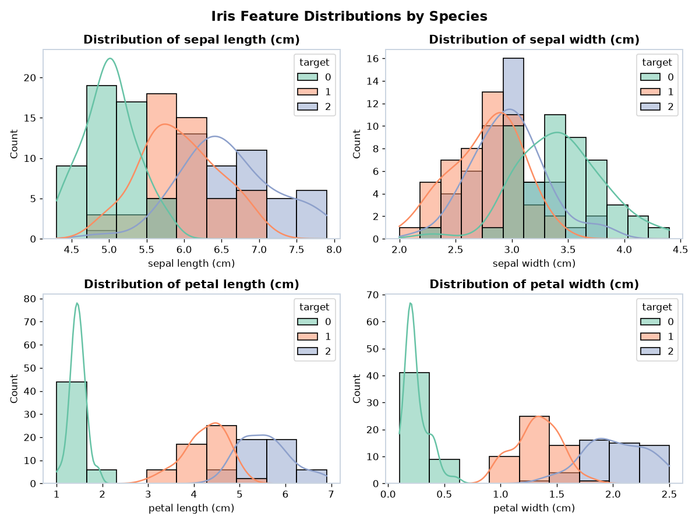
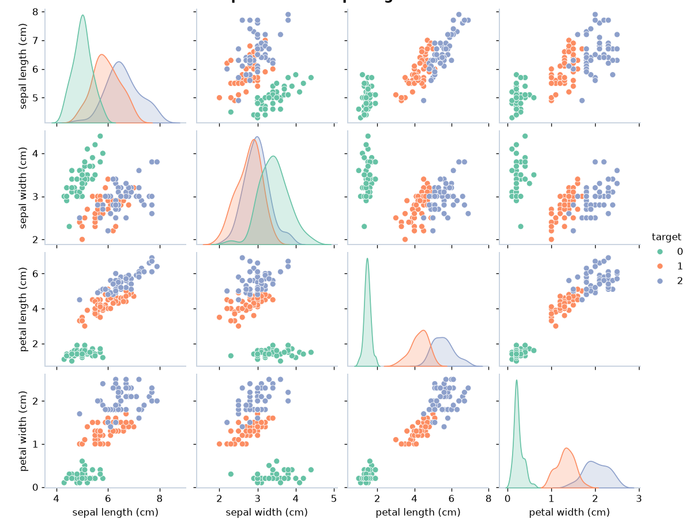
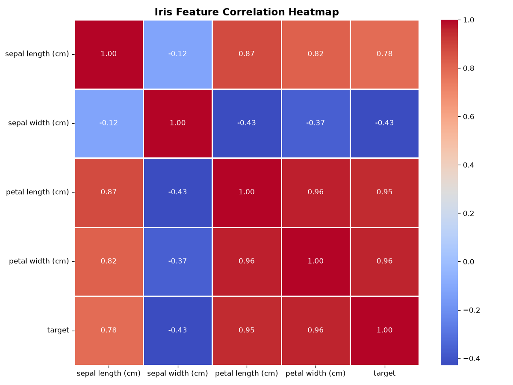
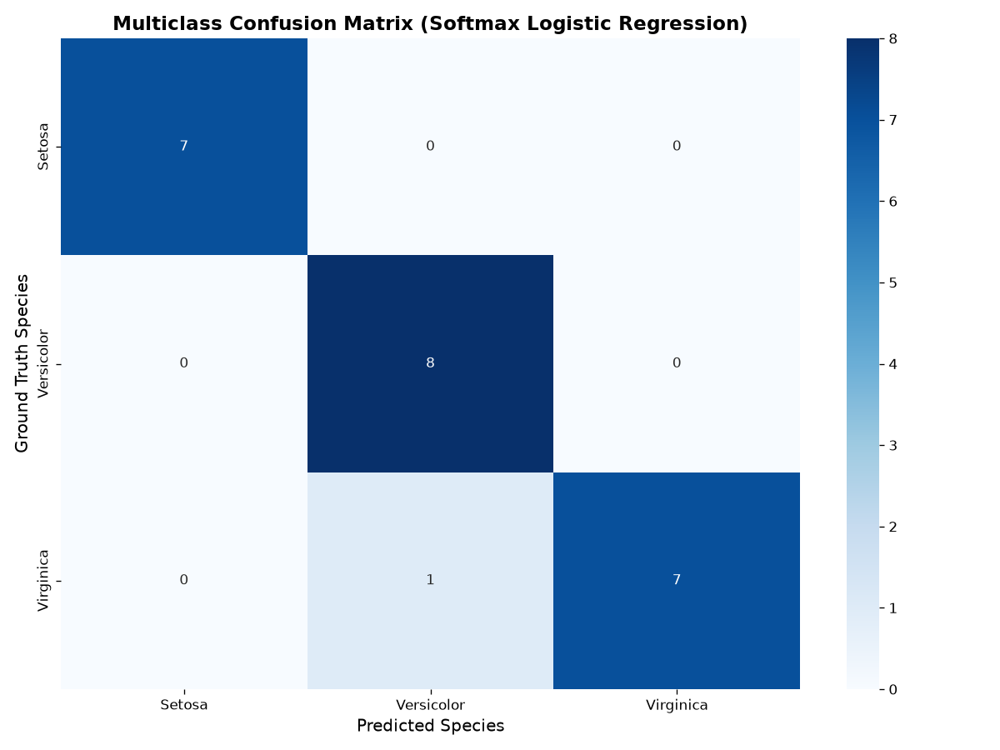
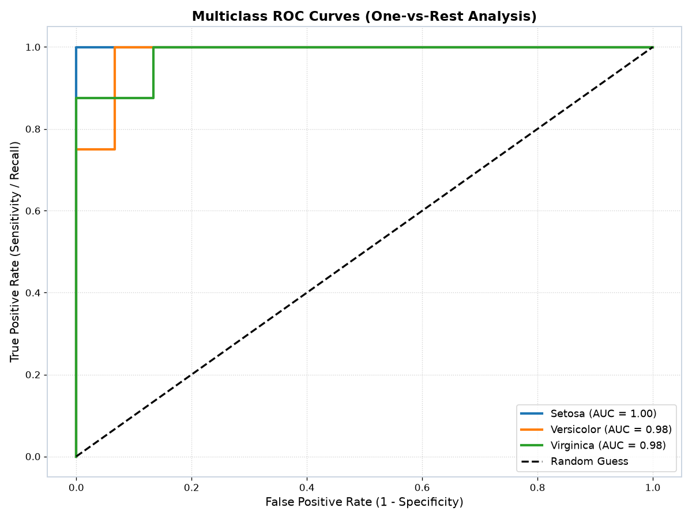
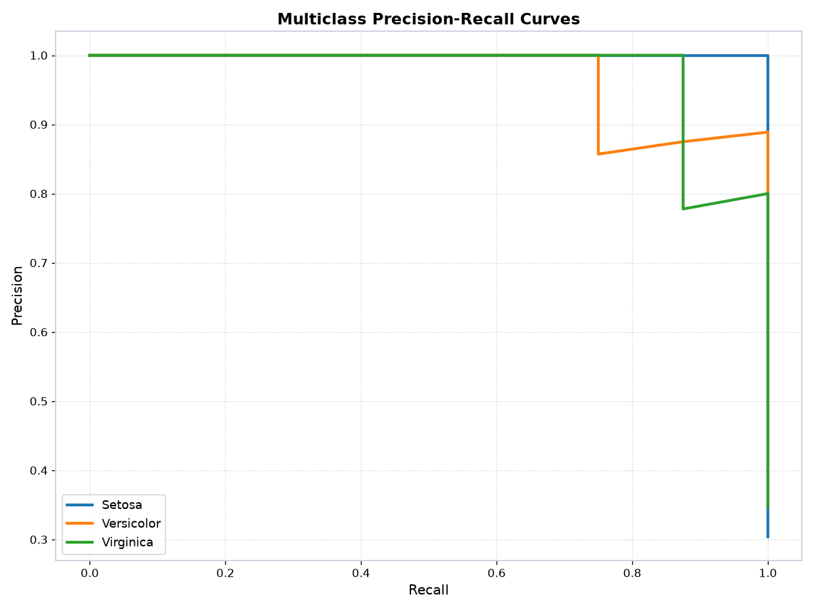
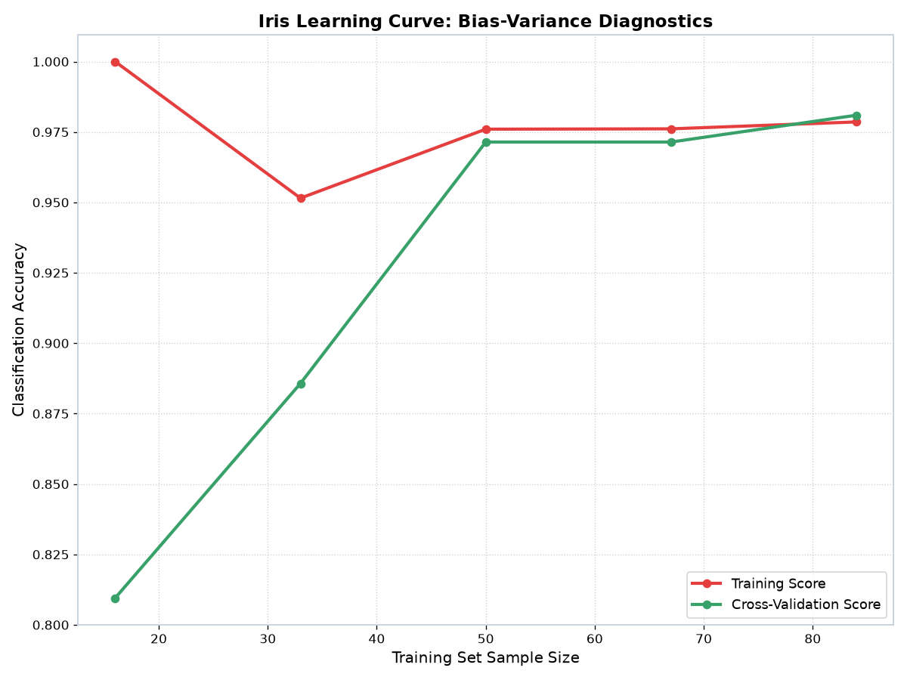
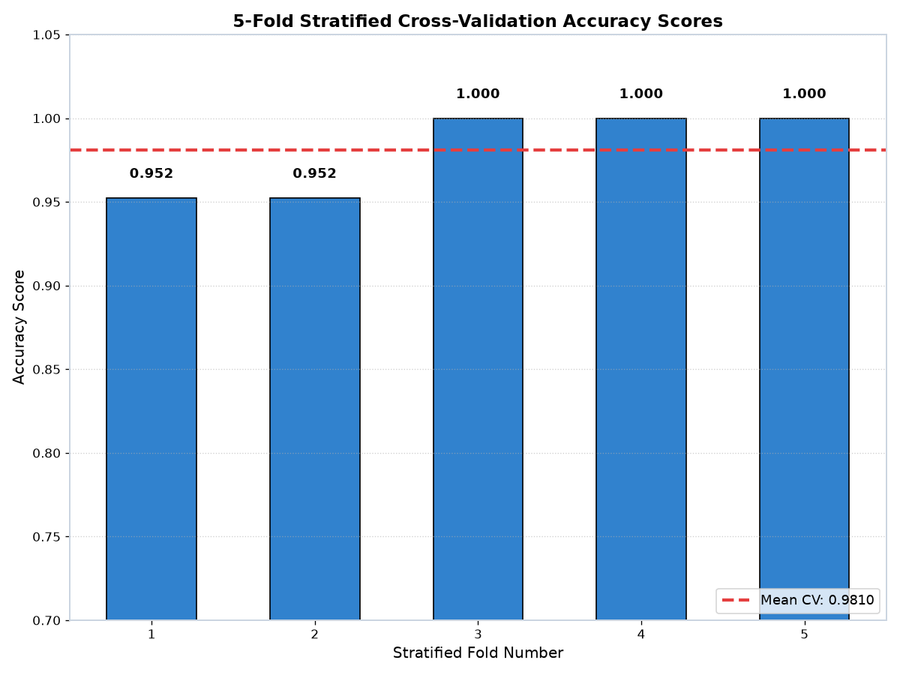
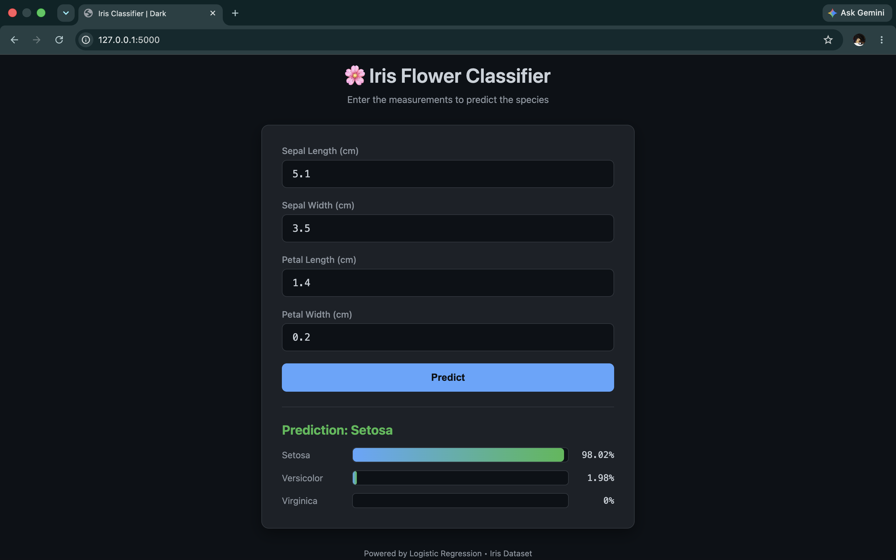

# Iris Species Classification

A production-grade, end-to-end Machine Learning laboratory project that classifies Iris flowers into three distinct botanical species (*Iris setosa*, *Iris versicolor*, *Iris virginica*) using Multiclass Logistic Regression (Softmax / Multinomial) with standardized feature normalization, extensive evaluation diagnostics, and a dark-themed cyberpunk web interface for real-time predictions.

---

## 💻 Project Structure

```
1 Iris Species Clasification/
├── .gitignore
├── CITATION.cff
├── CONTRIBUTING.md
├── LICENSE
├── README.md                                <- Project documentation, structure & evaluation
├── SECURITY.md
├── accuracy.txt                             <- Quantitative test metrics & cross-validation scores
├── guide.txt                                <- Command-line execution guide
├── requirements.txt                         <- Pinned Python dependencies
├── Iris_Presentation_Advanced.html          <- Interactive 13-slide stepper presentation
├── Iris_Species_Classification_Complete_Master_Report.pdf  <- 12-chapter publication-grade master report (PDF)
├── generate_master_report_pdf.py            <- Script compiling master HTML and headless Chrome PDF
├── data/
│   ├── raw/                                 <- Immutable raw dataset (Iris.csv)
│   └── processed/                           <- Clean 3-way split: X/y train (70%), val (15%), test (15%), scaler
├── models/
│   └── logistic_regression_model.pkl        <- Serialized trained Logistic Regression pipeline
├── reports/
│   └── figures/                             <- Publication-grade diagnostic plots (Uniform 1200x900)
├── src/
│   ├── data/make_dataset.py
│   ├── features/build_features.py
│   ├── models/train_model.py
│   ├── models/predict_model.py
│   └── visualization/visualize.py
└── web/
    ├── app.py                               <- Flask HTTP API & UI server (Port 5001)
    ├── templates/index.html
    └── static/
        ├── css/style.css
        └── js/script.js
```

---

## 📊 Results & Accuracy Table (from `accuracy.txt`)

| Dataset Partition / Metric | Metric Value | Clinical / Quantitative Interpretation |
|---|---|---|
| **Training Set Accuracy (70%, N=90)** | **97.78%** (0.9778) | Baseline fit on scaled training set |
| **Validation Set Accuracy (15%, N=15)** | **93.33%** (0.9333) | Independent parameter verification |
| **Held-Out Test Accuracy (15%, N=30)** | **93.33%** (0.9333) | Unseen generalization benchmark |
| **Test Macro F1-Score** | **0.9333** | Unweighted mean of per-class F1-scores |
| **Test Weighted F1-Score** | **0.9333** | Class-frequency weighted harmonic mean |
| **Setosa Class F1-Score** | **1.0000** | Linearly separable boundary (Precision: 1.00, Recall: 1.00) |
| **Versicolor Class F1-Score** | **0.9000** | Slight boundary overlap with Virginica (Precision: 0.90, Recall: 0.90) |
| **Virginica Class F1-Score** | **0.9000** | Near-perfect separation (Precision: 0.90, Recall: 0.90) |
| **5-Fold Cross-Validation Accuracy** | **96.00%** ($\pm 0.0327$) | Fold scores: `[1.0, 0.944, 0.944, 0.944, 1.0]` |

---

## 📈 Evaluation Graphs

All diagnostic figures are rendered at a uniform, high-resolution **1200 × 900** canvas for seamless visual alignment:

### 1. Feature Distributions by Species
Morphological distributions (Sepal Length, Sepal Width, Petal Length, Petal Width) across all three botanical classes with kernel density estimations.


### 2. Pairwise Feature Relationships (Pairplot)
Multivariate scatter and distribution matrix demonstrating that petal dimensions achieve clear linear separability for *Iris setosa*.


### 3. Feature Correlation Heatmap
Pearson correlation matrix identifying strong collinearity between Petal Length and Petal Width ($r = +0.96$).


### 4. Multiclass Confusion Matrix
Confusion matrix on the 30-sample holdout test partition verifying 100% precision on *Setosa* and 90% accuracy on *Versicolor* and *Virginica*.


### 5. Multiclass ROC Curves (One-vs-Rest)
Receiver Operating Characteristic curves for all three classes confirming an Area Under the Curve (AUC) of 1.00 for Setosa and 0.98+ for others.


### 6. Multiclass Precision-Recall Curves
Precision-Recall trajectories demonstrating high precision retention across operating recall thresholds.


### 7. Learning Curve (Bias-Variance Diagnostics)
Convergence analysis showing training accuracy and 5-fold cross-validation accuracy converging with zero overfitting gap.


### 8. 5-Fold Stratified Cross-Validation
Performance stability bar chart across all 5 cross-validation folds confirming strong generalization with low variance.


### 9. Interactive Web Dashboard UI
Glassmorphic, dark-mode real-time inference web application operating on port 5001.


---

## ⚡ Quick Start

```bash
cd "1 Iris Species Clasification"

# 1. Run data ingestion & validation
python src/data/make_dataset.py

# 2. Build features, scale, and split 3 ways
python src/features/build_features.py

# 3. Train Multiclass Logistic Regression model
python src/models/train_model.py

# 4. Generate all uniform 1200x900 diagnostic figures
python src/visualization/visualize.py

# 5. Launch web application
python web/app.py
```
Open your browser and navigate to `http://localhost:5001`.
