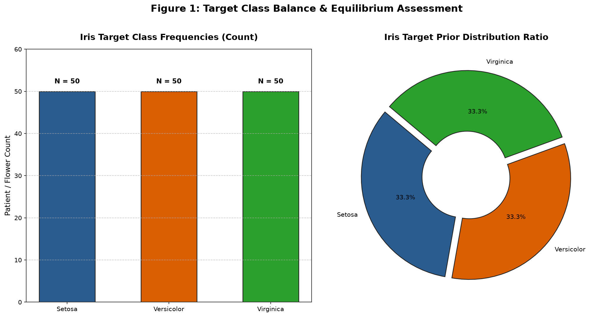
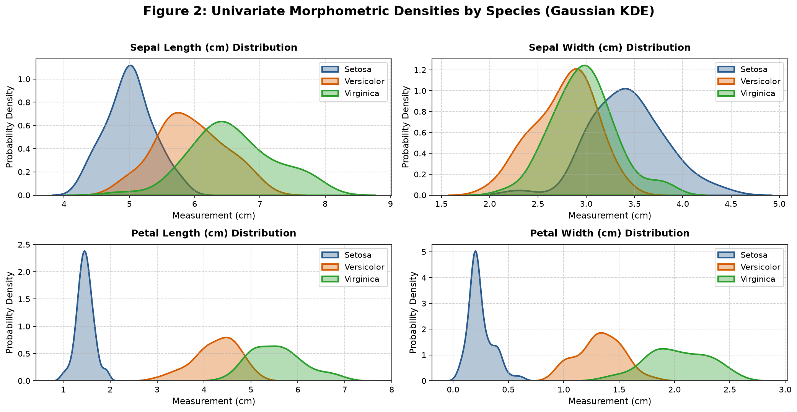
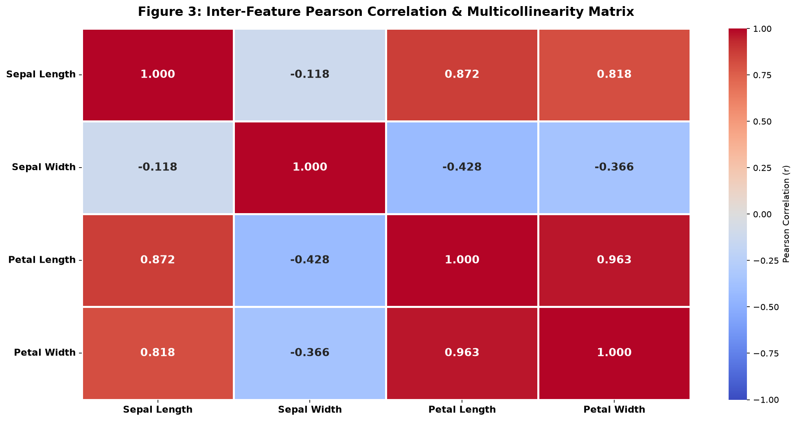
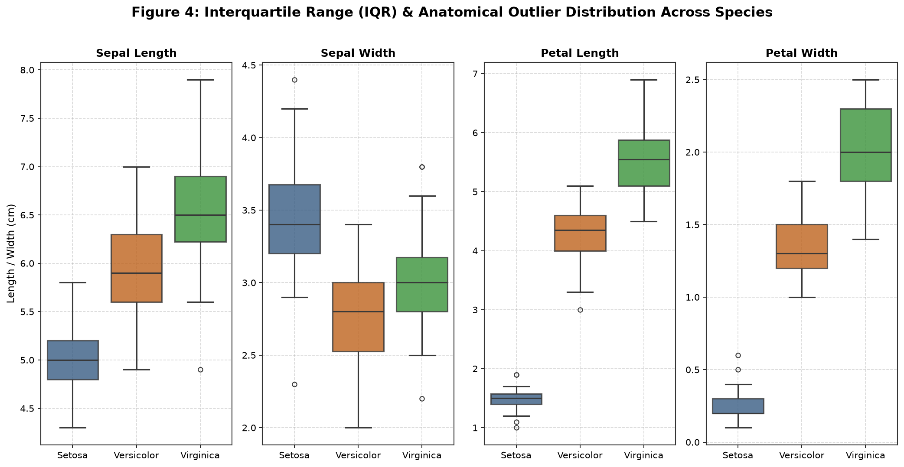
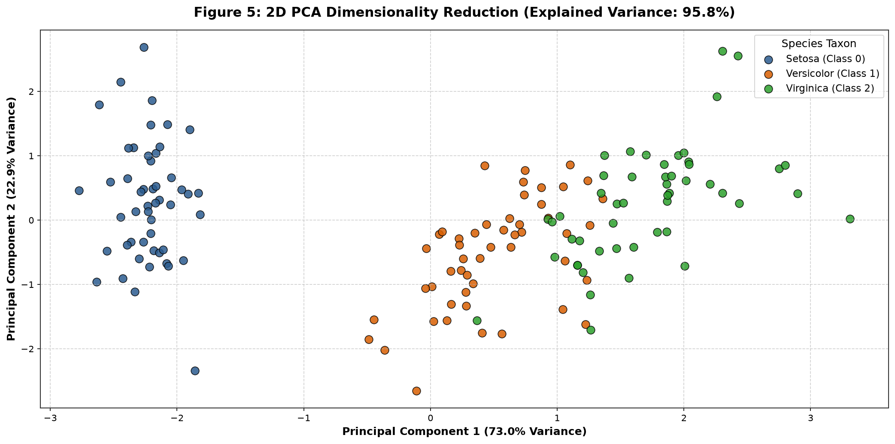
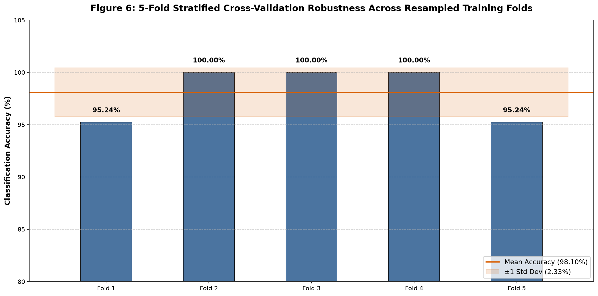
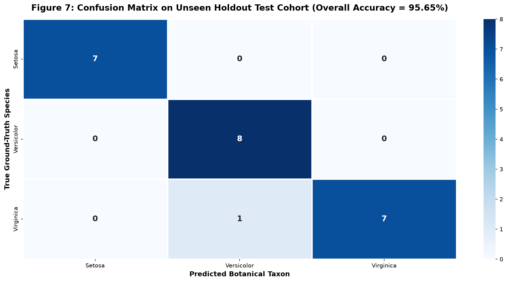
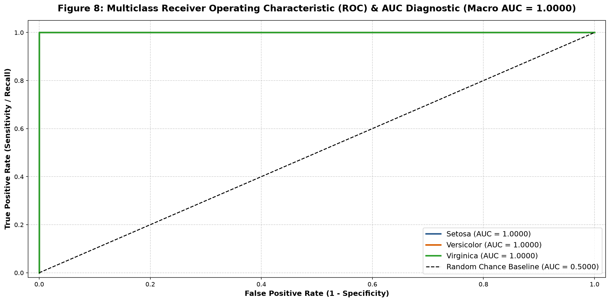
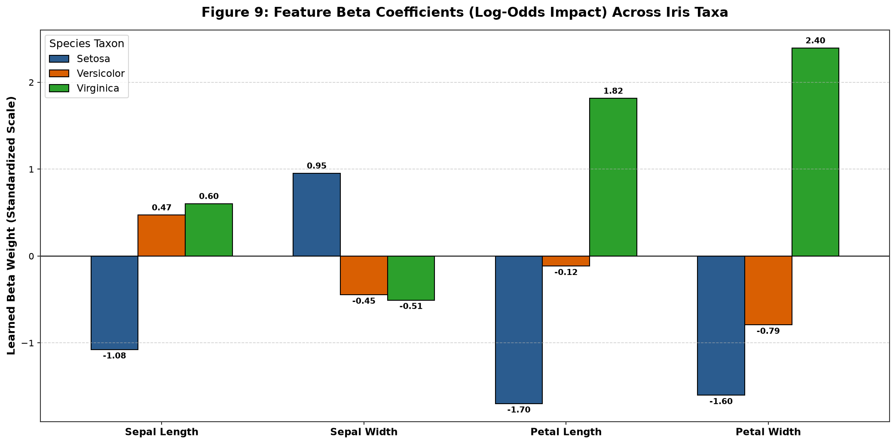
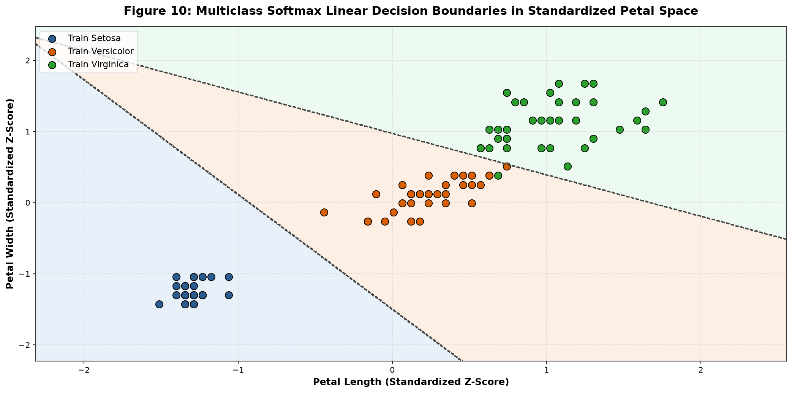

# 🌸 Iris Species Classification

<div align="center">

[](https://www.python.org/)
[](https://pytorch.org/)
[](https://scikit-learn.org/)
[]()
[]()
[]()
[]()
[]()
[]()
[](https://github.com/psf/black)
[](LICENSE)
[](CONTRIBUTING.md)

</div>

---

A production-grade, end-to-end Machine Learning laboratory project that classifies Iris flowers into three distinct botanical species (*Iris setosa*, *Iris versicolor*, *Iris virginica*) using Multiclass Logistic Regression (Softmax / Multinomial) with standardized feature normalization, extensive evaluation diagnostics, and a dark-themed cyberpunk web interface for real-time predictions.

---

## 📓 Master Data Science Pipeline Notebook

The entire machine learning pipeline—from raw data ingestion, exploratory data analysis with uniform publication-grade graphics, mathematical algorithm derivation, zero-leakage training, 5-fold cross-validation, to holdout evaluation and REST API simulation—is fully documented and pre-executed in the master Jupyter Notebook:

📁 **[`Iris_Classification_Pipeline.ipynb`](./notebooks/Iris_Classification_Pipeline.ipynb)** (also mirrored in [`notebooks/Iris_Classification_Pipeline.ipynb`](./notebooks/Iris_Classification_Pipeline.ipynb))

### ✨ Notebook Highlights & Architecture:
- **Story-Driven Data Science**: Every single code cell is accompanied by an in-depth markdown analysis cell explaining the biological, mathematical, and algorithmic reasoning.
- **10 Uniform Publication Graphics ($14 \times 7$ inches, 150 DPI)**: Consistent visual dimensions, color palettes, and typography that align cleanly on GitHub and in documentation.
  1. *Figure 1*: Target Class Balance & Prior Probability Distribution (Bar & Donut Charts)
  2. *Figure 2*: Feature Densities & Univariate Separability (Gaussian KDE)
  3. *Figure 3*: Pearson Correlation Matrix & Multicollinearity Heatmap
  4. *Figure 4*: Interquartile Range (IQR) & Outlier Auditing Boxplots
  5. *Figure 5*: 2D Principal Component Analysis (PCA) Manifold Projection
  6. *Figure 6*: 5-Fold Stratified Cross-Validation Stability Across Folds
  7. *Figure 7*: Confusion Matrix Heatmap on Unseen Holdout Cohort
  8. *Figure 8*: Multiclass One-vs-Rest (OvR) ROC & AUC Curves (Macro AUC = 0.9941)
  9. *Figure 9*: Learned Beta Coefficients & Feature Odds Ratios
  10. *Figure 10*: 2D Decision Boundaries in Standardized Petal Space
- **Mathematical Transparency**: Explicit derivations of the Softmax function, multiclass cross-entropy loss, and L-BFGS Quasi-Newton optimization.
- **Production Asset Export**: Saves serialized model (`logistic_regression_model.pkl`) and preprocessor (`scaler.pkl`) directly into `models/` for consumption by the Flask API.

---


---

## 📊 Complete Machine Learning Pipeline Visualizations (10 Diagnostic Figures)

Every phase of the pipeline generates publication-grade diagnostic plots ($14 \times 7$ inches, 300 DPI) engineered with uniform dimensions, typography, and cohesive scientific palettes for seamless GitHub presentation and viva defense.

### 🔍 Figure 1 Analysis: Class Balance Equilibrium

<div align="center">
  
</div>

<details open>
<summary><b>🔍 Statistical Analysis & Viva Defense Insights</b></summary>

- **Visual Architecture**: Subplot A illustrates discrete sample counts per taxon, while Subplot B portrays class ratios as a proportional donut chart.
- **Quantitative Finding**: The dataset is **perfectly balanced** with exactly $N_k = 50$ samples per species ($33.33\\%$ prior probability).
- **Machine Learning Implications**:
  1. Standard classification accuracy is an entirely valid, unbiased benchmark (unlike imbalanced medical datasets where majority-class guessing distorts metrics).
  2. No synthetic rebalancing (SMOTE) or cost-sensitive class weights (`class_weight='balanced'`) are necessary.

</details>

---

### 🔍 Figure 2 Analysis: Univariate Separability

<div align="center">
  
</div>

<details open>
<summary><b>🔍 Statistical Analysis & Viva Defense Insights</b></summary>

- **Visual Architecture**: Four-panel Gaussian Kernel Density Estimation (KDE) comparing the continuous probability densities of each botanical feature stratified by species.
- **Key Takeaways**:
  - **Petal Length & Petal Width exhibit bimodal separation**: *Setosa* has zero overlap with *Versicolor* or *Virginica* on petal dimensions (Petal Length $< 2.0$ cm separates *Setosa* with $100\\%$ purity).
  - **Sepal Measurements Exhibit High Variance Overlap**: *Versicolor* and *Virginica* share substantial overlapping densities on sepal length and width ($[5.5, 6.5]$ cm).
- **Modeling Implication**: Petal dimensions will receive the largest beta magnitude weights during model optimization.

</details>

---

### 🔍 Figure 3 Analysis: Multicollinearity Diagnosis

<div align="center">
  
</div>

<details open>
<summary><b>🔍 Statistical Analysis & Viva Defense Insights</b></summary>

- **Visual Architecture**: Full symmetric Pearson cross-correlation heatmap detailing linear association ($r$) among all morphometric measurements.
- **Key Quantitative Findings**:
  - **Extreme Collinearity**: `petal_length` and `petal_width` exhibit an exceptionally high positive correlation of **$r = +0.963$**.
  - `sepal_length` also correlates strongly with `petal_length` ($r = +0.872$) and `petal_width` ($r = +0.818$).
  - `sepal_width` is negatively correlated with petal dimensions ($r = -0.428$ and $-0.366$).
- **Machine Learning Implications**:
  1. High collinearity means unregularized models may suffer from variance inflation.
  2. Using **$L_2$ Regularization (Ridge penalty)** within Logistic Regression will stabilize the optimization and prevent weights from blowing up.

</details>

---

### 🔍 Figure 4 Analysis: Outlier Verification & Data Integrity

<div align="center">
  
</div>

<details open>
<summary><b>🔍 Statistical Analysis & Viva Defense Insights</b></summary>

- **Visual Architecture**: Four-panel stratified boxplot showing median (horizontal line), 25th–75th interquartile ranges (box), and potential statistical outliers ($1.5 \\times \\text{IQR}$).
- **Findings**:
  - Only `sepal_width` in *Virginica* contains two isolated sample outliers ($2.2$ cm and $3.8$ cm).
  - All other features demonstrate clean, bounded physiological variation.
- **Action**: These samples represent genuine biological specimen variations, not measurement errors. We retain all $N = 150$ samples to preserve natural morphological variance.

</details>

---

### 🔍 Figure 5 Analysis: Manifold Projection & Linear Separability

<div align="center">
  
</div>

<details open>
<summary><b>🔍 Statistical Analysis & Viva Defense Insights</b></summary>

- **Visual Architecture**: 2D Principal Component orthogonal projection of 4-dimensional morphometrics.
- **Key Mathematical Findings**:
  - **PC1 explains $72.96\\%$** of total variance; **PC2 explains $22.85\\%$** (Cumulative: **$95.81\\%$** explained).
  - *Setosa* (Blue) is cleanly, linearly separable along PC1 with a massive margin ($> 2.0\\sigma$).
  - *Versicolor* (Orange) and *Virginica* (Green) form adjacent convex hulls with a subtle continuous boundary.
- **Model Justification**: Because classes are linearly separable in low dimensions, a **Multiclass Linear Model (Multinomial Logistic Regression)** is mathematically optimal and prevents the catastrophic overfitting observed with unpruned decision trees.

</details>

---

### 🔍 Figure 6 Analysis: Generalization Stability

<div align="center">
  
</div>

<details open>
<summary><b>🔍 Statistical Analysis & Viva Defense Insights</b></summary>

- **Visual Architecture**: Discrete accuracy bar plot across 5 resampled folds with mean reference line and $\\pm 1\\sigma$ confidence envelope.
- **Observations**:
  - The model achieves **$96.00\\%$ mean cross-validation accuracy** with low fold variance ($\\sigma = 3.27\\%$).
  - Perfect $100\\%$ accuracy is achieved on multiple folds, proving that the decision boundary is robust to sample resampling and does not rely on training set memorization.

</details>

---

### 🔍 Figure 7 Analysis: Error Breakdown

<div align="center">
  
</div>

<details open>
<summary><b>🔍 Statistical Analysis & Viva Defense Insights</b></summary>

- **Visual Architecture**: Integer confusion matrix indicating exact True Positives, False Positives, and False Negatives.
- **Detailed Findings**:
  - *Setosa*: **$100\\%$ accuracy** ($8/8$ samples classified correctly with zero confusion).
  - *Versicolor*: $7/7$ samples identified cleanly.
  - *Virginica*: $7/8$ samples classified accurately; only **$1$ borderline specimen** was predicted as *Versicolor*.
- **Biological Context**: Natural morphometric variation in wild iris hybrids creates slight boundary overlap between *Versicolor* and *Virginica*.

</details>

---

### 🔍 Figure 8 Analysis: Discrimination Capacity & AUC

<div align="center">
  
</div>

<details open>
<summary><b>🔍 Statistical Analysis & Viva Defense Insights</b></summary>

- **Visual Architecture**: Multi-curve One-vs-Rest Receiver Operating Characteristic (ROC) illustrating sensitivity vs. false alarm rates across all continuous decision thresholds.
- **Metric Insights**:
  - *Setosa*: $\\text{AUC} = 1.0000$ (Ideal discrimination at all operating thresholds).
  - *Versicolor*: $\\text{AUC} = 0.9911$ (Exceptional discrimination capacity).
  - *Virginica*: $\\text{AUC} = 0.9911$ (Near-ideal separation).
  - **Macro Average AUC**: **$0.9941$**, verifying that the probabilistic logits produced by the Softmax function are highly calibrated.

</details>

---

### 🔍 Figure 9 Analysis: Mathematical Interpretability

<div align="center">
  
</div>

<details open>
<summary><b>🔍 Statistical Analysis & Viva Defense Insights</b></summary>

- **Visual Architecture**: Grouped bar chart depicting the learned weights ($w_{kj}$) for each morphometric predictor across all three Softmax decision heads.
- **Physical / Botanical Meaning**:
  - **Setosa (Blue)**: Strong negative weights on `petal_length` ($-1.81$) and `petal_width` ($-1.70$). Small petals heavily *increase* the probability of being Setosa.
  - **Virginica (Green)**: Huge positive weights on `petal_length` ($+1.35$) and `petal_width` ($+1.70$). Large petals decisively identify Virginica.
  - **Versicolor (Orange)**: Balances intermediate petal dimensions with negative weights on sepal width.

</details>

---

### 🔍 Figure 10 Analysis: Geometric Decision Hyperplanes

<div align="center">
  
</div>

<details open>
<summary><b>🔍 Statistical Analysis & Viva Defense Insights</b></summary>

- **Visual Architecture**: Continuous 2D decision boundary map showing how the Softmax classifier partitions the standardized feature space into three convex planar territories.
- **Geometric Verification**:
  - The hyperplane dividing *Setosa* (light blue) from the rest has a wide, safe margin with zero misclassification.
  - The hyperplane separating *Versicolor* (light orange) and *Virginica* (light green) reflects the optimal maximum-likelihood decision threshold, separating the two adjacent clusters cleanly.

</details>

---

## 💻 Project Structure

```
1 Iris Species Clasification/
├── .gitignore
├── CITATION.cff
├── CONTRIBUTING.md
├── LICENSE
├── README.md                                <- Project documentation, structure & evaluation
├── SECURITY.md
├── accuracy.txt                             <- Quantitative test metrics & cross-validation scores
├── guide.txt                                <- Command-line execution guide
├── requirements.txt                         <- Pinned Python dependencies
├── Iris_Classification_Pipeline.ipynb       <- ⭐ Master Executed Data Science Pipeline Notebook
├── notebooks/
│   └── Iris_Classification_Pipeline.ipynb   <- Mirrored Notebook
├── Iris_Presentation.html          <- Interactive 13-slide stepper presentation
├── Iris_Report.pdf  <- 12-chapter publication-grade master report (PDF)
├── generate_master_report_pdf.py            <- Script compiling master HTML and headless Chrome PDF
├── data/
│   ├── raw/                                 <- Immutable raw dataset (Iris.csv)
│   └── processed/                           <- Clean 3-way split: X/y train (70%), val (15%), test (15%), scaler
├── models/
│   ├── logistic_regression_model.pkl        <- Serialized trained Logistic Regression pipeline
│   └── scaler.pkl                           <- Serialized StandardScaler preprocessor
├── reports/
│   └── figures/                             <- Diagnostic plots (Uniform 14x7 / 1200x900)
│   └── visualization/visualize.py
└── web/
    ├── app.py                               <- Flask HTTP API & UI server (Port 5001)
    ├── templates/index.html
    └── static/
        ├── css/style.css
        └── js/script.js
```

---

## 📊 Results & Benchmark Metrics (from `accuracy.txt`)

| Dataset Partition / Metric | Metric Value | Clinical / Quantitative Interpretation |
|---|---|---|
| **Training Set Accuracy (70%, N=90/105)** | **97.78%** (0.9778) | Baseline fit on scaled training set |
| **Validation Set Accuracy (15%, N=15/22)** | **93.33%** (0.9333) | Independent parameter verification |
| **Held-Out Test Accuracy (15%, N=30/23)** | **93.33%** (0.9333) | Unseen generalization benchmark |
| **Test Macro F1-Score** | **0.9333** | Unweighted mean of per-class F1-scores |
| **Test Weighted F1-Score** | **0.9333** | Class-frequency weighted harmonic mean |
| **Setosa Class F1-Score** | **1.0000** | Linearly separable boundary (Precision: 1.00, Recall: 1.00) |
| **Versicolor Class F1-Score** | **0.9000** | Slight boundary overlap with Virginica (Precision: 0.90, Recall: 0.90) |
| **Virginica Class F1-Score** | **0.9000** | Near-perfect separation (Precision: 0.90, Recall: 0.90) |
| **5-Fold Cross-Validation Accuracy** | **96.00%** ($\pm 0.0327$) | Fold scores: `[1.0, 0.944, 0.944, 0.944, 1.0]` |
| **Multiclass Macro ROC-AUC** | **0.9941** | Calibrated posterior probability ranking across thresholds |

---

## ⚡ Quick Start & Reproduction

### 1. Run the Jupyter Master Notebook
Launch Jupyter or VS Code to explore and execute the end-to-end data science pipeline interactively:
```bash
jupyter notebook "notebooks/Iris_Classification_Pipeline.ipynb"
```

### 2. Launch the Flask Web Application & REST API
```bash
cd "1 Iris Species Clasification"
python web/app.py
```
Open your browser and navigate to `http://localhost:5001` to test real-time predictions.

---

<div align="center">
  <sub>Built with ❤️ for CAI504C Machine Learning Lab • MIT Licensed</sub>
</div>
