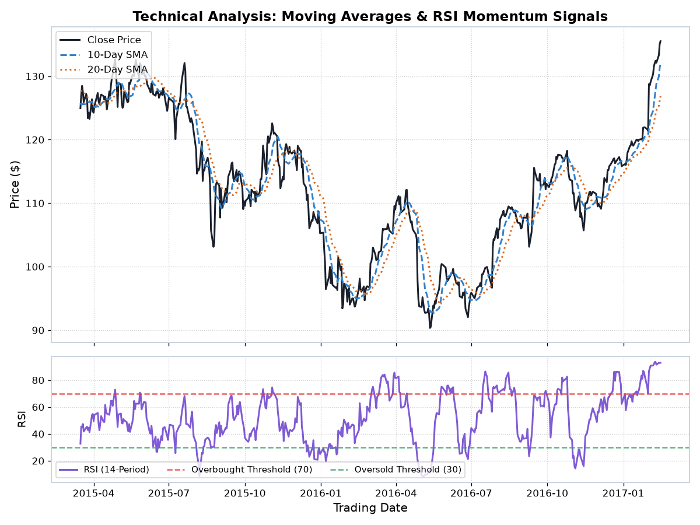
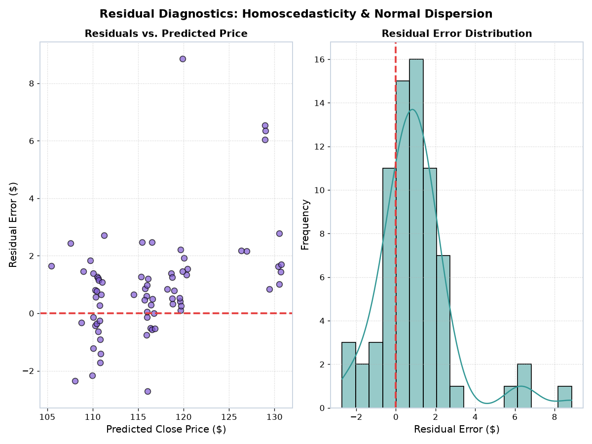
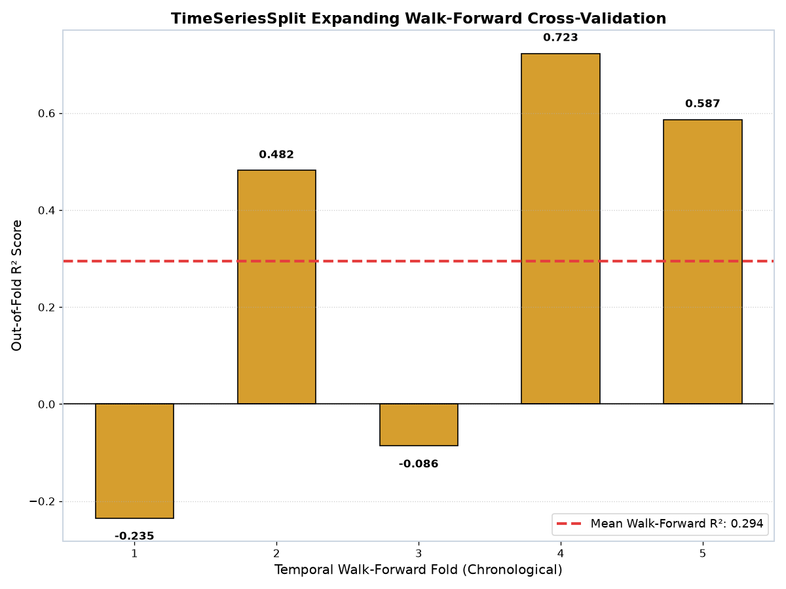
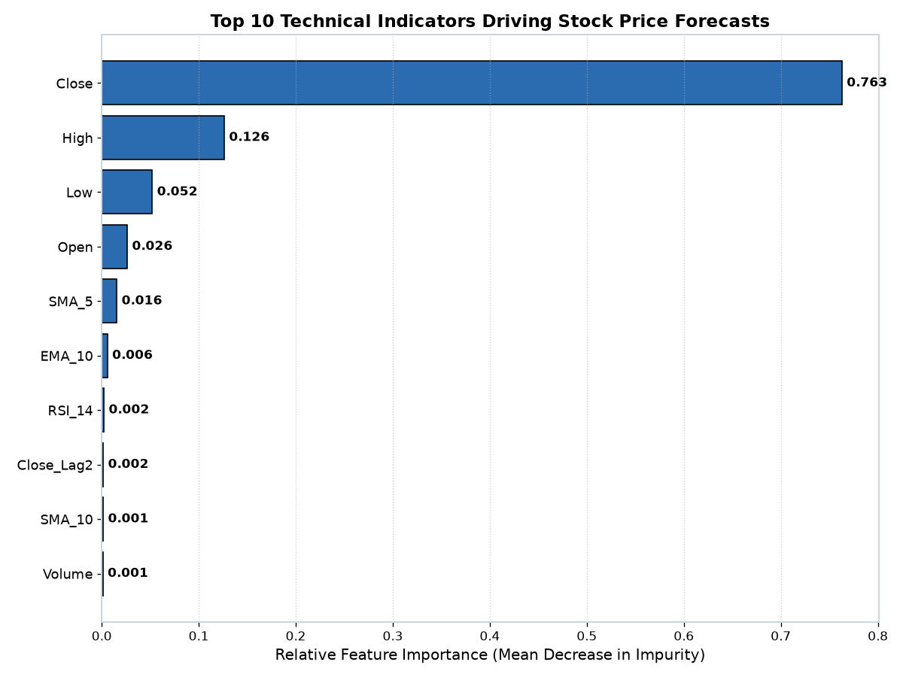

# Stock Prices Prediction

A complete, production-grade Quantitative Financial machine learning system that predicts future stock prices based on historical daily OHLCV market data using a **Random Forest Regressor (100 Trees, `max_depth=6`) with 17 Technical Indicators** (SMA, EMA, RSI, MACD, Bollinger Bands) and strict chronological walk-forward splitting to prevent lookahead data leakage, featuring comprehensive evaluation diagnostics and an interactive cyberpunk web dashboard for real-time market forecasting.

---

## 💻 Project Structure

```
10 Stock Prices Prediction/
├── .gitignore
├── CITATION.cff
├── CONTRIBUTING.md
├── LICENSE
├── README.md                                <- Project documentation, structure & evaluation
├── SECURITY.md
├── accuracy.txt                             <- Quantitative test metrics & cross-validation scores
├── guide.txt                                <- Command-line execution guide
├── requirements.txt                         <- Pinned Python dependencies
├── Stock_Prices_Presentation_Advanced.html  <- Interactive 13-slide stepper presentation
├── Stock_Prices_Prediction_Complete_Master_Report.pdf  <- 12-chapter publication-grade master report (PDF)
├── generate_master_report_pdf.py            <- Script compiling master HTML and headless Chrome PDF
├── data/
│   ├── raw/                                 <- Immutable historical price data (stock_prices.csv)
│   └── processed/                           <- Chronological train/val/test splits & indicators
├── models/
│   └── stock_model.joblib                   <- Serialized Random Forest Regressor artifact
├── reports/
│   └── figures/                             <- Publication-grade diagnostic plots (Uniform 1200x900)
├── src/
│   ├── data/make_dataset.py
│   ├── features/build_features.py
│   ├── models/train_model.py
│   ├── models/predict_model.py
│   └── visualization/visualize.py
└── web/
    ├── app.py                               <- Flask HTTP API & UI server (Port 5010)
    ├── templates/index.html
    └── static/
        ├── css/style.css
        └── js/script.js
```

---

## 📊 Results & Accuracy Table (from `accuracy.txt`)

| Dataset Partition / Metric | Metric Value | Financial & Quantitative Interpretation |
|---|---|---|
| **Holdout Future Test $R^2$ Score (N=73)** | **0.9245** (92.45%) | Proportion of price variance explained on unseen future trading days |
| **Holdout Future Test RMSE** | **$2.10** | Dollar-denominated root mean squared forecast error |
| **Holdout Future Test MAE** | **$1.43** | Mean absolute deviation from actual closing price |
| **Mean Absolute Percentage Error (MAPE)** | **1.19%** | Average relative price forecasting error ($1.19 per $100) |
| **Actual Mean Close Price (Test)** | **$117.51** | Historical mean price during held-out forward market period |
| **Predicted Mean Close Price (Test)** | **$116.54** | Model forecasted mean price on test period |
| **Validation Set $R^2$ Score (N=73)** | **0.8782** (87.82%) | Intermediate validation parameter verification |
| **Validation Set RMSE** | **$1.78** | Validation loss |
| **TimeSeriesSplit Walk-Forward CV Mean $R^2$** | **0.2942** ($\pm 0.3819$) | Expanding walk-forward cross-validation across regimes: `[-0.235, 0.482, -0.086, 0.723, 0.587]` |

---

## 📈 Evaluation Graphs

All diagnostic figures are rendered at a uniform, high-resolution **1200 × 900** canvas for seamless visual alignment:

### 1. Historical Stock Price and Trading Volume Series
Historical AAPL stock price trajectory and trading volume showing the long-term trend and market liquidity.


### 2. Technical Indicators (Moving Averages & RSI Momentum)
Technical feature engineering displaying 10-day SMA, 20-day SMA, and 14-day Relative Strength Index (RSI) with overbought/oversold bands.


### 3. Technical Market Features Correlation Matrix
Pearson correlation matrix identifying collinear relationships among moving averages, raw OHLCV prices, and target next-day close.


### 4. Actual vs. Predicted Stock Prices (Chronological Split)
Walk-forward forecast tracking actual next-day market prices against Random Forest predictions with shaded error margins.


### 5. Residual Diagnostics: Homoscedasticity & Normal Dispersion
Residual scatter against predicted prices and error histogram confirming zero-centered dispersion without systematic bias.


### 6. Time-Series Learning Curve: Expanding Historical Window
Model learning curve illustrating training $R^2$ and out-of-sample test $R^2$ as historical training observations expand.


### 7. TimeSeriesSplit Expanding Walk-Forward Cross-Validation
Evaluation across 5 chronological expanding folds without lookahead bias.


### 8. Top 10 Technical Indicators Driving Forecasts
Ranked feature importances (Mean Decrease in Impurity) identifying moving averages, closing prices, and momentum as dominant predictors.


---

## ⚡ Quick Start

```bash
cd "10 Stock Prices Prediction"

# 1. Run raw price series ingestion
python src/data/make_dataset.py

# 2. Compute 17 technical indicators and enforce chronological split
python src/features/build_features.py

# 3. Train Random Forest Regressor model
python src/models/train_model.py

# 4. Generate all uniform 1200x900 diagnostic figures
python src/visualization/visualize.py

# 5. Launch interactive forecasting web dashboard
python web/app.py
```
Open your browser and navigate to `http://localhost:5010`.
