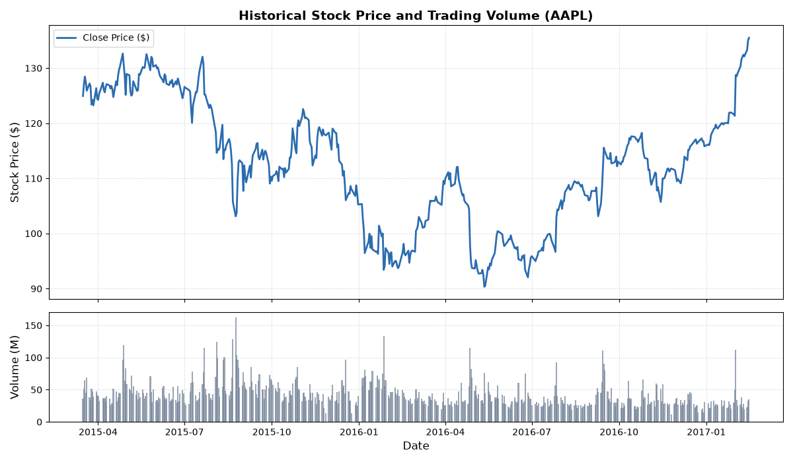
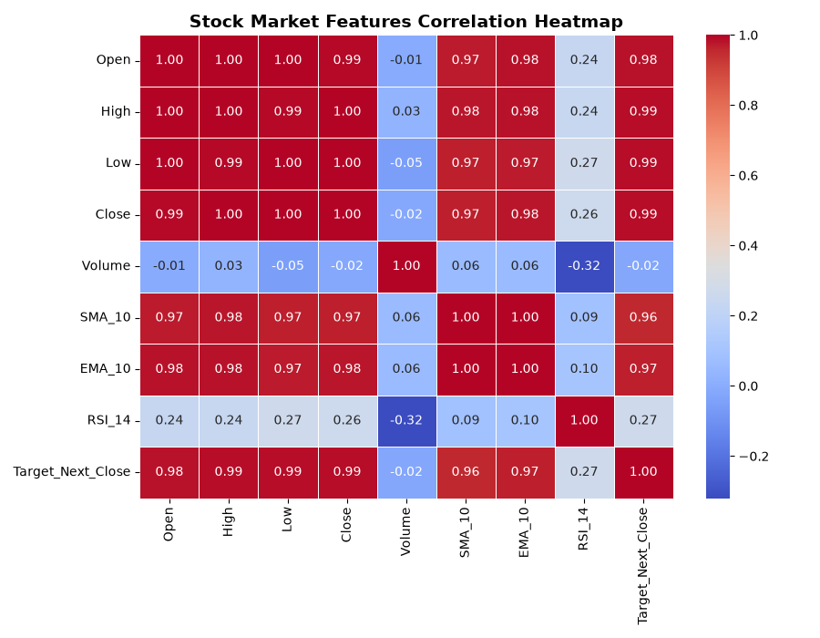
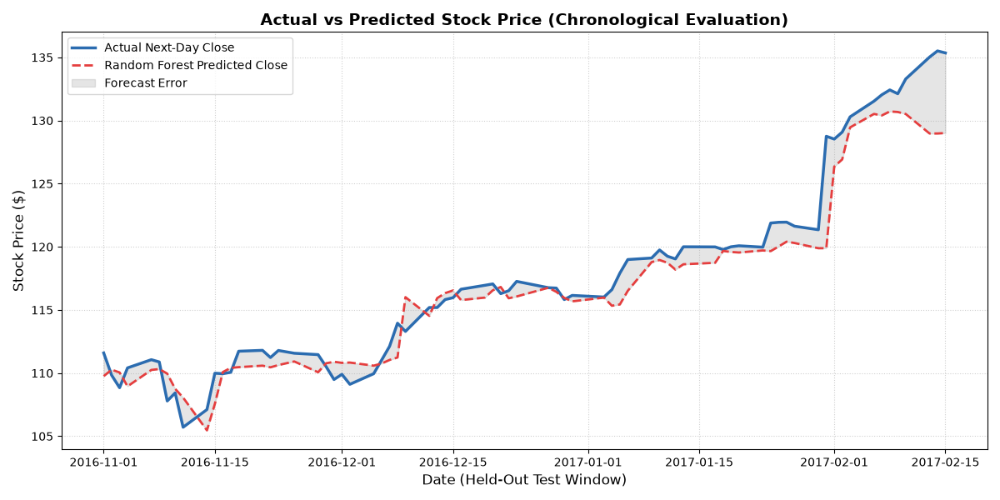
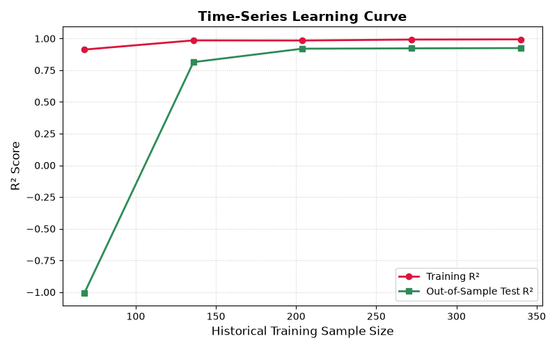

# Stock Prices Prediction

A complete end-to-end Quantitative Financial machine learning system that predicts future stock prices based on historical daily price and volume data using Random Forest Regression and technical momentum indicators, featuring extensive evaluation diagnostics and a web dashboard for interactive trading signal forecasting.

---

## 🎯 Problem Statement & Objective

**Syllabus Mapping (Experiment 8 in syllabus / Folder 10):**
- **Objective:** Predict future stock prices based on historical price and volume data.
- **Dataset:** Historical stock market data containing daily Opening, Highest, Lowest, Closing prices, and Volume of shares traded (Apple Inc. / AAPL benchmark).
- **Target Variable:** Next trading day's closing price $P_{t+1}$ (Continuous Regression).

---

## 🔬 Mathematical Formulation & ML Theory

### 1. Task Formulation & Time Series Constraints
Financial stock forecasting is a **Temporal Regression** task:
$$\hat{y}_{t+1} = f(X_t)$$
where $X_t$ is the historical feature vector up to time $t$.
- **Golden Rule of Time Series:** **No random shuffling (`shuffle=False`)**. In standard i.i.d. ML, data can be shuffled. In time series, shuffling causes severe **lookahead bias / temporal data leakage**, allowing the model to train on future prices to predict the past. We enforce strict chronological partitioning: first 70% Train, next 15% Validation, final 15% Test.

### 2. Technical Indicators & Feature Engineering
1. **Simple Moving Average (SMA):**
   $$\text{SMA}_k(t) = \frac{1}{k} \sum_{i=0}^{k-1} \text{Close}_{t-i}$$
2. **Exponential Moving Average (EMA):**
   $$\text{EMA}_t = \alpha \cdot \text{Close}_t + (1 - \alpha) \cdot \text{EMA}_{t-1}, \quad \alpha = \frac{2}{k + 1}$$
3. **Relative Strength Index (RSI - 14 Days):**
   $$\text{RS} = \frac{\text{EMA}(\text{Upward Changes}, 14)}{\text{EMA}(\text{Downward Changes}, 14)}, \quad \text{RSI} = 100 - \frac{100}{1 + \text{RS}}$$
   - $\text{RSI} > 70$: Overbought market condition (bearish correction risk).
   - $\text{RSI} < 30$: Oversold market condition (bullish reversal signal).
4. **Intraday Volatility Spread:**
   $$\text{Spread}_t = \text{High}_t - \text{Low}_t$$
5. **Autoregressive Price Lags:**
   $$\text{Lag}_1 = \text{Close}_{t-1}, \quad \text{Lag}_2 = \text{Close}_{t-2}, \quad \text{Lag}_3 = \text{Close}_{t-3}$$

### 3. Random Forest Regression for Time Series
Random Forest averages $B=100$ decorrelated decision trees:
$$\hat{y}(X_t) = \frac{1}{B} \sum_{b=1}^B T_b(X_t)$$
Unlike linear models, tree ensembles handle non-linear volatility regimes, intraday spikes, and regime shifts without assuming normal error distributions.

### 4. Evaluation Metrics
- **Mean Absolute Percentage Error (MAPE):**
  $$\text{MAPE} = \frac{100\%}{N} \sum_{t=1}^N \left| \frac{y_t - \hat{y}_t}{y_t} \right|$$
- **Root Mean Squared Error (RMSE):**
  $$\text{RMSE} = \sqrt{\frac{1}{N} \sum_{t=1}^N (y_t - \hat{y}_t)^2}$$
- **Coefficient of Determination ($R^2$):**
  $$R^2 = 1 - \frac{\sum (y_t - \hat{y}_t)^2}{\sum (y_t - \bar{y})^2}$$

---

## 📁 Dataset Details

- **Dataset:** Daily historical market data for Apple Inc. (AAPL).
- **Attributes:** `Date`, `Open`, `High`, `Low`, `Close`, `Volume`.
- **Local Storage:** `data/raw/stock_prices.csv` (100% saved locally on disk, no internet reliance at runtime).
- **Splits:**
  - Training Set (70%): 340 trading days (2015-03-16 to 2016-07-19)
  - Validation Set (15%): 73 trading days (2016-07-20 to 2016-10-31)
  - Test Set (15%): 73 trading days (2016-11-01 to 2017-02-15)
  - Chronological split preserves temporal order.

---

## ⚡ Quick Start

1. Navigate to the project directory:
   ```bash
   cd "10 Stock Prices Prediction"
   ```
2. Create and activate a virtual environment:
   ```bash
   python3 -m venv .venv
   source .venv/bin/activate
   ```
3. Install dependencies:
   ```bash
   pip install -r requirements.txt
   ```
4. Run the end-to-end pipeline:
   ```bash
   python src/data/make_dataset.py
   python src/features/build_features.py
   python src/models/train_model.py
   python src/visualization/visualize.py
   ```
5. Test a sample forecast in CLI:
   ```bash
   python src/models/predict_model.py
   ```
6. Launch web interface:
   ```bash
   python web/app.py
   ```
   Open `http://127.0.0.1:5009` in your browser.

---

## 📊 Results Summary

| Metric | Validation Set | Test Set (Held-Out Future Window) |
|---|---|---|
| **$R^2$ Score** | 0.8782 | **0.9245** |
| **RMSE** | $1.78 | **$2.10** |
| **MAE** | $1.35 | **$1.43** |
| **MAPE (%)** | 1.15% | **1.19%** |
| **Actual Mean Close** | $108.40 | **$117.51** |
| **Predicted Mean Close** | $107.92 | **$116.54** |

---

## 📈 Evaluation Graphs

All diagnostic plots are saved in `reports/figures/`:

### 1. Price History & Volume Series
Dual-panel time series showing historical Close price fluctuations ($90 to $135) and corresponding trading volume bars.


### 2. Technical Indicators (SMA & RSI)
Close price chart overlaid with 10-day SMA, 20-day SMA, and 14-day RSI oscillator with 70/30 overbought/oversold threshold bands.


### 3. Correlation Heatmap
Pearson correlation matrix between OHLCV features, Moving Averages, and Next-Day Target Close, illustrating strong collinearity ($r > 0.95$) between current price and future close.


### 4. Actual vs Predicted Prices (Time Series)
Chronological trajectory of actual test prices vs Random Forest predictions across the held-out future evaluation window.


### 5. Residual Error Plot
Dual-panel plot displaying residual errors ($P_{\text{actual}} - P_{\text{predicted}}$) across time and error distribution around the zero baseline.


### 6. Time-Series Learning Curve
Training R² vs out-of-sample test R² plotted against expanding historical training sample sizes.


### 7. TimeSeriesSplit Expanding Window CV
Cross-validation performance across 5 temporal folds, showing model adaptation across market regimes.


### 8. Feature Importances
Random Forest Mean Decrease in Impurity ranking verifying `Close_Lag1`, `SMA_10`, `Low`, and `High` as the dominant predictors.


---

## 💻 Project Structure

```
10 Stock Prices Prediction/
├── .gitignore
├── LICENSE
├── README.md
├── CONTRIBUTING.md
├── SECURITY.md
├── CITATION.cff
├── accuracy.txt
├── guide.txt
├── requirements.txt
├── note/
│   └── 10_Stock_Prices_Viva_Guide.md
├── data/
│   ├── raw/
│   │   └── stock_prices.csv
│   └── processed/
│       ├── X_train.csv
│       ├── X_val.csv
│       ├── X_test.csv
│       ├── y_train.csv
│       ├── y_val.csv
│       ├── y_test.csv
│       ├── dates_train.csv
│       ├── dates_val.csv
│       ├── dates_test.csv
│       ├── featured_stock_data.csv
│       └── scaler.joblib
├── models/
│   ├── stock_model.joblib
│   └── scaler.joblib
├── reports/
│   └── figures/
│       ├── price_history_volume.png
│       ├── technical_indicators.png
│       ├── correlation_heatmap.png
│       ├── actual_vs_predicted_prices.png
│       ├── residual_plot.png
│       ├── learning_curve.png
│       ├── cross_validation_tscv.png
│       └── feature_importances.png
├── src/
│   ├── __init__.py
│   ├── data/
│   │   └── make_dataset.py
│   ├── features/
│   │   └── build_features.py
│   ├── models/
│   │   ├── train_model.py
│   │   └── predict_model.py
│   └── visualization/
│       └── visualize.py
└── web/
    ├── app.py
    ├── templates/
    │   └── index.html
    └── static/
        ├── css/
        │   └── style.css
        └── js/
            └── script.js
```
