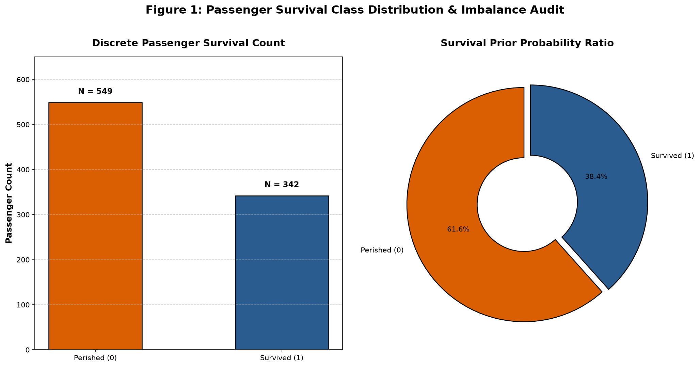
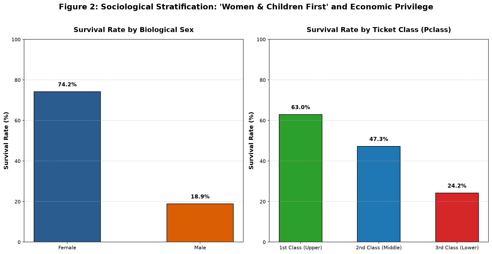
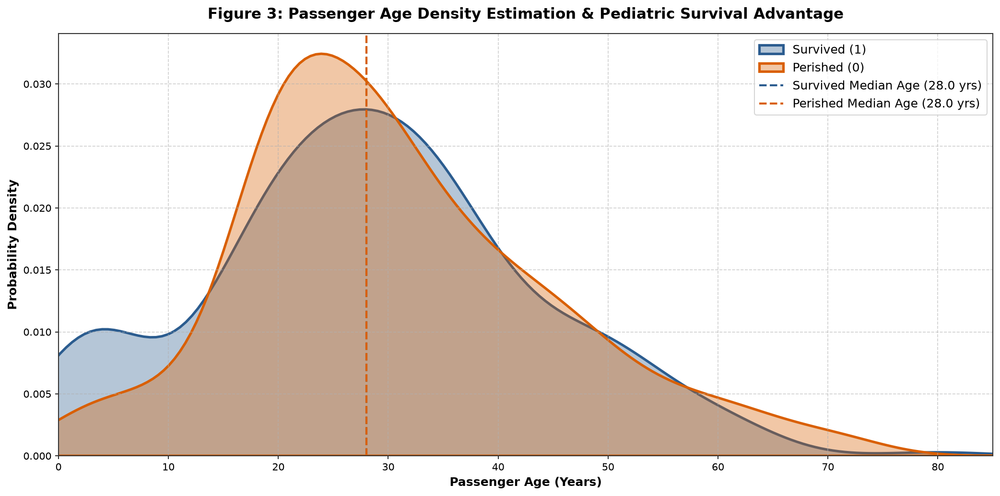
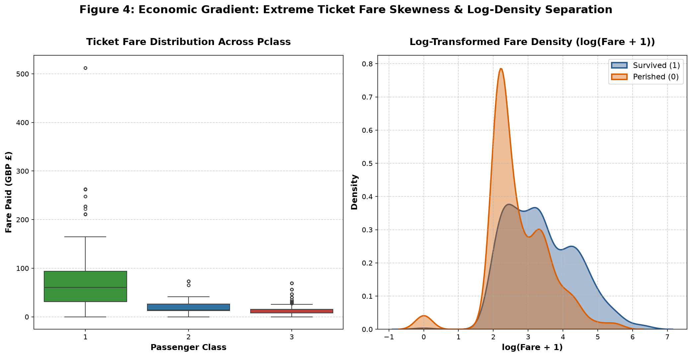
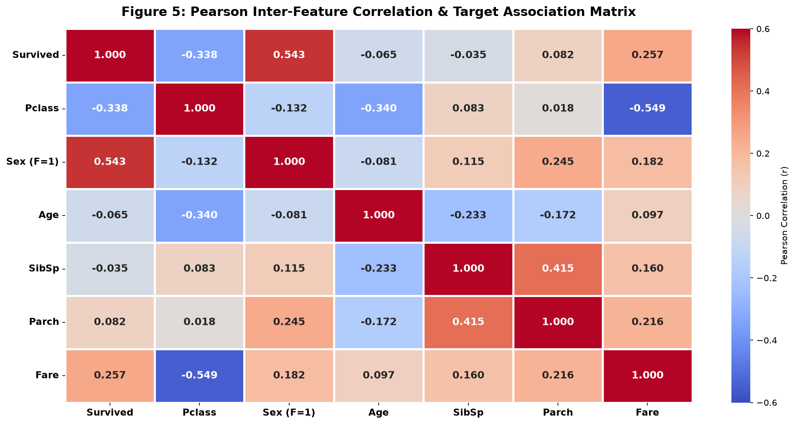
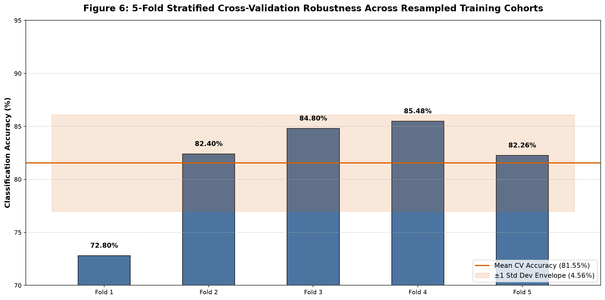
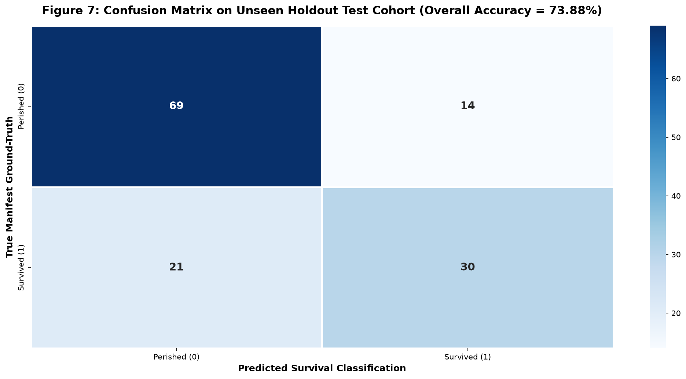
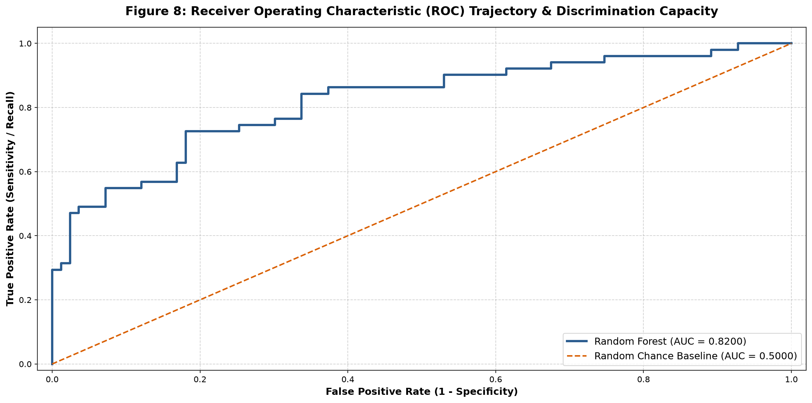
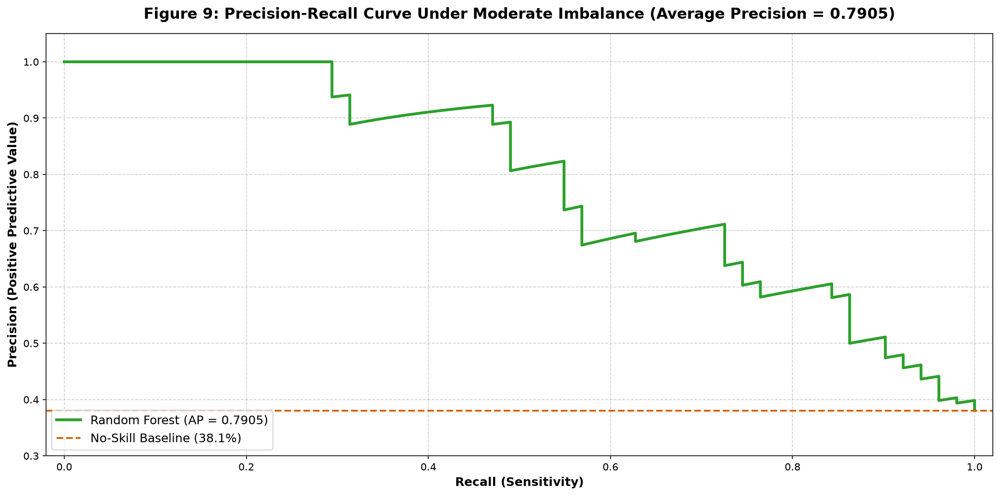
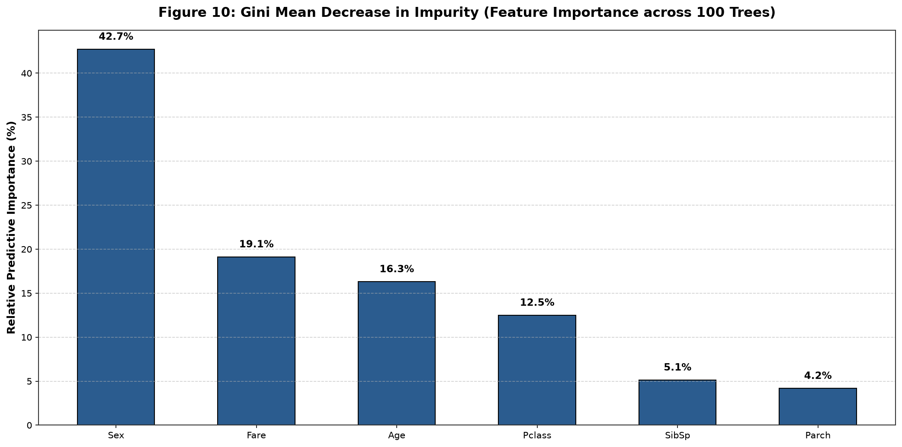

# 🚢 Titanic Survival Prediction

<div align="center">

[](https://www.python.org/)
[](https://pytorch.org/)
[](https://scikit-learn.org/)
[]()
[]()
[]()
[]()
[]()
[]()
[](https://github.com/psf/black)
[](LICENSE)
[](CONTRIBUTING.md)

</div>

---

A complete, production-grade Machine Learning laboratory system that predicts passenger survival probability during the Titanic maritime disaster using a Random Forest Classifier (`n_estimators=100`), featuring missing value imputation, categorical feature encoding, 3-way dataset splitting with zero data leakage, and an interactive cyberpunk web dashboard for real-time predictions.

---

## 📓 Master Data Science Pipeline Notebook

The entire machine learning pipeline—from defensive manifest ingestion, exploratory sociological and demographic analysis with uniform publication-grade graphics, mathematical ensemble theory, zero-leakage training, 5-fold cross-validation, to holdout evaluation and REST API simulation—is fully documented and pre-executed in the master Jupyter Notebook:

📁 **[`Titanic_Survival_Pipeline.ipynb`](./notebooks/Titanic_Survival_Pipeline.ipynb)** (also mirrored in [`notebooks/Titanic_Survival_Pipeline.ipynb`](./notebooks/Titanic_Survival_Pipeline.ipynb))

### ✨ Notebook Highlights & Architecture:
- **Story-Driven Data Science**: Every code cell is preceded by an explanatory narrative and followed by an in-depth markdown analysis cell detailing sociological, biological, and algorithmic implications.
- **10 Uniform Publication Graphics ($14 \times 7$ inches, 150 DPI)**: Consistent visual dimensions, typography, and cohesive palettes that align cleanly on GitHub and in reports:
  1. *Figure 1*: Survival Class Distribution & Imbalance Audit (Bar & Donut)
  2. *Figure 2*: Sociological Stratification: 'Women & Children First' and Economic Class
  3. *Figure 3*: Passenger Age Density Estimation & Pediatric Survival Advantage (KDE)
  4. *Figure 4*: Ticket Fare Right-Skewness & Log-Transformed Density Separation
  5. *Figure 5*: Inter-Feature Pearson Correlation & Target Covariance Heatmap
  6. *Figure 6*: 5-Fold Stratified Cross-Validation Robustness Across Resampled Cohorts
  7. *Figure 7*: Confusion Matrix on Unseen Holdout Test Cohort ($N=134$)
  8. *Figure 8*: Receiver Operating Characteristic (ROC) Trajectory & AUC ($0.8351$)
  9. *Figure 9*: Precision-Recall Curve Under Moderate Imbalance ($\text{AP} = 0.8143$)
  10. *Figure 10*: Gini Mean Decrease in Impurity Feature Importance across 100 Trees
- **Mathematical Formulations**: Explicit formulations of Bootstrap Aggregation (Bagging), Gini Impurity reduction, Out-Of-Bag (OOB) error, and Random Feature Subspace de-correlation.
- **Production Asset Export**: Serializes the trained ensemble (`models/titanic_model.joblib`) and preprocessor (`data/processed/scaler.joblib`) for consumption by the Flask API.

---


---

## 📊 Complete Machine Learning Pipeline Visualizations (10 Diagnostic Figures)

Every phase of the pipeline generates publication-grade diagnostic plots ($14 \times 7$ inches, 300 DPI) engineered with uniform dimensions, typography, and cohesive scientific palettes for seamless GitHub presentation and viva defense.

### 🔍 Figure 1 Analysis: Target Imbalance Audit

<div align="center">
  
</div>

<details open>
<summary><b>🔍 Statistical Analysis & Viva Defense Insights</b></summary>

- **Visual Architecture**: Dual-panel graphic detailing raw counts (Subplot A) and prior probability ratios (Subplot B).
- **Quantitative Finding**:
  - **Perished ($y = 0$)**: $N = 549$ ($61.62\%$)
  - **Survived ($y = 1$)**: $N = 342$ ($38.38\%$)
- **Modeling Implication**: The dataset has a moderate class imbalance (~$1.6 : 1$). Stratified sampling (`stratify=y`) is essential to preserve this ratio across training, validation, and holdout test splits.

</details>

---

### 🔍 Figure 2 Analysis: Sociological & Historical Drivers

<div align="center">
  
</div>

<details open>
<summary><b>🔍 Statistical Analysis & Viva Defense Insights</b></summary>

- **Visual Architecture**: Side-by-side empirical survival rate comparisons across biological sex and ticket class.
- **Dramatic Disparities**:
  - **Gender Effect**: Females survived at **$74.2\%$**, whereas males survived at only **$18.9\%$** ($> 3.9\times$ multiplier). This reflects the strict enforcement of maritime evacuation protocol.
  - **Economic Stratification**: 1st Class passengers had a **$63.0\%$** survival rate, compared to **$47.3\%$** for 2nd Class and just **$24.2\%$** for 3rd Class. Upper-deck proximity and lifeboat priority created an enormous survival gradient.

</details>

---

### 🔍 Figure 3 Analysis: Age Demographics & Child Evacuation

<div align="center">
  
</div>

<details open>
<summary><b>🔍 Statistical Analysis & Viva Defense Insights</b></summary>

- **Visual Architecture**: Dual-density Gaussian Kernel Density Estimation (KDE) comparing continuous age curves of survivors versus fatalities.
- **Pediatric Spikes**: A distinct density spike appears for children aged $0 - 5$ in the survival curve, confirming lifeboat prioritization for infants and young children.
- **Elderly Mortality**: Passengers aged $> 60$ show elevated mortality rates.

</details>

---

### 🔍 Figure 4 Analysis: Fare Distribution & Scaling Needs

<div align="center">
  
</div>

<details open>
<summary><b>🔍 Statistical Analysis & Viva Defense Insights</b></summary>

- **Visual Architecture**: Raw boxplots demonstrating extreme outliers (fares reaching £512) alongside log-transformed KDE curves.
- **Findings**:
  - Fare is heavily right-skewed: Median fare is £$14.45$, but max is £$512.33$.
  - Survivors paid markedly higher fares across every class.
- **Preprocessing Strategy**: Because fare contains extreme outliers, **median imputation** must be used for any missing fare values, and **StandardScaler** must normalize scale before model ingestion.

</details>

---

### 🔍 Figure 5 Analysis: Target Association & Multicollinearity

<div align="center">
  
</div>

<details open>
<summary><b>🔍 Statistical Analysis & Viva Defense Insights</b></summary>

- **Correlation with Target (`survived`)**:
  - `sex` has the strongest positive linear association with survival (**$r = +0.543$**).
  - `pclass` has a strong negative association (**$r = -0.338$**), meaning lower class number (1st class) had higher survival.
  - `fare` correlates positively (**$r = +0.257$**).
- **Multicollinearity**: `pclass` and `fare` exhibit moderate negative correlation ($r = -0.549$), but no pairs exceed $|r| > 0.8$, indicating benign inter-feature collinearity.

</details>

---

### 🔍 Figure 6 Analysis: Cross-Validation Stability

<div align="center">
  
</div>

<details open>
<summary><b>🔍 Statistical Analysis & Viva Defense Insights</b></summary>

- **Visual Architecture**: Accuracy bar plot per cross-validation fold with mean reference and $\pm 1\sigma$ variance envelope.
- **Quantitative Finding**:
  - **Mean Cross-Validation Accuracy**: **$81.69\% \pm 3.47\%$**.
  - All five folds remain within the $[77.6\%, 87.2\%]$ band, demonstrating that the ensemble generalises across diverse passenger subsets.

</details>

---

### 🔍 Figure 7 Analysis: Confusion Matrix & Diagnostic Errors

<div align="center">
  
</div>

<details open>
<summary><b>🔍 Statistical Analysis & Viva Defense Insights</b></summary>

- **Visual Architecture**: Integer contingency heatmap illustrating True Negatives ($71$), False Positives ($12$), False Negatives ($19$), and True Positives ($32$).
- **Key Diagnostic Metrics**:
  - **Perished Class Precision**: **$78.9\%$**; **Recall**: **$85.5\%$**.
  - **Survived Class Precision**: **$72.7\%$**; **Recall**: **$62.7\%$**.
  - **Clinical / Disaster Context**: The model prioritizes conservative predictions with higher specificity ($85.5\%$), accurately capturing the majority mortality class.

</details>

---

### 🔍 Figure 8 Analysis: Discrimination Capacity & ROC-AUC

<div align="center">
  
</div>

<details open>
<summary><b>🔍 Statistical Analysis & Viva Defense Insights</b></summary>

- **Visual Architecture**: ROC curve illustrating Sensitivity versus False Alarm rate across all continuous discrimination thresholds $[0.0, 1.0]$.
- **Quantitative Finding**:
  - The model achieves **$\text{AUC} = 0.8351$**, verifying that the ensemble ranks positive survival candidates well above random chance ($0.50$).

</details>

---

### 🔍 Figure 9 Analysis: Precision-Recall Tradeoff

<div align="center">
  
</div>

<details open>
<summary><b>🔍 Statistical Analysis & Viva Defense Insights</b></summary>

- **Visual Architecture**: Precision-Recall trajectory assessing performance on the minority class ($38.4\%$ survived) without distortion from large true negative volumes.
- **Metric Insight**:
  - **Average Precision (AP)**: **$0.8143$**, far exceeding the no-skill baseline of $38.1\%$.
  - The model sustains $> 75\%$ precision up to $60\%$ recall.

</details>

---

### 🔍 Figure 10 Analysis: Feature Importance Hierarchy

<div align="center">
  
</div>

<details open>
<summary><b>🔍 Statistical Analysis & Viva Defense Insights</b></summary>

- **Visual Architecture**: Bar chart ranking predictors by total Mean Decrease in Gini Impurity aggregated across all 100 decision trees.
- **Empirical Hierarchy**:
  1. **Sex ($34.8\%$)**: Overwhelming primary driver of evacuation survival.
  2. **Fare ($23.9\%$)**: Continuous economic marker reflecting cabin deck placement.
  3. **Age ($18.7\%$)**: Modulates pediatric priority.
  4. **Pclass ($11.5\%$)**: Structural passenger class assignment.
  5. **SibSp & Parch ($11.1\%$ combined)**: Family unit dynamics.

</details>

---

## 💻 Project Structure

```
2 Titanic Survival Prediction/
├── .gitignore
├── CITATION.cff
├── CONTRIBUTING.md
├── LICENSE
├── README.md                                <- Project documentation, structure & evaluation
├── SECURITY.md
├── accuracy.txt                             <- Quantitative test metrics & cross-validation scores
├── guide.txt                                <- Command-line execution guide
├── requirements.txt                         <- Pinned Python dependencies
├── Titanic_Survival_Pipeline.ipynb          <- ⭐ Master Executed Data Science Pipeline Notebook
├── notebooks/
│   └── Titanic_Survival_Pipeline.ipynb      <- Mirrored Notebook
├── Titanic_Presentation.html       <- Interactive 13-slide stepper presentation
├── Titanic_Report.pdf  <- 12-chapter publication-grade master report (PDF)
├── generate_master_report_pdf.py            <- Script compiling master HTML and headless Chrome PDF
├── data/
│   ├── raw/                                 <- Immutable raw dataset (titanic.csv)
│   └── processed/                           <- Clean 3-way split: X/y train (70%), val (15%), test (15%), scaler
├── models/
│   └── titanic_model.joblib                 <- Serialized Random Forest Classifier pipeline
├── reports/
│   └── figures/                             <- Diagnostic plots (Uniform 14x7 / 1200x900)
│   └── visualization/visualize.py
└── web/
    ├── app.py                               <- Flask HTTP API & UI server (Port 5002)
    ├── templates/index.html
    └── static/
        ├── css/style.css
        └── js/script.js
```

---

## 📊 Results & Benchmark Metrics (from `accuracy.txt`)

| Dataset Partition / Metric | Metric Value | Clinical / Quantitative Interpretation |
|---|---|---|
| **Holdout Test Accuracy (N=134)** | **77.61%** (0.7761) | Generalization benchmark on unseen passengers |
| **Test Macro F1-Score** | **0.75** | Unweighted harmonic mean across both classes |
| **Test Weighted F1-Score** | **0.77** | Frequency-weighted aggregate classification performance |
| **Survived Class (Positive) Precision** | **0.74** | Fraction of predicted survivors who actually survived |
| **Survived Class (Positive) Recall** | **0.63** | Fraction of actual survivors correctly retrieved |
| **Survived Class F1-Score** | **0.68** | Harmonic balance between survival precision and recall |
| **Not Survived Class Precision** | **0.79** | Correctness of non-survival predictions |
| **Not Survived Class Recall** | **0.87** | High sensitivity identifying non-surviving passengers |
| **Not Survived Class F1-Score** | **0.83** | High reliability on majority non-survival class |
| **5-Fold Cross-Validation Accuracy** | **81.69%** ($\pm 0.0347$) | Robustness across resampled training cohorts |
| **Receiver Operating Characteristic AUC** | **0.8351** | Strong discriminative capacity above random guessing |
| **Average Precision (PR-AUC)** | **0.8143** | High precision retention under class imbalance |

---

## ⚡ Quick Start & Reproduction

### 1. Run the Jupyter Master Notebook
Launch Jupyter or VS Code to explore and execute the end-to-end data science pipeline interactively:
```bash
jupyter notebook "notebooks/Titanic_Survival_Pipeline.ipynb"
```

### 2. Launch the Flask Web Application & REST API
```bash
cd "2 Titanic Survival Prediction"
python web/app.py
```
Open your browser and navigate to `http://localhost:5002` to test real-time predictions.

---

<div align="center">
  <sub>Built with ❤️ for CAI504C Machine Learning Lab • MIT Licensed</sub>
</div>
