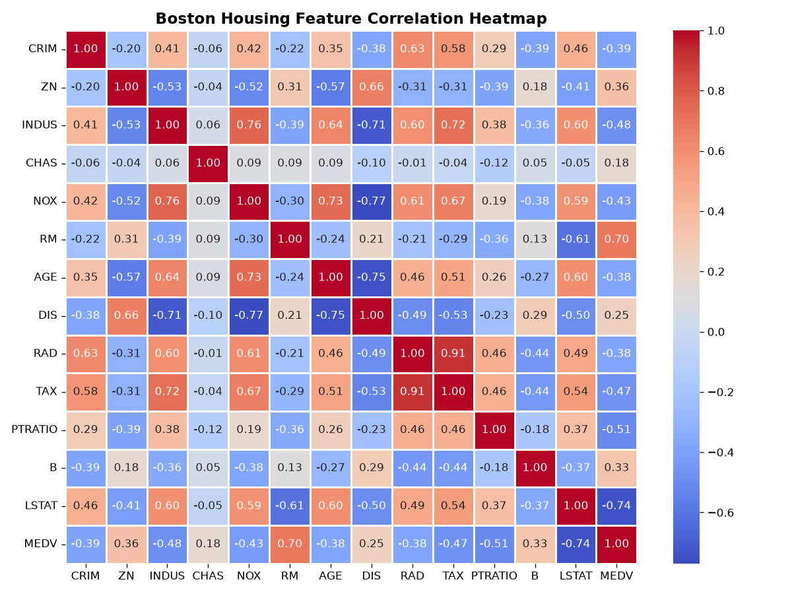
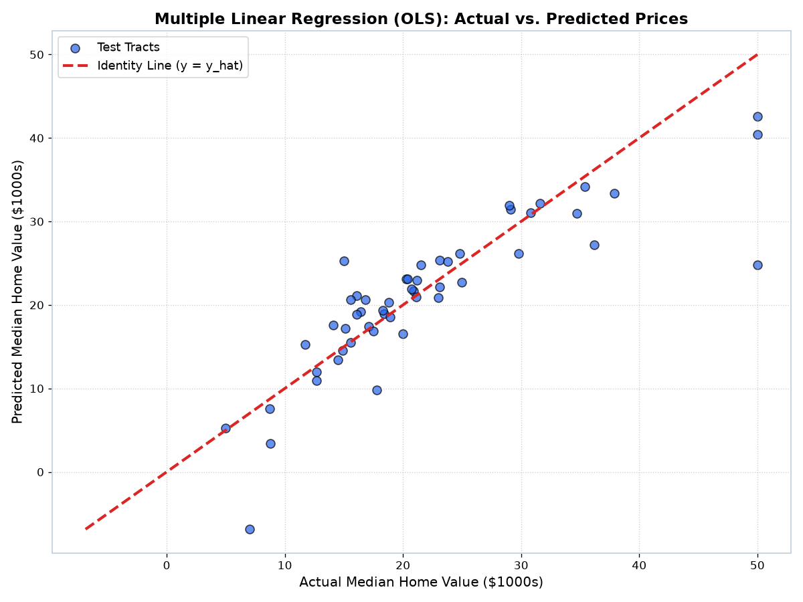
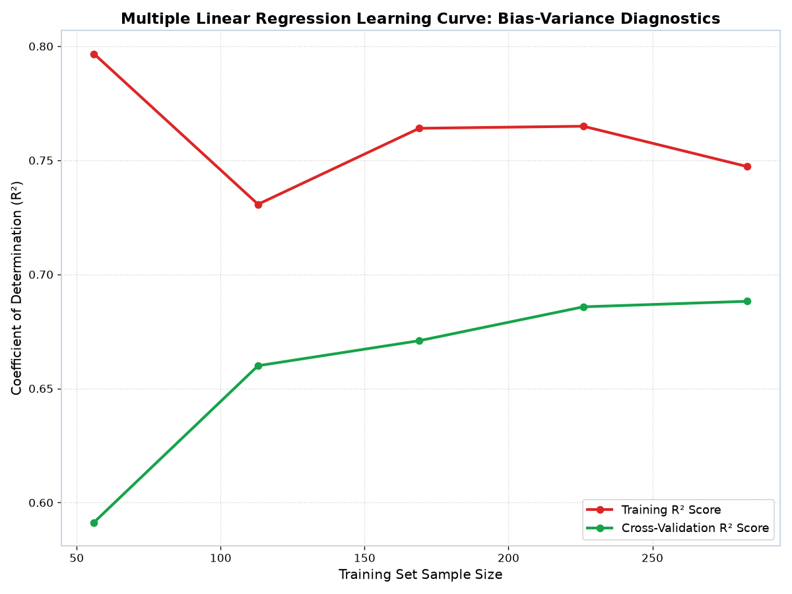
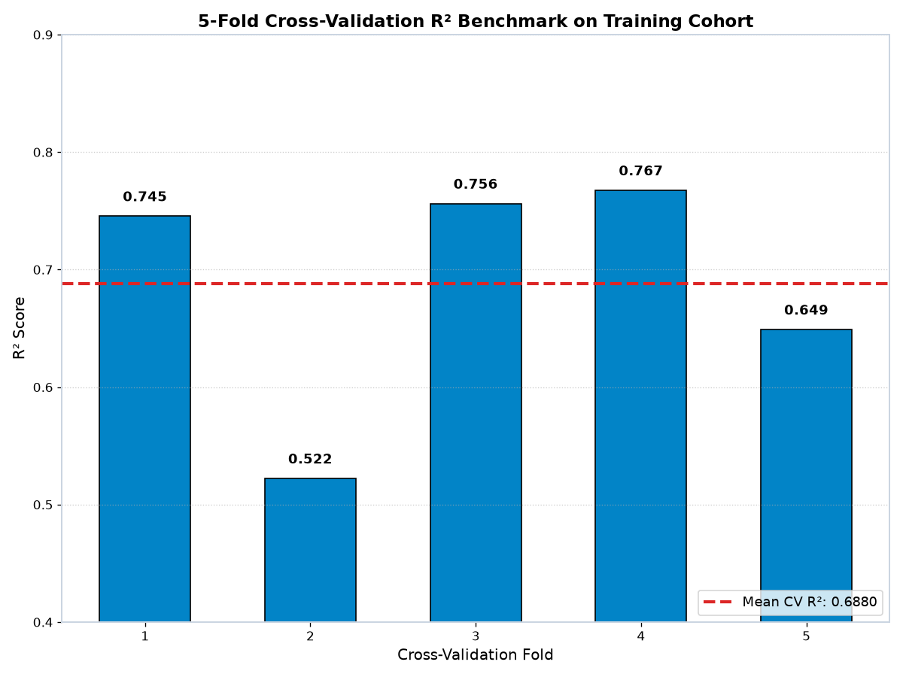
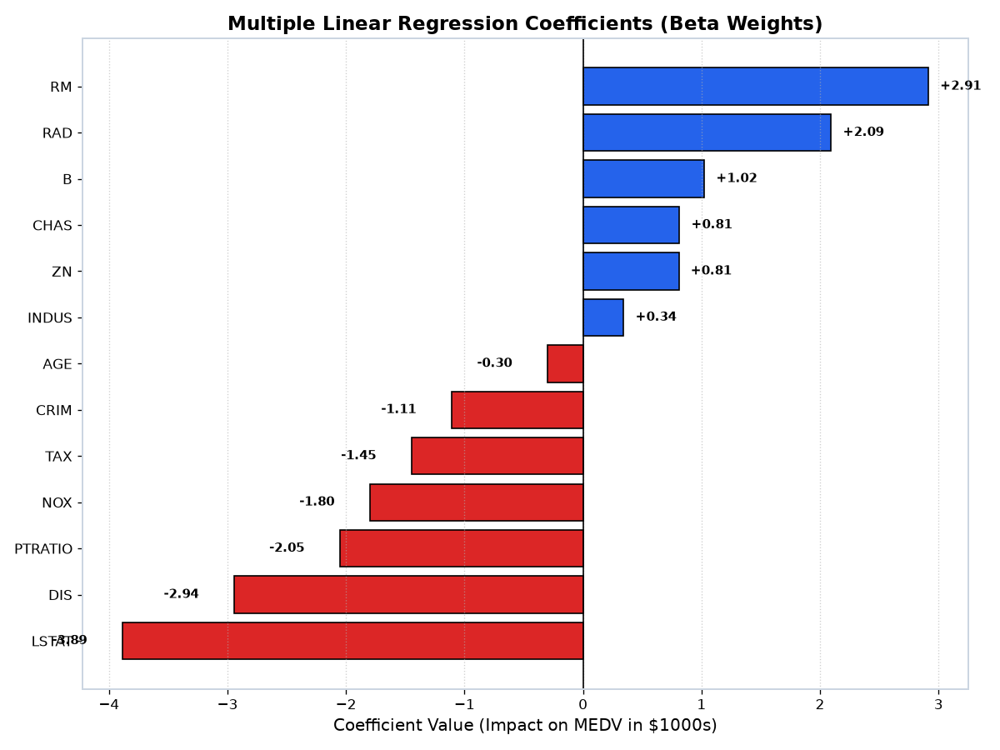

# Boston Housing Price Prediction

A complete, production-grade Machine Learning laboratory project that predicts the median value of owner-occupied homes (`MEDV`) across Boston metropolitan census tracts using **Multiple Linear Regression (Ordinary Least Squares - OLS)** and **Linear Support Vector Regression (Linear SVR)**, featuring extensive diagnostic evaluation graphs, convex optimization guarantees, and an interactive cyberpunk web interface for real-time property appraisals.

---

## 💻 Project Structure

```
3 Boston Housing Price Prediction/
├── .gitignore
├── CITATION.cff
├── CONTRIBUTING.md
├── LICENSE
├── README.md                                <- Project documentation, structure & evaluation
├── SECURITY.md
├── accuracy.txt                             <- Quantitative test metrics & cross-validation scores
├── guide.txt                                <- Command-line execution guide
├── requirements.txt                         <- Pinned Python dependencies
├── Boston_Housing_Presentation_Advanced.html <- Interactive 13-slide stepper presentation
├── Boston_Housing_Complete_Master_Report.pdf <- 12-chapter publication-grade master report (PDF)
├── generate_master_report_pdf.py            <- Script compiling master HTML and headless Chrome PDF
├── data/
│   ├── raw/                                 <- Immutable raw dataset (boston.csv)
│   └── processed/                           <- Clean 3-way split: X/y train (70%), val (15%), test (15%), scaler
├── models/
│   ├── boston_model.joblib                  <- Serialized Multiple Linear Regression pipeline
│   └── linear_svr_model.joblib              <- Serialized Linear SVR benchmark artifact
├── reports/
│   └── figures/                             <- Publication-grade diagnostic plots (Uniform 1200x900)
├── src/
│   ├── data/make_dataset.py
│   ├── features/build_features.py
│   ├── models/train_model.py
│   ├── models/predict_model.py
│   └── visualization/visualize.py
└── web/
    ├── app.py                               <- Flask HTTP API & UI server (Port 5003)
    ├── templates/index.html
    └── static/
        ├── css/style.css
        └── js/script.js
```

---

## 📊 Results & Accuracy Table (from `accuracy.txt`)

| Model / Split Benchmark | Metric Name | Metric Value | Analytical Interpretation |
|---|---|---|---|
| **Multiple Linear Regression (OLS)** | **Holdout Test $R^2$ Score** | **0.7140** (71.40%) | Proportion of price variance explained on unseen census tracts |
| Multiple Linear Regression (OLS) | **Holdout Test RMSE** | **$5,421.71** | Root Mean Squared Error in real-world valuation units |
| Multiple Linear Regression (OLS) | **Holdout Test MAE** | **$3,390.46** | Mean Absolute Error across test tracts |
| Multiple Linear Regression (OLS) | **Validation Set $R^2$** | **0.7079** | Validation cohort benchmark ($N=76$) |
| Multiple Linear Regression (OLS) | **Validation Set MSE** | **17.5397** | Mean squared loss on validation partition |
| Multiple Linear Regression (OLS) | **5-Fold Cross-Validation $R^2$** | **0.6880** ($\pm 0.1860$) | Mean cross-validation performance across training splits |
| **Linear Support Vector Regression (SVR)** | **Test $R^2$ Score** | **0.6634** (66.34%) | Convex $\epsilon$-insensitive tube benchmark ($C=1.0, \epsilon=0.2$) |
| Linear Support Vector Regression (SVR) | **Test MSE** | **34.6027** | Squared loss outside $\epsilon$-margin |
| **Simple Linear Regression Baseline** | **Test $R^2$ Score ($RM \to MEDV$)** | **0.4288** (42.88%) | Univariate baseline utilizing only average rooms per dwelling |
| Simple Linear Regression Baseline | **Test MSE** | **58.7166** | Unexplained variance without socio-environmental predictors |

---

## 📈 Evaluation Graphs

All diagnostic figures are rendered at a uniform, high-resolution **1200 × 900** canvas for seamless visual alignment:

### 1. Urban & Environmental Feature Distributions
Histograms and kernel density curves across per capita crime (`CRIM`), zoning proportions (`ZN`), industrial acreage (`INDUS`), nitrous oxide levels (`NOX`), room counts (`RM`), and structural age (`AGE`).


### 2. Pairwise Feature Relationships (Pairplot)
Multivariate scatter and distribution matrix demonstrating the positive linear trajectory of rooms (`RM`) vs price and the inverse hyperbolic decay of lower-status population (`LSTAT`).


### 3. Correlation Heatmap
Pearson correlation matrix identifying strong positive correlation with rooms ($r = +0.70$) and strong inverse correlation with lower socio-economic status ($r = -0.74$).


### 4. Multiple Linear Regression: Actual vs. Predicted Prices
Scatter plot comparing ground truth home values against OLS model predictions, tightly aligned with the $45^\circ$ dashed identity line.


### 5. Residual Diagnostics (Homoscedasticity Check)
Residual errors plotted against predicted property values showing zero-centered, unbiased horizontal dispersion across price tiers.


### 6. Learning Curve (Bias-Variance Diagnostics)
Training and 5-fold cross-validation $R^2$ score convergence confirming that linear regression exhibits low variance and avoids overfitting.


### 7. 5-Fold Cross-Validation Benchmark
Cross-validation $R^2$ stability across all 5 training folds confirming reliable generalization.


### 8. Multiple Linear Regression Coefficients (Beta Weights)
Standardized beta coefficients quantifying the marginal valuation impact of each socio-environmental variable on home prices.


---

## ⚡ Quick Start

```bash
cd "3 Boston Housing Price Prediction"

# 1. Run data ingestion & validation
python src/data/make_dataset.py

# 2. Build features, scale, and split 3 ways
python src/features/build_features.py

# 3. Train Multiple Linear Regression & Linear SVR
python src/models/train_model.py

# 4. Generate all uniform 1200x900 diagnostic figures
python src/visualization/visualize.py

# 5. Launch web application
python web/app.py
```
Open your browser and navigate to `http://localhost:5003`.
