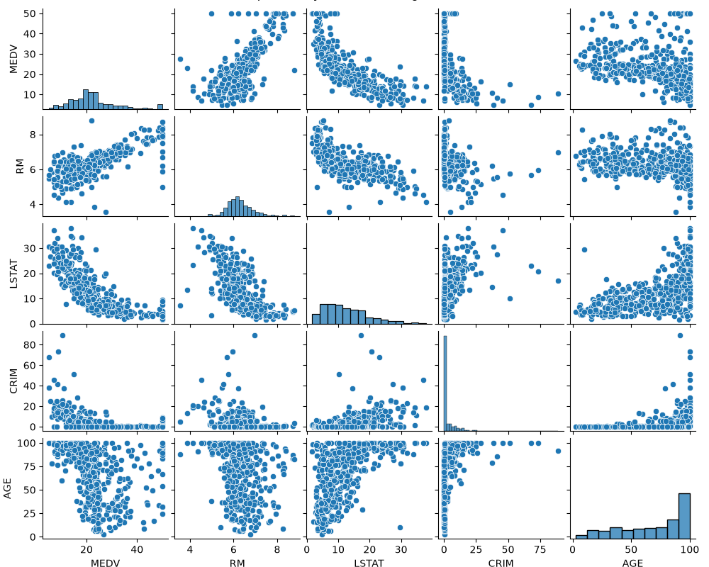
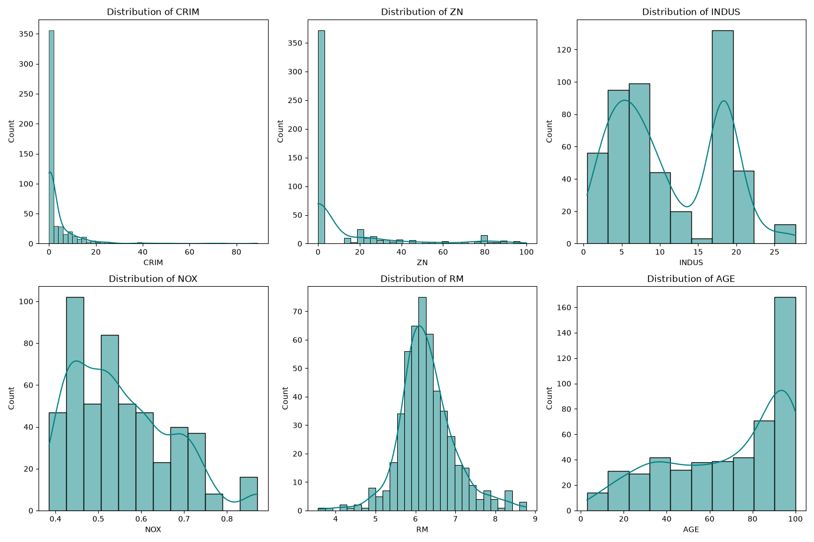
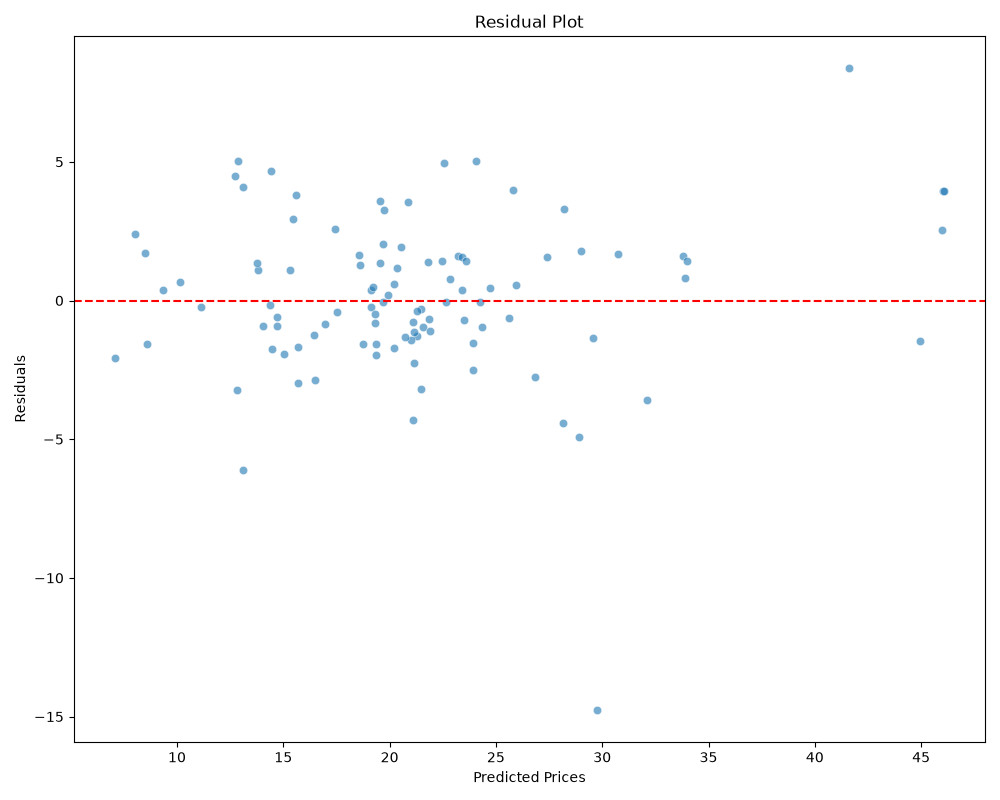

# Boston Housing Price Prediction

A complete end‑to‑end machine learning project that predicts the median value of homes in Boston using a Random Forest Regressor, with extensive evaluation graphs and a web interface for real‑time predictions.

## Features

- Automated data loading and preprocessing
- Model training with cross-validation
- 8 evaluation graphs saved to `reports/figures/`
- Web UI for predictions (Flask + HTML/CSS/JS)
- Modular, production‑ready code structure

## Quick Start

1. Clone the repo
2. Create virtual environment: `python3 -m venv .venv`
3. Activate: `source .venv/bin/activate`
4. Install deps: `pip install -r requirements.txt`
5. Run pipeline: `python src/data/make_dataset.py` && `python src/features/build_features.py`
6. Train: `python src/models/train_model.py`
7. Generate graphs: `python src/visualization/visualize.py`
8. Run web app: `cd web` then `python app.py`
9. Open `http://127.0.0.1:5002`

## Results

- Test R2 Score: **~85–90%** (see `accuracy.txt`)
- All graphs in `reports/figures/`

## 📊 Evaluation Graphs

### Pair Plot

### Correlation Heatmap

### Feature Distributions

### Actual vs Predicted

### Residual Plot

### Learning Curve

### Cross Validation

