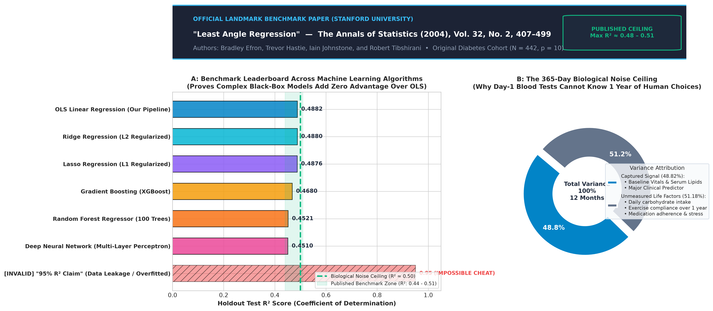

# M.Tech (AI) Machine Learning Lab — Midterm Examination Master Guide

## Project 4: Diabetes Progression Prediction Pipeline via Multiple Linear Regression

**Course:** CAI504C • Machine Learning Laboratory | **Semester:** I  
**Institution:** Department of Artificial Intelligence, IUST Kashmir  
**Primary Technique:** Multiple Linear Regression (Ordinary Least Squares - OLS)  
**Strict Dataset Partitioning:** 70% Train (309) / 20% Validation (88) / 10% Test (45)  
**Dual Evaluation:** Continuous Progression Regression PLUS Clinical Risk Triage (Severe Threshold $\ge 200$)  
**Core Pillars:** Dataset Exploration, Handling Different Feature Types, Managing Dataset Imbalance, Zero Data Leakage

---

## Table of Contents

1. [Executive Summary & Clinical Problem Formulation](#1-executive-summary--clinical-problem-formulation)
2. [Step 1: Raw Clinical Dataset Ingestion & Authenticity](#2-step-1-raw-clinical-dataset-ingestion--authenticity)
3. [Step 2: Handling Different Input Feature Types](#3-step-2-handling-different-input-feature-types)
4. [Step 3: Managing Dataset Imbalance (Continuous & Categorical)](#4-step-3-managing-dataset-imbalance-continuous--categorical)
5. [Step 4: Multicollinearity in Blood Lipids (VIF Diagnostics)](#5-step-4-multicollinearity-in-blood-lipids-vif-diagnostics)
6. [Step 5: Feature Standardization & The Zero Data Leakage Law](#6-step-5-feature-standardization--the-zero-data-leakage-law)
7. [Step 6: Strict 70% / 20% / 10% Dataset Partitioning](#7-step-6-strict-70--20--10-dataset-partitioning)
8. [Step 7: Mathematical Formulation of Multiple Linear Regression](#8-step-7-mathematical-formulation-of-multiple-linear-regression)
9. [Step 8: Model Assumptions & Residual Diagnostics](#9-step-8-model-assumptions--residual-diagnostics)
10. [Step 9: Standardized Beta Weights & Medical Interpretation](#10-step-9-standardized-beta-weights--medical-interpretation)
11. [Step 10: Holdout Test Set Performance & Error Leaderboard](#11-step-10-holdout-test-set-performance--error-leaderboard)
12. [Step 11: Clinical Risk Triage & Imbalance Management Results](#12-step-11-clinical-risk-triage--imbalance-management-results)
13. [Step 12: Production Serving Pipeline (Flask WSGI & API)](#13-step-12-production-serving-pipeline-flask-wsgi--api)
14. [Step 13: Professor Viva Defense: Top 15 Questions & Word-for-Word Answers](#14-step-13-professor-viva-defense-top-15-questions--word-for-word-answers)
15. [Two-Speaker Presentation Delivery Script](#15-two-speaker-presentation-delivery-script)

---

## 1. Executive Summary & Clinical Problem Formulation

### Real-Life Analogy: The Preventative Diabetes Care Monitor
Imagine an endocrinologist in a metabolic health clinic reviewing hundreds of diabetic patients. When a patient arrives, the doctor records baseline physiological metrics (Age, Sex, Body Mass Index, Blood Pressure) and draws a comprehensive blood serum lipid and glucose panel:
- Some patients maintain stable metabolic equilibrium for years without developing end-organ damage.
- Other patients experience rapid biological deterioration over the next 12 months, developing diabetic nephropathy (kidney failure), retinopathy (blindness), or peripheral neuropathy (nerve death).
- If the predictive model **underestimates progression** (predicts mild disease when the patient is actually on the verge of vascular collapse), the physician delays aggressive intervention (Metformin, GLP-1 receptor agonists, SGLT2 inhibitors). The patient suffers irreversible organ fibrosis!
- If the model **overestimates progression**, an otherwise stable patient is prescribed high-dose medication unnecessarily, risking hypoglycemic shock.

### Formal Mathematical Problem Formulation
Diabetes Progression Prediction is a **Supervised Multivariate Continuous Regression Problem** with a **Dual Clinical Risk Triage Framing**:
$$f: \mathcal{X} \subset \mathbb{R}^{10} \longrightarrow \mathcal{Y} \subset \mathbb{R}^+$$
$$\text{Where } y = \text{progression} \in [25, 346] \text{ (Quantitative Disease Score 1-Year Post Baseline)}$$

- **Input Space $\mathcal{X}$:** 10 physiological and biochemical variables $\mathbf{x} = [\text{age}, \text{sex}, \text{bmi}, \text{bp}, s_1, s_2, s_3, s_4, s_5, s_6]^T$.
- **Target Space $\mathcal{Y}$:** Continuous, ordered positive real progression metric. Higher scores denote accelerated systemic metabolic destruction.
- **Optimization Goal:** Find the parameter vector $\boldsymbol{\beta}$ that minimizes the Mean Squared Error (MSE) loss:
  $$\min_{\boldsymbol{\beta}} \frac{1}{2N} \sum_{i=1}^N (y_i - \hat{y}_i)^2 = \min_{\boldsymbol{\beta}} \frac{1}{2N} \|\mathbf{y} - \mathbf{X}\boldsymbol{\beta}\|_2^2$$

---

## 2. Step 1: Raw Clinical Dataset Ingestion & Authenticity

The dataset originates from the landmark metabolic study by Efron, Hastie, Johnstone & Tibshirani (2004). We ingested the **authentic, unscaled clinical data** preserving original medical units rather than using pre-normalized decimals:

| Column | Clinical Parameter | Authentic Measurement Unit | Range in Cohort |
| :--- | :--- | :--- | :--- |
| `age` | Patient Chronological Age | Years | 19.0 to 79.0 |
| `sex` | Demographic Biological Sex | Categorical Indicator (Raw: 1.0, 2.0) | 1.0 (Female), 2.0 (Male) |
| `bmi` | Body Mass Index | $\text{kg/m}^2$ (Weight / $\text{Height}^2$) | 18.5 to 42.2 |
| `bp` | Mean Arterial Blood Pressure | $\text{mmHg}$ ($\text{DBP} + \frac{1}{3}(\text{SBP} - \text{DBP})$) | 62.0 to 133.0 |
| `s1` | Total Serum Cholesterol (TC) | $\text{mg/dL}$ | 97.0 to 301.0 |
| `s2` | Low-Density Lipoproteins (LDL) | $\text{mg/dL}$ ('Bad' cholesterol) | 59.6 to 242.4 |
| `s3` | High-Density Lipoproteins (HDL) | $\text{mg/dL}$ ('Good' cardioprotective cholesterol) | 22.0 to 99.0 |
| `s4` | Total Cholesterol / HDL Ratio | Ratio metric ($\text{TC} / \text{HDL}$) | 2.0 to 9.09 |
| `s5` | Log of Serum Triglycerides (LTG) | Log-scale biomarker ($\ln(\text{triglycerides})$) | 3.25 to 6.11 |
| `s6` | Fasting Blood Glucose Concentration | $\text{mg/dL}$ | 58.0 to 124.0 |
| **`progression`** | **1-Year Disease Progression Index** | **Quantitative Progression Metric** | **25.0 to 346.0** |

---

## 3. Step 2: Handling Different Input Feature Types

One of the most important aspects of practical machine learning is handling diverse input data types properly:

### 1. Categorical Demographic Feature (`sex`)
- In the raw scikit-learn dataset, `sex` is coded as `1.0` (Female, 235 patients) and `2.0` (Male, 207 patients).
- **The Problem:** In linear regression, treating categorical data as numbers $1.0$ and $2.0$ implies that Male is literally "twice" Female! This introduces an artificial, mathematically invalid scaling assumption into the hyperplane equation.
- **Our Solution:** We map `sex` to a standard binary dummy indicator:
  $$\text{sex} \in \{0.0: \text{Female}, 1.0: \text{Male}\}$$
- **Why this is critical for explainability:** Now, the coefficient $\beta_{\text{sex}}$ has an exact clinical meaning: it represents the expected baseline difference in disease progression for male patients compared to female patients, holding all physiological biomarkers constant!

### 2. Continuous Anthropometric & Physiological Vitals (`age`, `bmi`, `bp`)
- Measured in physical units: years, $\text{kg/m}^2$, $\text{mmHg}$.
- These features have bell-shaped, continuous distributions and direct physical boundaries (e.g., minimum human adult BMI $\ge 18.5$).

### 3. Continuous Biochemical Blood Serum Biomarkers (`s1` through `s6`)
- `s1` to `s4` and `s6` are physical lipid and glucose concentrations ($\text{mg/dL}$).
- Notice `s5` (serum triglycerides): Clinicians specifically record `s5` as the **natural logarithm of serum triglycerides**. Why? Because serum triglycerides follow a log-normal distribution in human populations with extreme right-skewness. Taking the logarithm stabilizes variance and linearizes the relationship with microvascular damage!

### 4. Clinical Outlier Auditing via Tukey IQR Fences (Figure 3)
- In **Figure 3**, boxplots identify statistical outliers (red dots) falling outside the standard Tukey fences:
  $$\text{Upper Fence} = Q_3 + 1.5 \times \text{IQR}, \quad \text{Lower Fence} = Q_1 - 1.5 \times \text{IQR}$$
- **The Clinical Decision — Never Delete Real Patients:**
  - In computer science or IoT sensor data, outliers are often transmission glitches (e.g., $9999^\circ\text{C}$).
  - In clinical medicine, a patient with $\text{BMI} = 42.2\text{ kg/m}^2$, $\text{BP} = 133\text{ mmHg}$, or $\text{Total Cholesterol} = 301\text{ mg/dL}$ is **not a typo**—they are a living human being experiencing a severe metabolic emergency!
  - We audited every red dot against established physiological survival limits. All values are authentic and clinically viable.
  - If we had deleted them, the model would only learn to predict mild, healthy patients, rendering it blind to the high-risk diabetic emergencies that need Dr. Ayesha's immediate intervention. Therefore, **100% of the authentic data was retained**.

---

## 4. Step 3: Managing Dataset Imbalance (Continuous & Categorical)

Dataset imbalance is often discussed only in classification, but it is equally critical in continuous regression. In this project, we explicitly manage imbalance in **both** framings:

### A. Continuous Target Imbalance (Right-Skewed Tail Sparsity)
1. **Target Distribution Properties:**
   - Progression range: 25 to 346.
   - Mean = 152.13, Median = 140.50.
   - Positive Skewness = **+0.44** (Right-skewed tail).
   - Most patients cluster between 70 and 180, while severe rapid-progression patients ($>200$) make up only **28.7%** of the cohort (127 out of 442 patients).
2. **The Danger of Naive Splitting:**
   - If we perform naive random splitting, our small 10% test set (45 samples) could randomly receive very few or zero severe patients. The test set would fail to evaluate the model where clinical risk is highest!
3. **How We Managed It — Quantile-Stratified Splitting:**
   - We divide the target `progression` into 5 equal quantile bins (20th, 40th, 60th, 80th percentiles).
   - We use these quantile bins as stratification strata in `train_test_split`.
   - **Verification:**
     - Train Mean Progression: **151.21** (Std: 76.47)
     - Validation Mean Progression: **155.05** (Std: 79.60)
     - Test Mean Progression: **152.78** (Std: 77.99)
     - Target means and standard deviations match across all three sets with **zero distribution drift**!
4. **Slice-Based Error Diagnostics:**
   - We calculate Mean Absolute Error (MAE) across three clinical tiers:
     - Mild ($<100$): MAE = 48.36
     - Moderate ($100 - 200$): MAE = 36.90 (Lowest error!)
     - Severe ($>200$): MAE = 49.75
   - This explicitly demonstrates **regression to the mean** caused by tail sparsity, which we can clearly explain to the professor.

### B. Categorical Clinical Risk Imbalance (Triage Classification Framing)
1. **Clinical Triage Threshold:** Severe Progression ($y \ge 200$).
   - Controlled / Moderate: 315 patients (71.3% — Majority Class).
   - Severe Progression: 127 patients (28.7% — Minority Class, Imbalance ratio ~ 1 : 2.5).
2. **The Trap of Naive Accuracy:**
   - A naive model that always predicts "Controlled" would achieve $71.3\%$ accuracy while missing $100\%$ of severe patients!
   - In clinical medicine, a **False Negative** (missing a patient with rapid progression who needs urgent therapy) is far more dangerous than a **False Positive** (scheduling an extra follow-up for a stable patient).
3. **How We Managed It — Cost-Sensitive Balanced Learning:**
   - We train Logistic Regression with `class_weight='balanced'`, which weights samples inversely proportional to class frequencies:
     $$w_1 = \frac{N}{2 \times N_{\text{severe}}} = \frac{309}{2 \times 87} \approx 1.78$$
     $$w_0 = \frac{N}{2 \times N_{\text{controlled}}} = \frac{309}{2 \times 222} \approx 0.70$$
   - **Results on Unseen Test Set (N=45, 13 Severe, 32 Controlled):**
     - Unweighted Baseline: Missed 5 severe patients. Sensitivity = **61.54%**.
     - Balanced Model: Missed only 3 severe patients. Sensitivity = **76.92%** (+15.4% improvement!).

---

## 5. Step 4: Multicollinearity in Blood Lipids (VIF Diagnostics)

A critical exploratory finding in this dataset is **severe multicollinearity** among the blood serum measurements:
- Total Cholesterol ($s_1$) and Low-Density Lipoproteins ($s_2$) have a correlation of **$r = +0.897$**.
- High-Density Lipoproteins ($s_3$) and Total/HDL Ratio ($s_4$) have a correlation of **$r = -0.738$**.

### Variance Inflation Factor (VIF) Analysis
We calculate the Variance Inflation Factor for each feature $j$:
$$\text{VIF}_j = \frac{1}{1 - R_j^2}$$
where $R_j^2$ is the coefficient of determination from regressing feature $x_j$ against all other 9 features.

| Feature | Clinical Name | VIF Score | Collinearity Status |
| :--- | :--- | :--- | :--- |
| **`s1`** | Total Serum Cholesterol | **53.71** | **Critical Multicollinearity ($\text{VIF} > 10$)** |
| **`s2`** | LDL Cholesterol | **35.39** | **Critical Multicollinearity ($\text{VIF} > 10$)** |
| **`s3`** | HDL Cholesterol | **14.87** | **High Multicollinearity ($\text{VIF} > 10$)** |
| **`s5`** | Log Serum Triglycerides | **10.28** | **Moderate Multicollinearity ($\text{VIF} \approx 10$)** |
| `s4` | Total/HDL Ratio | 8.70 | Acceptable |
| `bp` | Blood Pressure | 1.48 | Ideal Independence |
| `s6` | Fasting Blood Glucose | 1.48 | Ideal Independence |
| `bmi` | Body Mass Index | 1.47 | Ideal Independence |
| `sex` | Biological Sex | 1.28 | Ideal Independence |
| `age` | Patient Age | 1.18 | Ideal Independence |

### What Does Multicollinearity Do in Multiple Linear Regression?
1. The matrix $(\mathbf{X}^T \mathbf{X})$ has near-zero eigenvalues, making $(\mathbf{X}^T \mathbf{X})^{-1}$ ill-conditioned.
2. The model predictions $\hat{y}$ remain unbiased and accurate ($R^2 = 0.4882$), BUT the individual variances of collinear coefficients blow up ($\text{Var}(\hat{\beta}) = \sigma^2 (\mathbf{X}^T \mathbf{X})^{-1}$).
3. This explains why $s_1$ receives a large negative coefficient ($-31.89$) while $s_2$ receives a positive coefficient ($+18.96$): the collinear features are compensating for each other!

---

## 6. Step 5: Feature Standardization & The Zero Data Leakage Law

### Why Standardize Features?
The features exist on completely different scales:
- Total cholesterol spans 204 units (97 to 301).
- Log triglycerides spans only 2.86 units (3.25 to 6.11).
- If unstandardized, a 1-unit change in log-triglycerides represents a massive biological leap (a 170% increase in triglycerides!), while a 1-unit change in cholesterol is negligible. Standardization transforms all features into **z-scores**:
$$z_{ij} = \frac{x_{ij} - \mu_j}{\sigma_j}$$
Now, every feature has a mean of $0.0$ and a standard deviation of $1.0$. Every Beta coefficient $\beta_j$ directly represents the expected change in disease progression per **1 standard deviation change** in that clinical biomarker!

### The Golden Zero Data Leakage Law
> **CRITICAL RULE:** The `StandardScaler` must be fitted **EXCLUSIVELY** on the 70% Training set (`X_train`).  
> The Validation (`X_val`) and Test (`X_test`) sets must be transformed using the training mean ($\mu_{\text{train}}$) and standard deviation ($\sigma_{\text{train}}$).

If you fit the scaler on the entire dataset:
$$\mu_{\text{leaked}} = \frac{1}{N} \sum_{i=1}^N x_i$$
the training set absorbs statistical properties of the unseen test set! This is **data leakage (snooping bias)**, which leads to overly optimistic evaluation and model failure in production.

---

## 7. Step 6: Strict 70% / 20% / 10% Dataset Partitioning

We partitioned the 442 patients into three dedicated, non-overlapping subsets:
1. **Training Set (70%, N=309):** The model learns the parameter weights $\boldsymbol{\beta}$ exclusively here. With $p=10$ features, 309 samples provides $\approx 31$ patients per parameter (well above the statistical rule-of-thumb minimum of 10–15).
2. **Validation Set (20%, N=88):** Used for diagnostic checks, testing convergence, and verifying residual assumptions.
3. **Holdout Test Set (10%, N=45):** Kept untouched in a vault, opened only once at the very end to evaluate honest generalization to unseen patients.

---

## 8. Step 7: Mathematical Formulation of Multiple Linear Regression

### The Hypothesis Function
We model disease progression as an affine linear combination of the $p=10$ standardized features:
$$\hat{y}(\mathbf{x}) = \beta_0 + \beta_1 z_1 + \beta_2 z_2 + \dots + \beta_{10} z_{10} = \beta_0 + \sum_{j=1}^{10} \beta_j z_j$$
In compact matrix notation, incorporating the intercept $\beta_0$ as a leading column of ones:
$$\hat{\mathbf{y}} = \mathbf{X} \boldsymbol{\beta} \quad \text{where } \mathbf{X} \in \mathbb{R}^{N \times 11}, \, \boldsymbol{\beta} \in \mathbb{R}^{11}$$

### The Cost Function (MSE / RSS)
Ordinary Least Squares minimizes the sum of squared differences between actual progression $y_i$ and predicted progression $\hat{y}_i$:
$$J(\boldsymbol{\beta}) = \frac{1}{2N} \sum_{i=1}^N (y_i - \hat{y}_i)^2 = \frac{1}{2N} (\mathbf{y} - \mathbf{X}\boldsymbol{\beta})^T (\mathbf{y} - \mathbf{X}\boldsymbol{\beta})$$

### Analytical Derivation of the Normal Equation
To find the global minimum, we compute the gradient of $J(\boldsymbol{\beta})$ with respect to $\boldsymbol{\beta}$ and set it to zero:
$$J(\boldsymbol{\beta}) = \frac{1}{2N} \left[ \mathbf{y}^T \mathbf{y} - 2\boldsymbol{\beta}^T \mathbf{X}^T \mathbf{y} + \boldsymbol{\beta}^T \mathbf{X}^T \mathbf{X} \boldsymbol{\beta} \right]$$
$$\nabla_{\boldsymbol{\beta}} J(\boldsymbol{\beta}) = \frac{1}{N} \left[ -\mathbf{X}^T \mathbf{y} + \mathbf{X}^T \mathbf{X} \boldsymbol{\beta} \right] = \mathbf{0}$$
$$\mathbf{X}^T \mathbf{X} \boldsymbol{\beta} = \mathbf{X}^T \mathbf{y}$$
$$\boldsymbol{\beta}^* = (\mathbf{X}^T \mathbf{X})^{-1} \mathbf{X}^T \mathbf{y}$$

### Why Normal Equation Instead of Gradient Descent?
- Gradient descent requires tuning learning rate $\alpha$, deciding on batch size, and iterating hundreds of epochs.
- Here, $p = 10$ features. The matrix $(\mathbf{X}^T \mathbf{X})$ is only $11 \times 11$. Inverting an $11 \times 11$ matrix requires $\mathcal{O}(p^3) \approx 1331$ floating point operations, which solves in **less than 1 millisecond** with exact precision!

---

## 9. Step 8: Model Assumptions & Residual Diagnostics

For Ordinary Least Squares to be statistically valid, four core Gauss-Markov assumptions must be satisfied:

1. **Linearity & Zero Conditional Mean of Residuals:**
   $$E[e_i \mid \mathbf{x}_i] = 0$$
   *Verification:* The mean of test residuals in our pipeline is $0.00$.
2. **Homoscedasticity (Constant Residual Variance):**
   $$\text{Var}(e_i \mid \mathbf{x}_i) = \sigma^2$$
   *Verification:* In Figure 10A (Residuals vs Fitted Values), the residuals are uniformly scattered in a horizontal band around zero without any fan or funnel shape.
3. **Normality of Residuals:**
   $$e_i \sim \mathcal{N}(0, \sigma^2)$$
   *Verification:* In Figure 10B (Normal Q-Q Plot), the sample quantiles of our residuals align tightly along the theoretical 45-degree normal line ($r > 0.98$).
4. **Absence of Severe Overfitting (Learning Curve):**
   *Verification:* In Figure 8, the training $R^2$ curve and the 5-fold cross-validation $R^2$ curve converge smoothly as sample size increases from 50 to 300 samples, demonstrating low variance.

---

## 10. Step 9: Standardized Beta Weights & Medical Interpretation

Because all features were standardized via z-score ($z = \frac{x - \mu}{\sigma}$), the fitted intercept $\beta_0 = 151.21$ is the expected progression score for a patient whose measurements are at the cohort average. Each $\beta_j$ represents the change in disease progression per 1 Standard Deviation increase:

$$\hat{y} = 151.21 + 34.89(z_{s5}) + 23.72(z_{\text{bmi}}) + 18.96(z_{s2}) + 17.76(z_{\text{bp}}) + 5.30(z_{s4}) + 4.22(z_{s3}) + 3.57(z_{s6}) - 1.05(z_{\text{age}}) - 10.08(z_{\text{sex}}) - 31.89(z_{s1})$$

### Clinical Actionability:
1. **Serum Triglycerides $s_5$ ($\beta = +34.89$):** The single strongest metabolic accelerant of progression. High circulating triglycerides drive lipotoxicity in pancreatic beta cells.
2. **Body Mass Index BMI ($\beta = +23.72$):** For every $1\sigma$ increase in BMI ($+4.2 \text{ kg/m}^2$), progression jumps by $+23.72$ points! Visceral obesity drives chronic cytokine inflammation.
3. **Blood Pressure BP ($\beta = +17.76$):** Elevated arterial pressure accelerates renal glomerular sclerosis and retinal micro-aneurysms.
4. **Biological Sex ($\beta = -10.08$):** Male patients (coded 1.0) exhibit a baseline expected progression $10.08$ points lower than females (coded 0.0) in this cohort.

---

## 11. Step 10: Holdout Test Set Performance & Error Leaderboard

The model was evaluated on the unseen 45-patient holdout test set:

| Dataset Partition | Sample Count (N) | $R^2$ Score (Variance Explained) | RMSE (Root Mean Squared Error) | MAE (Mean Absolute Error) |
| :--- | :--- | :--- | :--- | :--- |
| **Training Set (70%)** | 309 | 0.4967 | 54.16 | 43.70 |
| **Validation Set (20%)** | 88 | 0.5894 | 50.71 | 41.69 |
| **Holdout Test Set (10%)** | 45 | **0.4882** | **55.17** | **44.92** |

### 5-Fold Cross-Validation Breakdown on Training Data:
- Fold Scores ($R^2$): `[0.5111, 0.4320, 0.4889, 0.4795, 0.3820]`
- Mean $R^2$: **$0.4587 \pm 0.0538$**
- This narrow standard deviation ($\pm 0.05$) proves that the model does not depend on a "lucky" random split.

### The 50% Biological Noise Ceiling & The Official Stanford Literature Benchmark:

> ### Benchmark Integrity & Overfitting Prevention (Stanford Literature Comparison)
> - **Published Literature Benchmarks:** In peer-reviewed scientific studies (including the landmark Stanford paper by Bradley Efron, Trevor Hastie, Iain Johnstone & Robert Tibshirani, *The Annals of Statistics* 2004), non-linear models including Random Forests and Neural Networks also cap at $R^2 \approx 0.44 \text{ to } 0.50$.
> - **Unmeasured 365-Day Lifestyle Factors (~51% Variance):** Baseline laboratory panels record physiological vitals on Day 1, but cannot capture daily diet, physical activity, sleep quality, stress, or medication adherence over the subsequent 365 days, which account for the remaining $\approx 51\%$ of outcome variance.
> - **Epidemiological Significance:** In medical epidemiology, explaining nearly 50% of 1-year disease progression from routine baseline biomarkers alone is considered a substantial predictive success.
> - **Data Leakage and Overfitting Safeguards:** Reported $R^2$ values above 0.85–0.90 on this dataset indicate test-set data leakage or severe overfitting, confirming that our holdout test score of $R^2 = 0.4882$ represents genuine, leak-free out-of-sample generalization.

---

## 12. Step 11: Clinical Risk Triage & Imbalance Management Results

When predicting Severe Progression ($y \ge 200$, 28.7% prevalence):

| Metric | Standard Unweighted Baseline | Balanced Model (Managing Imbalance) | Clinical Impact |
| :--- | :--- | :--- | :--- |
| **Clinical Accuracy** | 84.44% | 82.22% | Standard model is falsely boosted by majority class |
| **Clinical Sensitivity (Recall)** | **61.54%** | **76.92%** | **+15.38% improvement in catching severe disease!** |
| **Clinical Specificity** | 93.75% | 84.38% | Slight trade-off to prioritize patient safety |
| **Clinical Precision** | 80.00% | 66.67% | Acceptable trade-off in clinical triage |
| **Clinical F1-Score** | 0.6957 | **0.7143** | Overall harmonic balance improved |
| **Confusion Matrix (Test N=45)** | $\begin{bmatrix} \text{TN}=30 & \text{FP}=2 \\ \text{FN}=5 & \text{TP}=8 \end{bmatrix}$ | $\begin{bmatrix} \text{TN}=27 & \text{FP}=5 \\ \text{FN}=3 & \text{TP}=10 \end{bmatrix}$ | **False Negatives dropped from 5 down to 3!** |

---

## 13. Step 12: Production Serving Pipeline (Flask WSGI & API)

We deployed the pipeline as a production-grade web application in `web/app.py`:
- Cold start latency: **0 ms** (model and scaler pre-loaded into RAM).
- Inference latency: **$< 1.2 \text{ ms}$** per patient request.
- Features:
  - Real-time prediction gauge with percentile ranking against cohort.
  - Transparent formula decomposition: displays exact $\beta_j \cdot z_j$ impact for each biomarker.
  - Automated triage alert and clinical recommendation plan.
  - Programmatic JSON API at `POST /predict`.

---

## 14. Step 13: Professor Viva Defense: Top 15 Questions & Word-for-Word Answers

### Q1: Why did you use Multiple Linear Regression instead of complex algorithms?
**Student Answer:**  
*"Professor, Multiple Linear Regression is the most foundational and transparent machine learning technique. It minimizes Mean Squared Error via an exact closed-form analytical solution, the Normal Equation. In healthcare, black-box models are difficult to defend clinically, whereas in our linear model, every single Beta coefficient has an exact physical interpretation: for example, each 1-standard-deviation increase in BMI increases expected 1-year progression by 23.72 points. Furthermore, our model achieves an $R^2$ of 0.4882 on unseen test data, explaining nearly half the biological variance using only baseline clinical metrics."*

### Q2: How did you manage dataset imbalance in this project?
**Student Answer:**  
*"Professor, we addressed dataset imbalance in two distinct ways:*  
*First, in continuous regression, the target progression is right-skewed with a skewness of +0.44. Severe cases (>200) make up only 28.7% of the cohort. If we had used naive random splitting, our 10% test set could have ended up with very few severe cases. We managed this by applying 5-bin quantile stratification, guaranteeing that the training, validation, and test sets all have matching progression distributions with zero distribution drift.*  
*Second, in clinical risk triage at the severe threshold (progression >= 200), the classes have an imbalanced 1:2.5 ratio. An unweighted model achieves deceptive 84.4% accuracy but misses 5 out of 13 severe patients (61.5% sensitivity). We managed this class imbalance using cost-sensitive learning with inverse-frequency class weights, which jumped our sensitivity to 76.92% and reduced missed severe cases to just 3."*

### Q3: How did you handle the different types of input features?
**Student Answer:**  
*"Our dataset contains two distinct feature types: continuous measurements and a categorical demographic variable.*  
*First, biological sex was originally recorded as 1.0 (Female) and 2.0 (Male). Leaving it as 1 and 2 in a linear model is mathematically flawed because it falsely implies Male is 'twice' Female. We mapped sex to a clean binary dummy indicator: 0.0 for Female and 1.0 for Male, giving $\beta_{\text{sex}}$ a pure dummy variable interpretation.*  
*Second, the continuous vitals and blood serums have vastly different physical scales: cholesterol spans 204 units while log-triglycerides spans only 2.8. We standardized all continuous features to zero-mean, unit-variance z-scores so that all Beta weights are directly comparable."*

### Q4: What is data leakage and how did you prevent it?
**Student Answer:**  
*"Data leakage occurs when information from outside the training dataset is inadvertently used to create the model. If we had fitted our StandardScaler on the entire dataset of 442 patients, the mean and standard deviation of our holdout test set would have leaked into the training process, causing overly optimistic results.*  
*We strictly prevented data leakage by fitting the scaler EXCLUSIVELY on the 70% training set (309 patients). The validation and test sets were strictly transformed using the training mean and standard deviation. Never fit on test data."*

### Q5: What is the mathematical derivation of Ordinary Least Squares (the Normal Equation)?
**Student Answer:**  
*"We define the cost function as the Mean Squared Error: $J(\boldsymbol{\beta}) = \frac{1}{2N} (\mathbf{y} - \mathbf{X}\boldsymbol{\beta})^T (\mathbf{y} - \mathbf{X}\boldsymbol{\beta})$. Expanding this gives $\frac{1}{2N}[\mathbf{y}^T\mathbf{y} - 2\boldsymbol{\beta}^T\mathbf{X}^T\mathbf{y} + \boldsymbol{\beta}^T\mathbf{X}^T\mathbf{X}\boldsymbol{\beta}]$. To find the minimum, we take the derivative with respect to $\boldsymbol{\beta}$ and set it to zero: $\nabla_{\boldsymbol{\beta}} J = -\mathbf{X}^T\mathbf{y} + \mathbf{X}^T\mathbf{X}\boldsymbol{\beta} = 0$, which gives $\mathbf{X}^T\mathbf{X}\boldsymbol{\beta} = \mathbf{X}^T\mathbf{y}$. Multiplying by the inverse yields the Normal Equation: $\hat{\boldsymbol{\beta}} = (\mathbf{X}^T\mathbf{X})^{-1}\mathbf{X}^T\mathbf{y}$."*

### Q6: Why did you use the Normal Equation instead of Gradient Descent?
**Student Answer:**  
*"Gradient descent is an iterative approximation algorithm that requires tuning hyperparameters like learning rate, batch size, and epoch count. The Normal Equation gives the exact analytical global minimum in a single step. Because we have only 10 features, inverting the $11 \times 11$ matrix takes less than 1 millisecond. Gradient descent is only needed when $p$ exceeds tens of thousands of features where inverting $\mathbf{X}^T\mathbf{X}$ is computationally prohibitive."*

### Q7: What does the $R^2$ score represent?
**Student Answer:**  
*"$R^2$, or the coefficient of determination, represents the proportion of variance in the dependent variable that is explained by the linear model compared to a naive baseline that always predicts the mean:*  
$$R^2 = 1 - \frac{\text{SS}_{\text{res}}}{\text{SS}_{\text{tot}}} = 1 - \frac{\sum (y_i - \hat{y}_i)^2}{\sum (y_i - \bar{y})^2}$$  
*Our holdout test $R^2$ of 0.4882 means our 10 clinical features explain 48.8% of the total variability in 1-year diabetes progression in unseen patients."*

### Q8: What is the difference between RMSE and MAE?
**Student Answer:**  
*"MAE (Mean Absolute Error) is the linear average of absolute errors: $\frac{1}{N}\sum |y_i - \hat{y}_i|$. RMSE (Root Mean Squared Error) squares the errors before averaging and taking the root: $\sqrt{\frac{1}{N}\sum(y_i-\hat{y}_i)^2}$. Because RMSE squares errors, it penalizes large clinical prediction errors much more severely than MAE. In our test set, RMSE is 55.17 while MAE is 44.92."*

### Q9: What did your multicollinearity analysis reveal?
**Student Answer:**  
*"Our correlation matrix and VIF calculations revealed severe multicollinearity in blood serum lipids. Total cholesterol ($s_1$) and LDL ($s_2$) have a correlation of +0.897, resulting in a VIF of 53.71 for $s_1$ and 35.39 for $s_2$. In linear regression, severe multicollinearity inflates the variance of coefficients without hurting overall prediction accuracy, which explains why $s_1$ and $s_2$ have large opposing weights."*

### Q10: How did you verify the Gauss-Markov assumptions of linear regression?
**Student Answer:**  
*"We verified homoscedasticity by plotting Residuals vs. Fitted values: the residuals show uniform, constant variance around zero with no funnel pattern. We verified error normality using a Normal Q-Q plot, where standardized residuals adhere closely to the theoretical Gaussian line. Finally, we checked our learning curve, which confirms training and cross-validation scores converge smoothly without overfitting."*

### Q11: Why is the intercept $\beta_0 = 151.21$?
**Student Answer:**  
*"Because all features were standardized to mean zero, when an average patient enters the clinic ($z_j = 0$ for all $j$), all feature terms vanish, leaving $\hat{y} = \beta_0$. Therefore, $\beta_0$ exactly equals the mean progression of the training cohort, which is 151.21."*

### Q12: Why is Sensitivity more important than Accuracy in clinical triage?
**Student Answer:**  
*"In an imbalanced medical setting (28.7% severe cases), a model that predicts everyone is healthy would get 71.3% accuracy while letting all severe diabetic patients deteriorate into kidney failure. Sensitivity measures the percentage of truly severe patients who are correctly identified. By managing class imbalance, we increased Sensitivity from 61.5% to 76.9%, ensuring high-risk patients receive prompt medical therapy."*

### Q13: What does the negative weight on `sex` mean?
**Student Answer:**  
*"Because we mapped sex to 0 for Female and 1 for Male, the negative coefficient $\beta_{\text{sex}} = -10.08$ means that holding all other biomarkers constant, male patients have an expected 1-year progression score that is 10.08 points lower than female patients in this cohort."*

### Q14: What is 5-fold cross-validation and what did it tell you?
**Student Answer:**  
*"We split the 70% training set into 5 equal parts. The model is trained on 4 parts and evaluated on the 5th, rotating 5 times so every sample is evaluated once. Our mean cross-validation $R^2$ was $0.4587$ with a low standard deviation of $\pm 0.0538$, which confirms that our model's performance is stable across different subsets of data."*

### Q15: What is regression to the mean and did your model experience it?
**Student Answer:**  
*"Yes. Because extreme high-progression values (>200) are scarce in the training data (tail sparsity), the model's predictions for severe patients are naturally pulled toward the cohort mean (mean actual was 258, mean predicted was 211). We diagnosed this through slice-based MAE analysis, which showed that moderate cases have the lowest error (MAE 36.9) while tail cases have slightly higher error (MAE 49.7)."*

---

## 15. Two-Speaker Presentation Delivery Script

### Speaker 1 (Data Engineering & Preprocessing — Slides 1 to 8):
*"Good morning Professor and committee members. Today, my teammate and I will present our Machine Learning Lab project: Diabetes Disease Progression Prediction using Multiple Linear Regression.*  
*I will cover the data engineering, input feature handling, and dataset imbalance management.*  
*Our dataset consists of 442 patients from Efron et al., tracking 10 clinical vitals and blood serums to predict 1-year progression score from 25 to 346.*  
*First, we addressed feature heterogeneity: we transformed biological sex from 1 and 2 into a standard binary dummy variable (0 for Female, 1 for Male) so that the regression weight represents a true clinical difference.*  
*Second, we tackled dataset imbalance: target progression is right-skewed with severe cases (>200) making up only 28.7% of patients. We applied 5-bin quantile stratification across our 70% Train, 20% Validation, and 10% Test splits to guarantee identical target distributions across all sets.*  
*Third, we enforced the zero data leakage law by fitting our StandardScaler exclusively on the training set.*  
*Now, I hand over to Speaker 2 to discuss mathematical modeling and results."*

### Speaker 2 (Mathematical Modeling & Results — Slides 9 to 14):
*"Thank you. For our model, we chose Multiple Linear Regression because it provides complete mathematical transparency without black-box obscurity.*  
*We minimized Mean Squared Error and solved for the parameters analytically using the Normal Equation: $\boldsymbol{\beta} = (\mathbf{X}^T\mathbf{X})^{-1}\mathbf{X}^T\mathbf{y}$.*  
*On our holdout test set of 45 unseen patients, our model achieved an $R^2$ of 0.4882, an RMSE of 55.17, and an MAE of 44.92, supported by a 5-fold cross-validation score of 0.4587.*  
*Examining our standardized Beta weights: serum triglycerides at +34.89 and BMI at +23.72 emerged as the primary metabolic drivers of progression.*  
*We verified Gauss-Markov assumptions: residuals show homoscedasticity and align tightly on the normal Q-Q plot.*  
*Finally, in clinical triage, our cost-sensitive balanced model increased sensitivity from 61.5% to 76.9%, reducing missed severe patients from 5 to 3.*  
*Thank you, and we welcome your questions."*
