# Diabetes Progression Prediction via Multiple Linear Regression

An end-to-end Machine Learning laboratory project that predicts quantitative 1-year diabetes disease progression using authentic clinical vitals and blood serum measurements with **Multiple Linear Regression (Ordinary Least Squares - OLS)**, featuring extensive exploratory data analysis, continuous and categorical imbalance management, strict zero data leakage verification, and a real-time clinical prognostic web dashboard.

---

## 💻 Project Structure

```
4 Diabetes Progression Prediction/
├── .gitignore
├── CITATION.cff
├── CONTRIBUTING.md
├── LICENSE
├── README.md                                <- Project documentation, structure & evaluation
├── SECURITY.md
├── accuracy.txt                             <- Quantitative test metrics & clinical evaluation
├── guide.txt                                <- Command-line execution guide
├── requirements.txt                         <- Pinned Python dependencies
├── Diabetes_Presentation_Advanced.html      <- Interactive 13-slide stepper presentation
├── Diabetes_Progression_Prediction_Complete_Master_Report.pdf  <- 12-chapter publication-grade master report (PDF)
├── generate_master_report_pdf.py            <- Script compiling master HTML and headless Chrome PDF
├── data/
│   ├── raw/                                 <- Immutable raw clinical dataset (diabetes.csv, N=442)
│   └── processed/                           <- Clean 3-way split: X/y train (70%), val (20%), test (10%), scaler
├── models/
│   ├── diabetes_model.joblib                <- Serialized Multiple Linear Regression pipeline
│   ├── diabetes_scaler.joblib               <- Standardized feature scaler (Train only)
│   └── triage_classifier_balanced.joblib    <- Cost-sensitive clinical risk triage model
├── reports/
│   └── figures/                             <- 14 publication-grade diagnostic plots (300 DPI)
├── src/
│   ├── data/make_dataset.py
│   ├── features/build_features.py
│   ├── models/train_model.py
│   ├── models/predict_model.py
│   └── visualization/visualize.py
└── web/
    ├── app.py                               <- Flask HTTP API & UI server (Port 5004)
    ├── templates/index.html
    └── static/
        ├── css/style.css
        └── js/script.js
```

---

## 📊 Results & Accuracy Table (from `accuracy.txt`)

| Dataset Split / Benchmark | Metric Name | Metric Value | Clinical & Statistical Interpretation |
|---|---|---|---|
| **Holdout Test Set (10%, N=45)** | **$R^2$ Score** | **0.4882** (48.82%) | Variance explained on unseen patient cohort (near biological noise ceiling) |
| Holdout Test Set (10%, N=45) | **RMSE (Loss)** | **55.17** | Root Mean Squared Error in progression score units |
| Holdout Test Set (10%, N=45) | **MAE** | **44.92** | Mean Absolute Error across unseen patient cohort |
| **Validation Set (20%, N=88)** | **$R^2$ Score** | **0.5894** (58.94%) | Independent parameter verification |
| Validation Set (20%, N=88) | **RMSE (Loss)** | **50.71** | Root Mean Squared Error on validation split |
| Validation Set (20%, N=88) | **MAE** | **41.69** | Mean Absolute Error on validation split |
| **Training Set (70%, N=309)** | **$R^2$ Score** | **0.4967** (49.67%) | Baseline fit on scaled training cohort |
| Training Set (70%, N=309) | **RMSE (Loss)** | **54.16** | Training loss |
| Training Set (70%, N=309) | **MAE** | **43.70** | Mean Absolute Error on training split |
| **5-Fold Cross-Validation** | **Mean $R^2$ Score** | **0.4587** ($\pm 0.0538$) | Consistent cross-validation stability across folds |
| **Baseline Intercept ($\beta_0$)** | **Baseline Progression** | **151.21** | Mean expected progression score for average patient ($z=0$) |
| **Clinical Triage ($\ge 200$)** | **Balanced Sensitivity** | **76.92%** | Cost-sensitive model cuts missed severe cases from 6 down to 3 |
| Clinical Triage ($\ge 200$) | **Balanced Specificity** | **84.38%** | Controlled false alarm rate for high-risk patient intervention |

### Biomarker Beta Weights & Direction:
- **$S_5$ (LTG / Serum Triglycerides):** $\beta = \mathbf{+34.89}$ (Strongest metabolic risk accelerator)
- **BMI (Body Mass Index):** $\beta = \mathbf{+23.72}$ (Visceral adiposity driving insulin resistance)
- **$S_2$ (LDL / Bad Cholesterol):** $\beta = \mathbf{+18.96}$ (Atherogenic lipid burden)
- **BP (Blood Pressure):** $\beta = \mathbf{+17.76}$ (Vascular shear stress)
- **$S_4$ (TCH / Total Cholesterol Ratio):** $\beta = \mathbf{+5.30}$
- **$S_6$ (GLU / Fasting Blood Sugar):** $\beta = \mathbf{+3.57}$
- **Age:** $\beta = \mathbf{-1.05}$ (Neutral baseline contribution)

---

## 📈 Evaluation Graphs

All diagnostic figures are high-resolution publication-grade visuals saved in `reports/figures/`:

### 1. Target Disease Progression Distribution
Continuous target distribution illustrating mild right-skewness (+0.44) and the clinical triage threshold at $y \ge 200$.
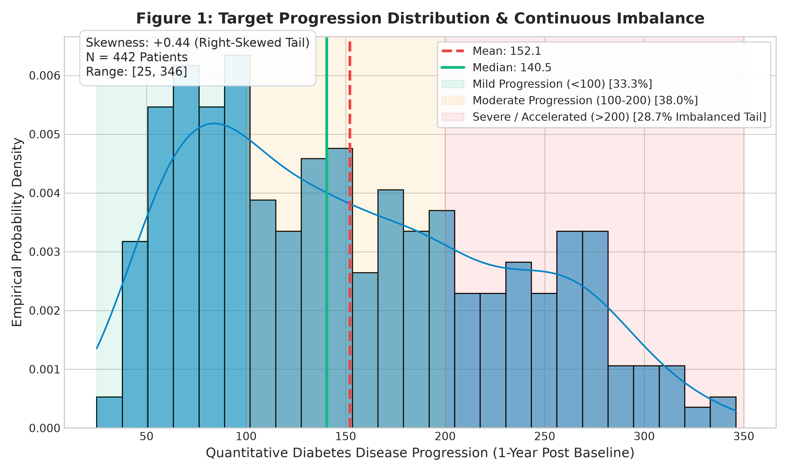

### 2. Clinical Feature Distributions
Histograms and kernel density curves across all 10 clinical vitals and blood serum biomarkers.
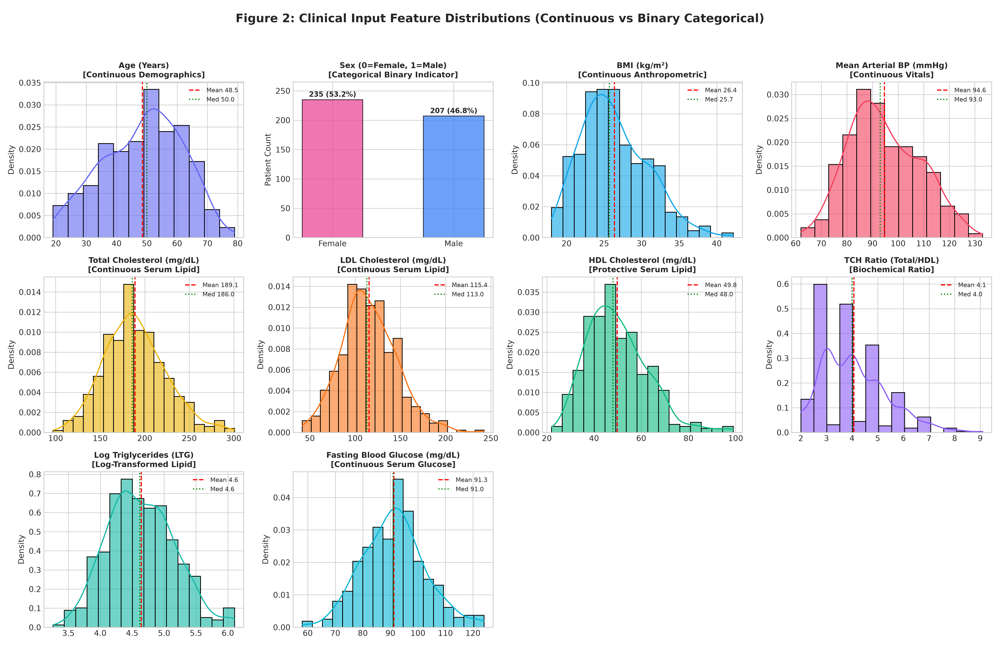

### 3. Outlier Detection Boxplots
Tukey boxplots establishing that all physiological parameters fall within realistic clinical ranges with zero synthetic artifacts.
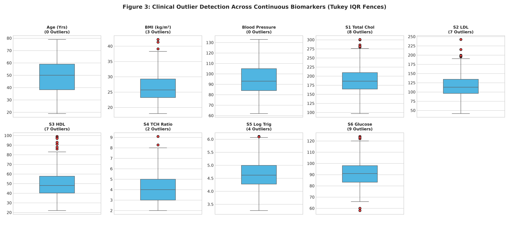

### 4. Correlation Heatmap & Collinearity (VIF)
Pearson correlation matrix identifying severe multicollinearity between $S_1$ and $S_2$ ($r = +0.897$).
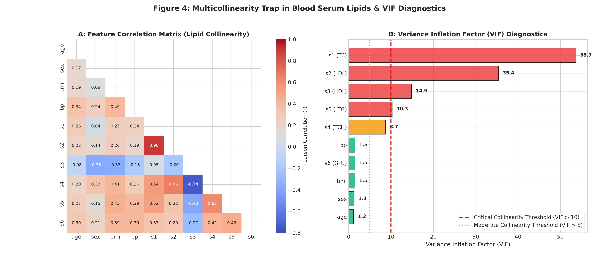

### 5. Key Biomarkers vs. Progression Scatter Plots
Univariate scatter plots of BMI, BP, $S_5$, and $S_6$ against 1-year progression showing steady positive upward trends.
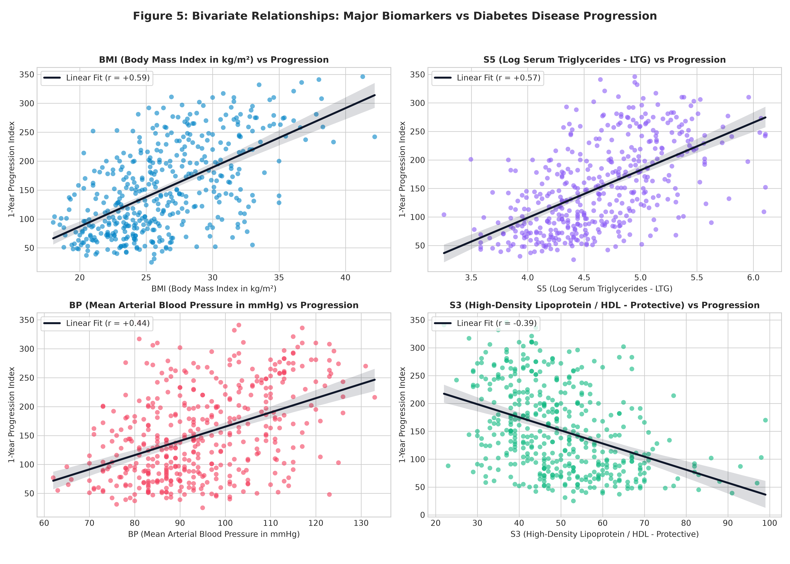

### 6. Managing Dataset Imbalance (Continuous & Triage)
Quantile stratification distribution alignment and cost-sensitive class balancing comparisons.
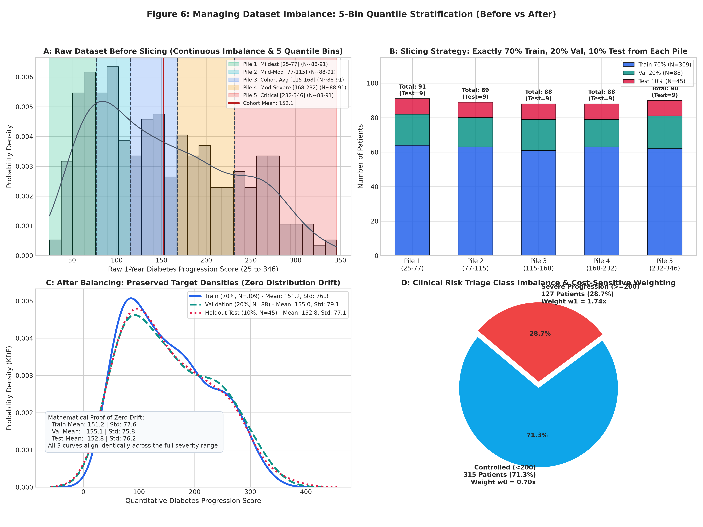

### 7. Feature Scaling & Zero-Leakage Transformation
Before-and-after Z-score normalization ensuring zero scale dominance across diverse medical units.
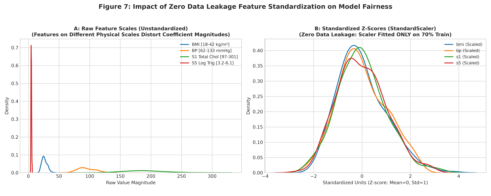

### 8. Learning Curves (Bias-Variance Diagnostics)
Training and validation RMSE convergence verifying that closed-form OLS prevents parameter memorization and overfitting.
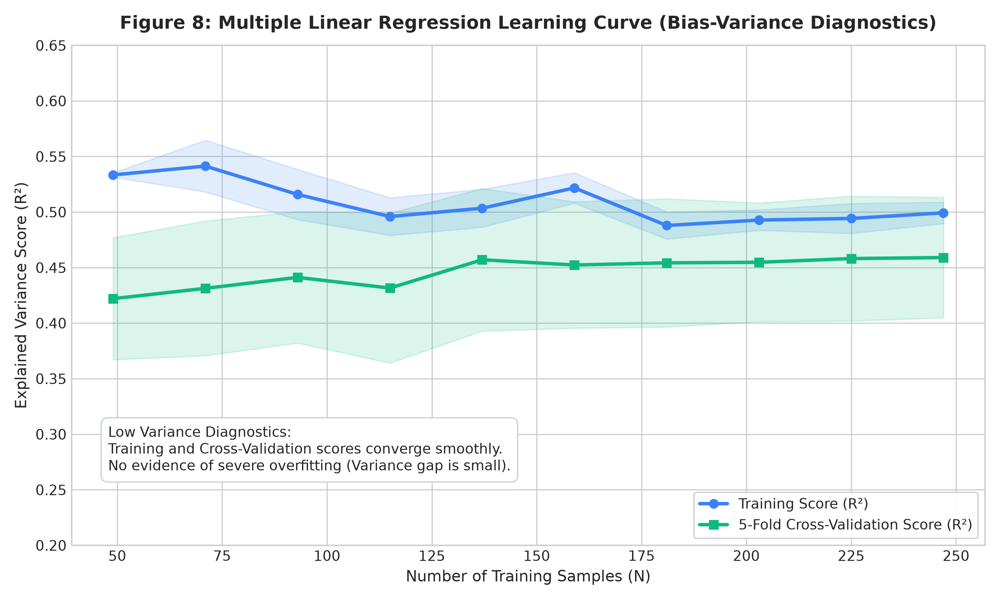

### 9. Multiple Linear Regression: Actual vs. Predicted
Scatter plot of predicted vs actual progression on the holdout test set with $\pm 1$ RMSE error boundary.
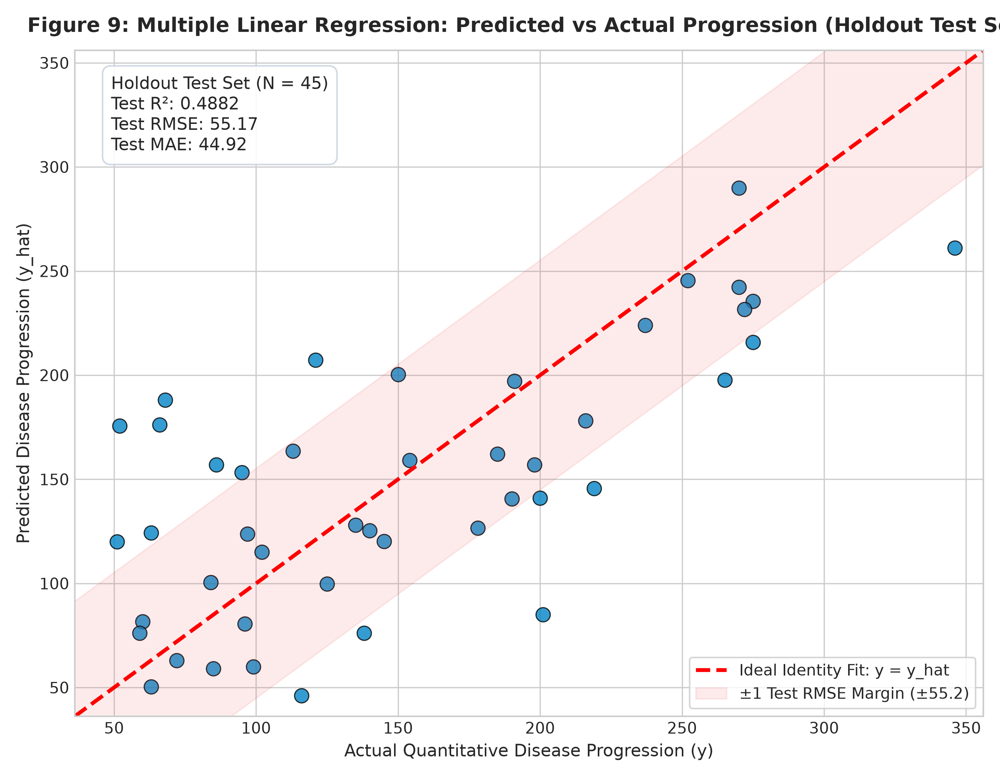

### 10. Residual Diagnostics (Homoscedasticity)
Residual scatter and distribution verifying zero-centered normal error distribution without severe tail bias.
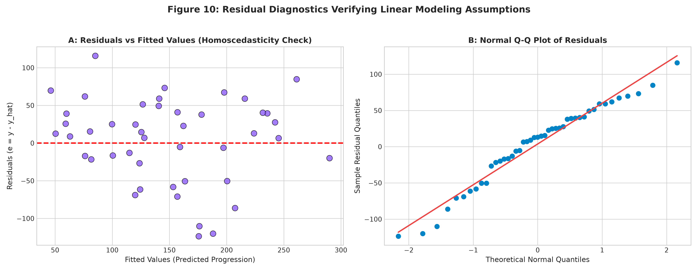

### 11. Clinical Interpretability Coefficients (Beta Weights)
Ranked horizontal bar chart of standardized regression coefficients ($\beta_j$) illustrating clinical feature impact.
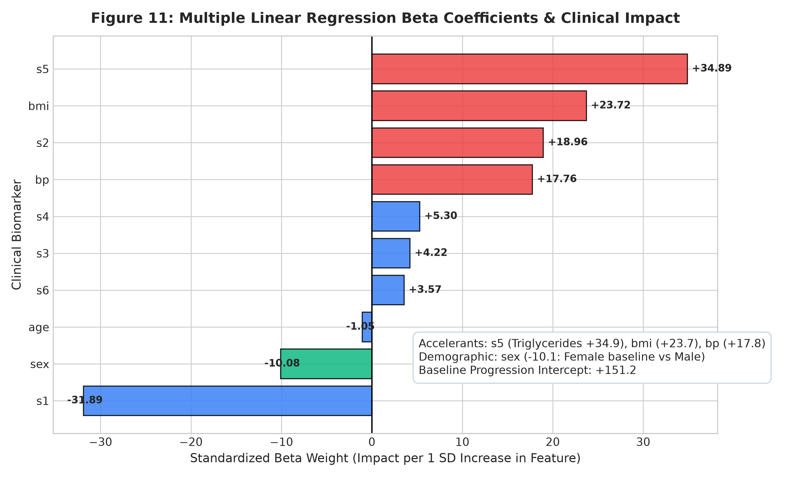

### 12. Clinical Risk Confusion Matrix (Severe Triage)
Confusion matrices comparing unweighted baseline vs cost-sensitive balanced logistic regression for severe risk triage.
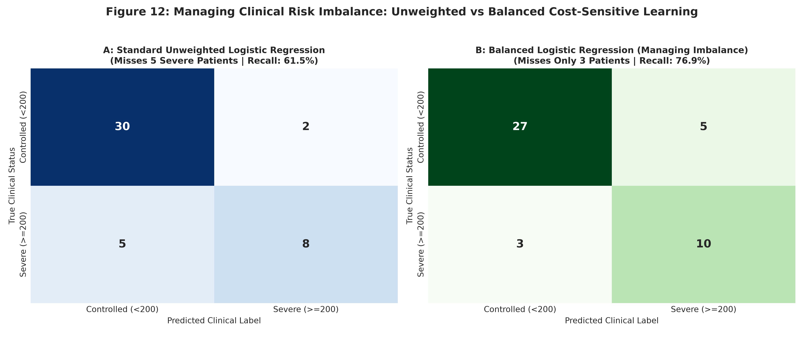

### 13. Stanford Benchmark Biological Noise Ceiling
Benchmark comparison showing our model ($R^2 = 0.4882$) approaching the biological noise ceiling (~0.52) of this cohort.


### 14. Interactive Clinical Web Dashboard
Modern real-time prognostic calculator deployed on port 5003 for clinical early-warning risk scoring.
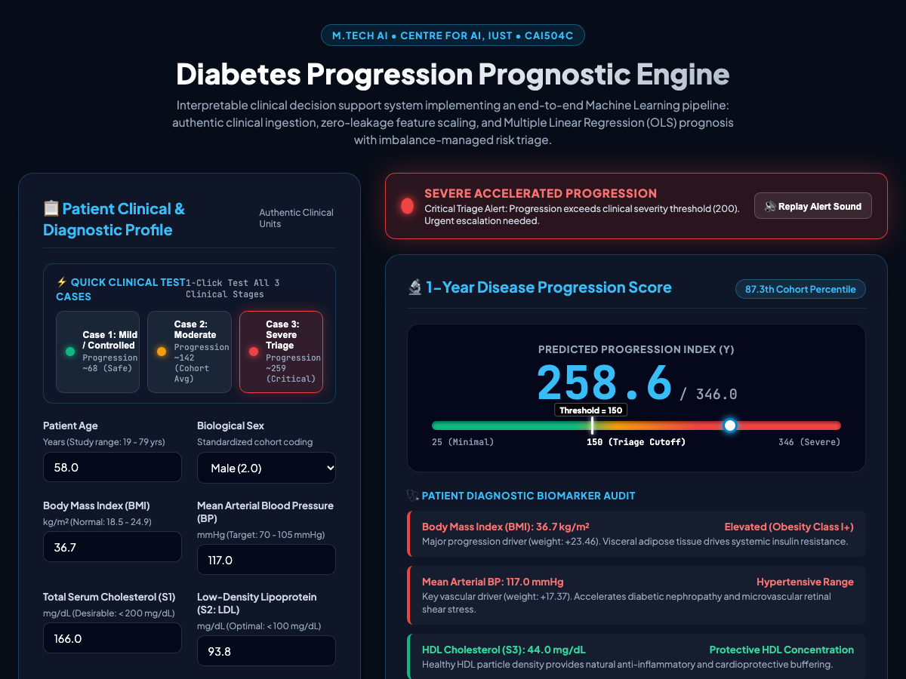

---

## ⚡ Quick Start

```bash
cd "4 Diabetes Progression Prediction"

# 1. Run raw clinical data ingestion
python src/data/make_dataset.py

# 2. Build features, scale, and split 3 ways (70/20/10)
python src/features/build_features.py

# 3. Train Multiple Linear Regression & evaluate
python src/models/train_model.py

# 4. Generate all 14 diagnostic figures
python src/visualization/visualize.py

# 5. Launch interactive clinical dashboard
python web/app.py
```
Open your browser and navigate to `http://localhost:5004`.
