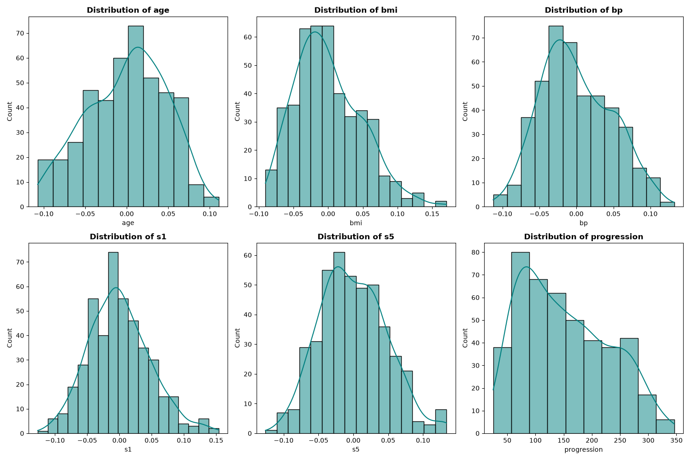
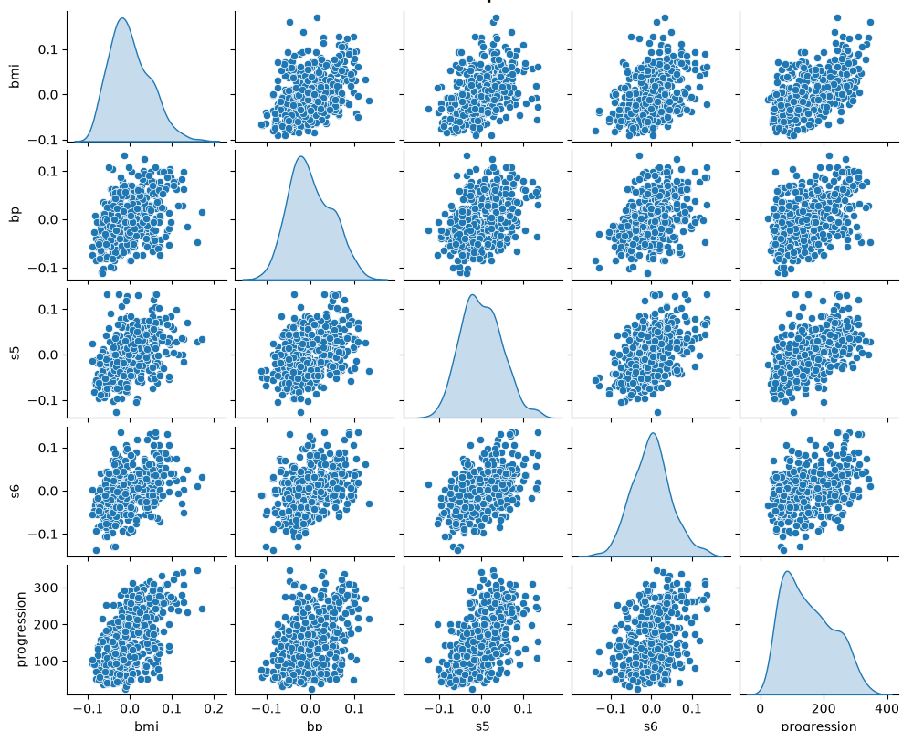
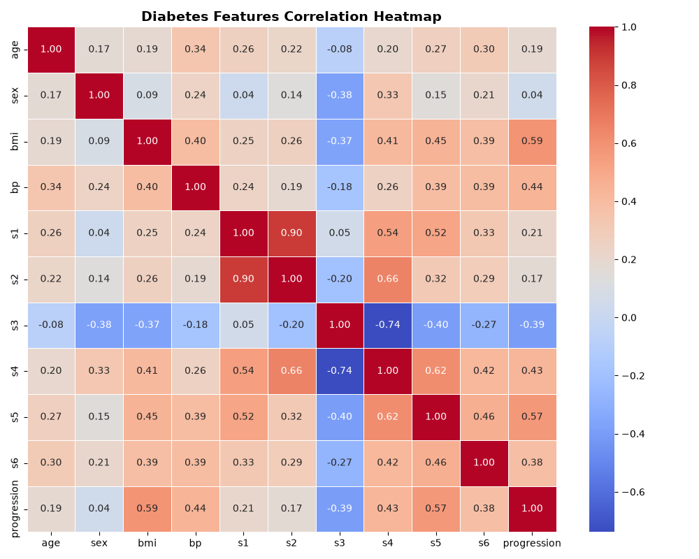
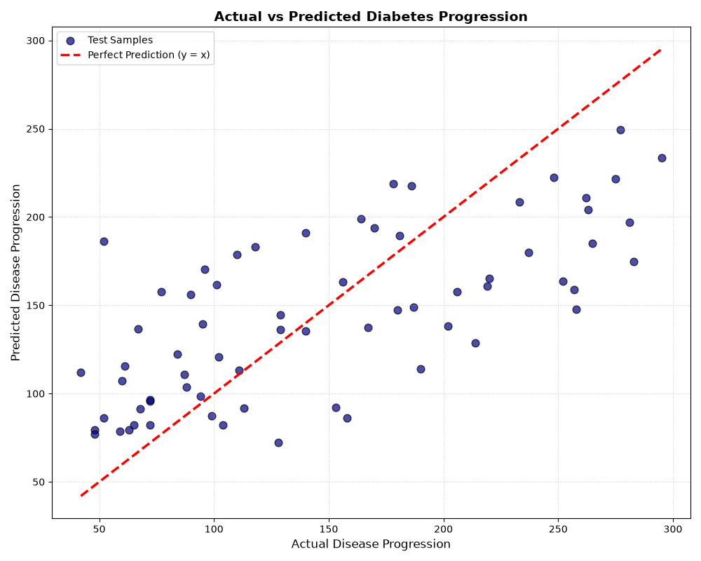
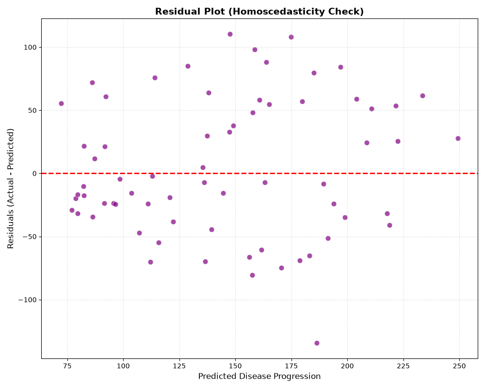
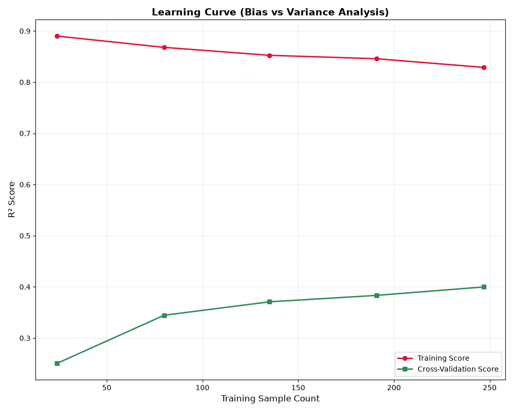
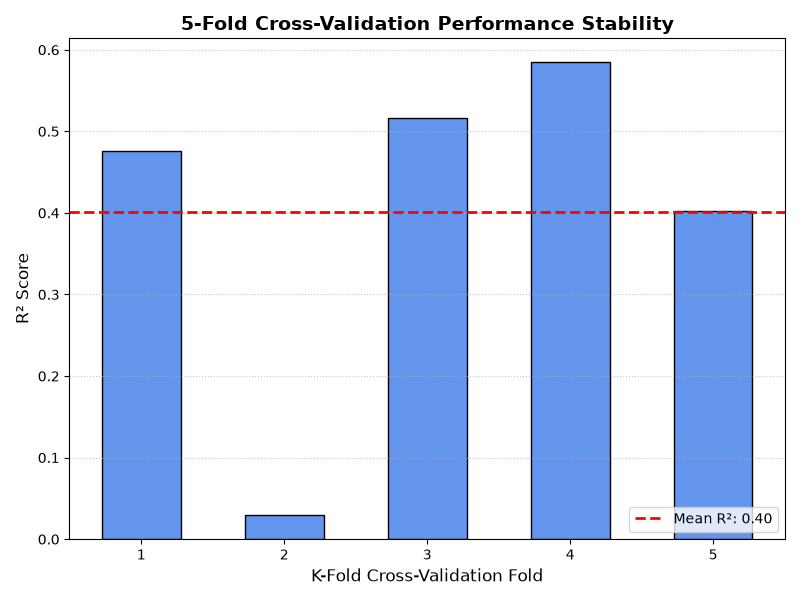
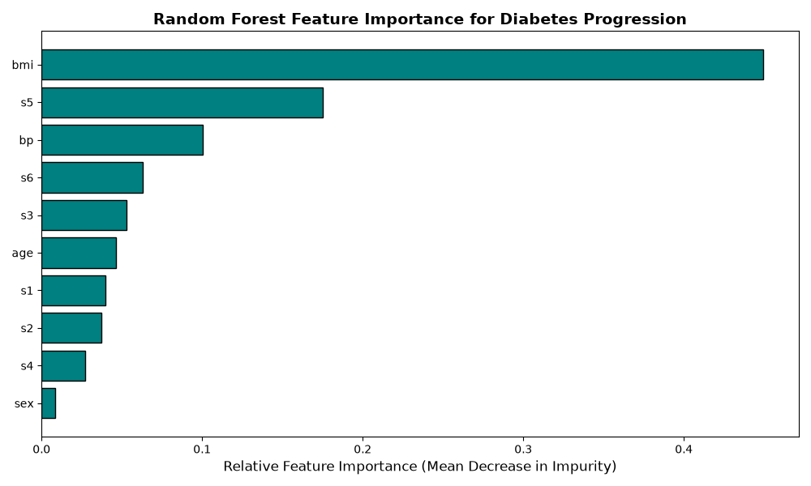

# Diabetes Progression Prediction

A complete end-to-end machine learning project that predicts the disease progression of diabetes in patients one year after baseline using diagnostic and blood serum measurements with a Random Forest Regressor and Ridge Regression, featuring extensive evaluation graphs and a dark-themed healthcare web interface for real-time prognosis.

---

## 🎯 Problem Statement & Objective

**Syllabus Mapping (Experiment 4):**
- **Objective:** Predict the progression of diabetes in patients one year after baseline using various diagnostic measurements.
- **Dataset:** The dataset includes physiological and clinical measurements such as body mass index (BMI), blood pressure, age, sex, and six blood serum measurements collected from a clinical study on diabetes progression.
- **Target Variable:** Quantitative measure of disease progression one year after baseline (continuous value ranging from 25 to 346).

---

## 🔬 Mathematical Formulation & ML Theory

### 1. Task Formulation
This problem is a **Supervised Regression** task where we learn a mapping function $f: \mathbb{R}^{10} \to \mathbb{R}$:
$$\hat{y} = f(X)$$
where $X = [x_1, x_2, \dots, x_{10}]$ corresponds to clinical measurements, and $y \in [25, 346]$ is the continuous progression index.

### 2. Random Forest Regressor
Random Forest is an ensemble of $B$ decorrelated regression trees built via bootstrap aggregating (bagging):
$$\hat{y}_{\text{RF}}(x) = \frac{1}{B} \sum_{b=1}^B T_b(x)$$

Each individual regression tree partition $R_m$ minimizes the **Mean Squared Error (MSE)** impurity:
$$H(R_m) = \frac{1}{|R_m|} \sum_{i \in R_m} (y_i - \bar{y}_{R_m})^2$$
At each split node, the feature $j$ and threshold $s$ are chosen to maximize the variance reduction:
$$\Delta H = H(R) - \left( \frac{|R_L|}{|R|} H(R_L) + \frac{|R_R|}{|R|} H(R_R) \right)$$

### 3. Regularization & Ridge Loss Comparison
For linear baselines, Ridge Regression minimizes the penalized residual sum of squares:
$$\mathcal{L}_{\text{Ridge}}(w) = \frac{1}{2n} \sum_{i=1}^n (y_i - x_i^T w)^2 + \frac{\alpha}{2} \|w\|_2^2$$
The L2 penalty $\frac{\alpha}{2} \sum_{j=1}^p w_j^2$ prevents exploding weights caused by multicollinearity among correlated blood serum components ($s1$ through $s6$).

### 4. Evaluation Metrics
- **Mean Squared Error (MSE):** $\text{MSE} = \frac{1}{n}\sum_{i=1}^n (y_i - \hat{y}_i)^2$
- **Root Mean Squared Error (RMSE):** $\text{RMSE} = \sqrt{\text{MSE}}$
- **Mean Absolute Error (MAE):** $\text{MAE} = \frac{1}{n}\sum_{i=1}^n |y_i - \hat{y}_i|$
- **Coefficient of Determination ($R^2$):**
  $$R^2 = 1 - \frac{\sum_{i=1}^n (y_i - \hat{y}_i)^2}{\sum_{i=1}^n (y_i - \bar{y})^2}$$

---

## 📁 Dataset Details

The dataset consists of 442 diabetes patients, recorded by Efron et al. (2004):
- **Age:** Patient age in years.
- **Sex:** Biological sex.
- **BMI:** Body mass index ($\text{kg/m}^2$). Strongest physiological predictor of metabolic resistance.
- **BP:** Average arterial blood pressure ($\text{mmHg}$).
- **S1 (tc):** Total serum cholesterol ($\text{mg/dL}$).
- **S2 (ldl):** Low-density lipoproteins.
- **S3 (hdl):** High-density lipoproteins.
- **S4 (tch):** Total cholesterol / HDL ratio.
- **S5 (ltg):** Log of serum triglycerides level.
- **S6 (glu):** Fasting blood glucose concentration.

**Data Storage:**
- Raw data: `data/raw/diabetes.csv` (100% stored locally, no external requests during execution).
- Processed splits: `data/processed/X_train.csv`, `X_val.csv`, `X_test.csv`, `y_train.csv`, `y_val.csv`, `y_test.csv`.
- Train/Val/Test ratio: 70% Training (309 samples), 15% Validation (66 samples), 15% Test (67 samples).

---

## ⚡ Quick Start

1. Clone or navigate to the repository directory:
   ```bash
   cd "4 Diabetes Progression Prediction"
   ```
2. Create and activate a virtual environment:
   ```bash
   python3 -m venv .venv
   source .venv/bin/activate
   ```
3. Install dependencies:
   ```bash
   pip install -r requirements.txt
   ```
4. Execute the complete data and modeling pipeline:
   ```bash
   python src/data/make_dataset.py
   python src/features/build_features.py
   python src/models/train_model.py
   python src/visualization/visualize.py
   ```
5. Launch the web application:
   ```bash
   python web/app.py
   ```
   Open `http://127.0.0.1:5003` in your browser.

---

## 📊 Results Summary

| Metric | Validation Set | Test Set | Cross-Validation (5-Fold Mean) |
|---|---|---|---|
| **$R^2$ Score** | 0.4707 | **0.4871** | 0.4017 (+/- 0.1952) |
| **MSE** | 2706.52 | **2912.01** | — |
| **RMSE** | 52.02 | **53.96** | — |
| **MAE** | 43.12 | **45.58** | — |

---

## 📈 Evaluation Graphs

All figures are automatically generated and saved in `reports/figures/`:

### 1. Feature Distributions
KDE and histogram distributions across patient age, BMI, blood pressure, lipid panels (s1, s5), and disease progression.


### 2. Pairwise Relationships
Pairplot demonstrating positive correlations between BMI, Serum Triglycerides ($s5$), and Diabetes Progression.


### 3. Correlation Heatmap
Pearson correlation matrix identifying multicollinearity among blood serum measurements ($s1$–$s6$) and clinical drivers of progression.


### 4. Actual vs Predicted Values
Scatter plot of actual patient progression versus model predictions, with red dashed diagonal line ($y = x$) representing perfect predictions.


### 5. Residual Plot
Residuals ($y - \hat{y}$) plotted against predicted progression verifying homoscedasticity and absence of non-linear bias.


### 6. Learning Curve
Diagnostic curve depicting training vs cross-validation $R^2$ scores across increasing training sample sizes to assess bias and variance.


### 7. Cross-Validation Scores
Bar chart of 5-fold cross-validation showing stability and generalization across distinct patient splits.


### 8. Feature Importances
Random Forest Mean Decrease in Impurity (MDI) ranking, verifying Body Mass Index (BMI) and Log Serum Triglycerides ($s5$) as the dominant prognostic markers.


---

## 💻 Project Structure

```
4 Diabetes Progression Prediction/
├── .gitignore
├── LICENSE
├── README.md
├── CONTRIBUTING.md
├── SECURITY.md
├── CITATION.cff
├── accuracy.txt
├── guide.txt
├── requirements.txt
├── note/
│   └── 4_Diabetes_Viva_Guide.md
├── data/
│   ├── raw/
│   │   └── diabetes.csv
│   └── processed/
│       ├── X_train.csv
│       ├── X_val.csv
│       ├── X_test.csv
│       ├── y_train.csv
│       ├── y_val.csv
│       ├── y_test.csv
│       └── scaler.joblib
├── models/
│   └── diabetes_model.joblib
├── reports/
│   └── figures/
│       ├── 01_feature_distributions.png (or feature_distributions.png)
│       ├── heatmap.png
│       ├── pairplot.png
│       ├── actual_vs_predicted.png
│       ├── residual_plot.png
│       ├── learning_curve.png
│       ├── cross_validation.png
│       └── feature_importances.png
├── src/
│   ├── __init__.py
│   ├── data/
│   │   └── make_dataset.py
│   ├── features/
│   │   └── build_features.py
│   ├── models/
│   │   ├── train_model.py
│   │   └── predict_model.py
│   └── visualization/
│       └── visualize.py
└── web/
    ├── app.py
    ├── templates/
    │   └── index.html
    └── static/
        ├── css/
        │   └── style.css
        └── js/
            └── script.js
```
