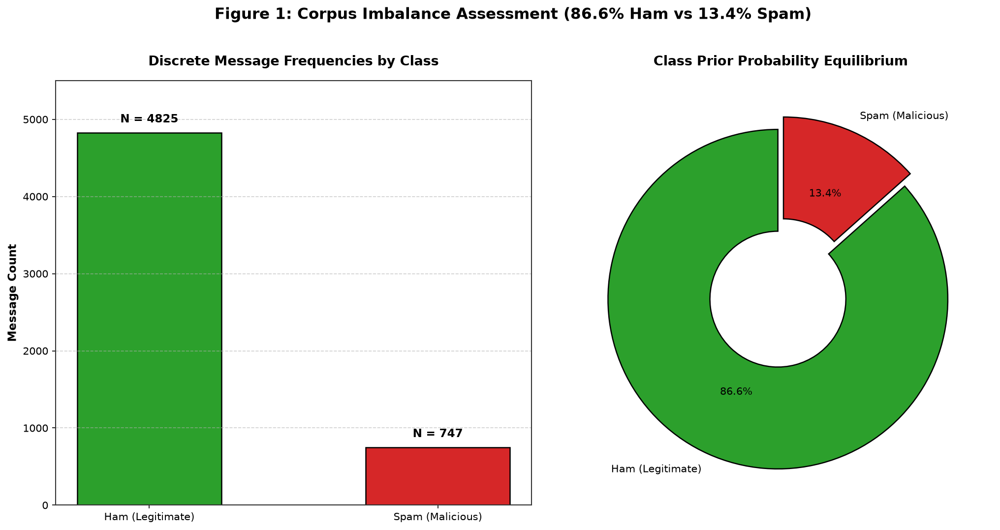
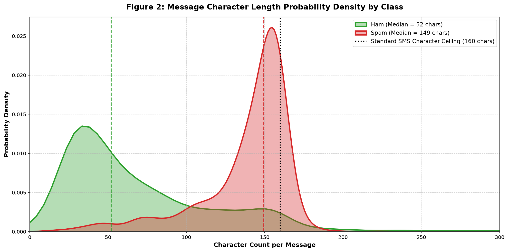
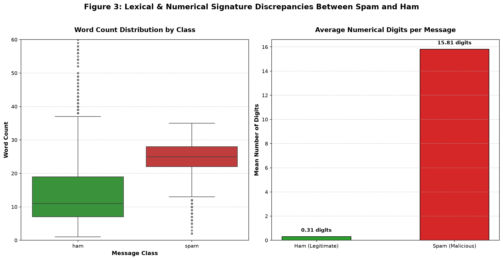
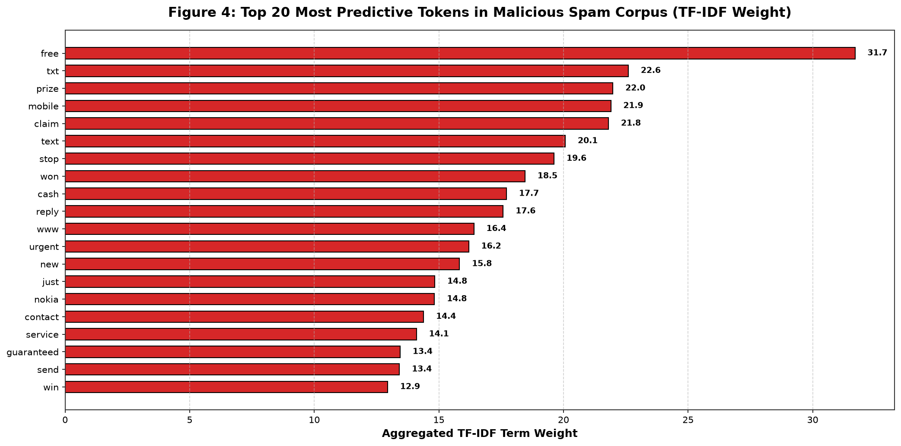
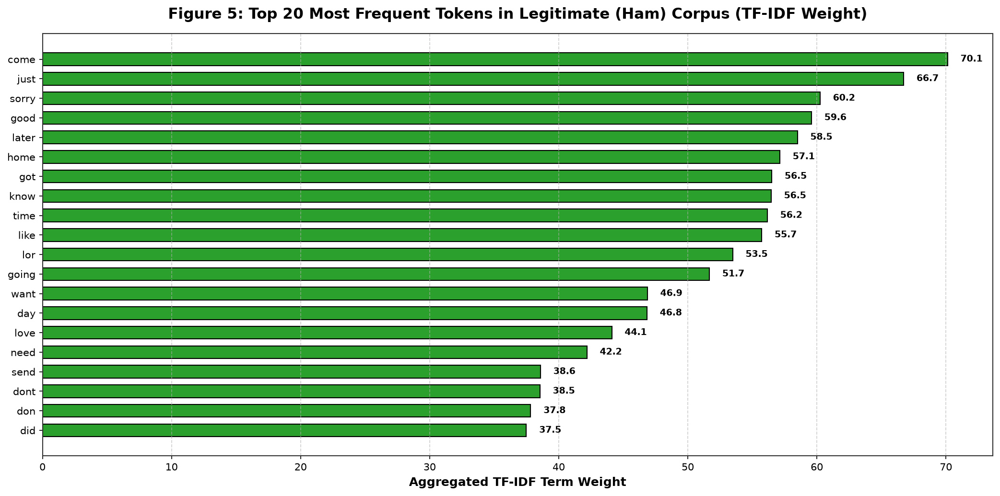
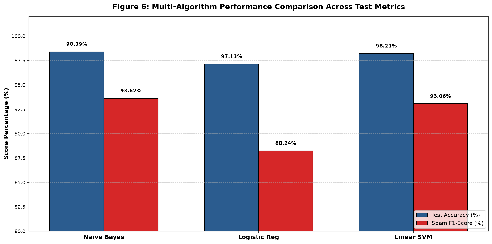
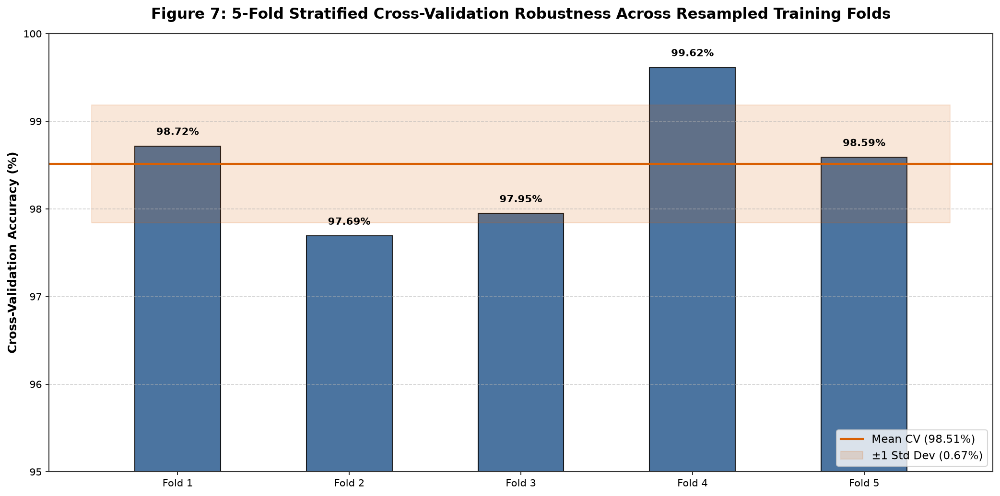
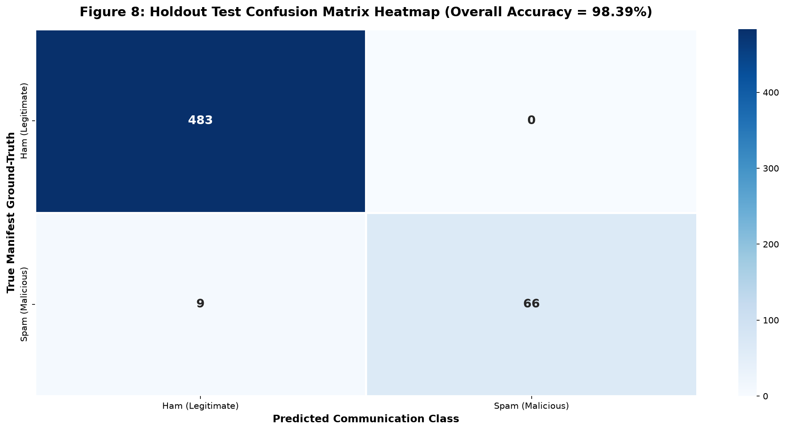
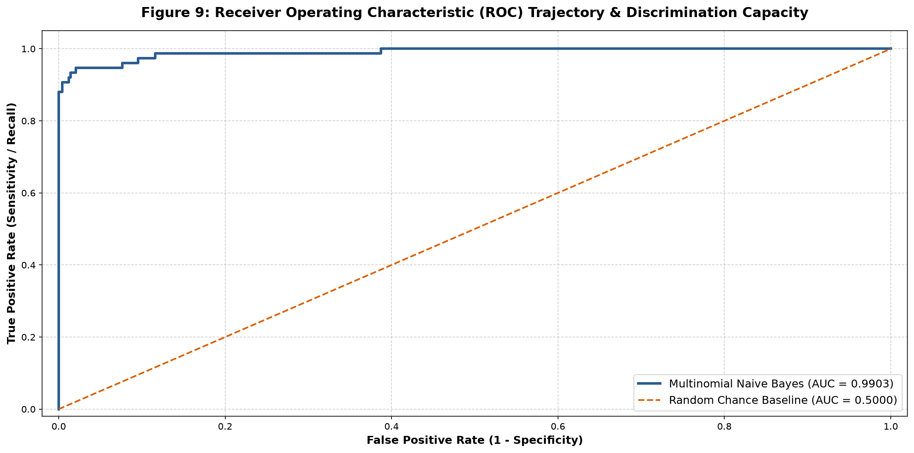
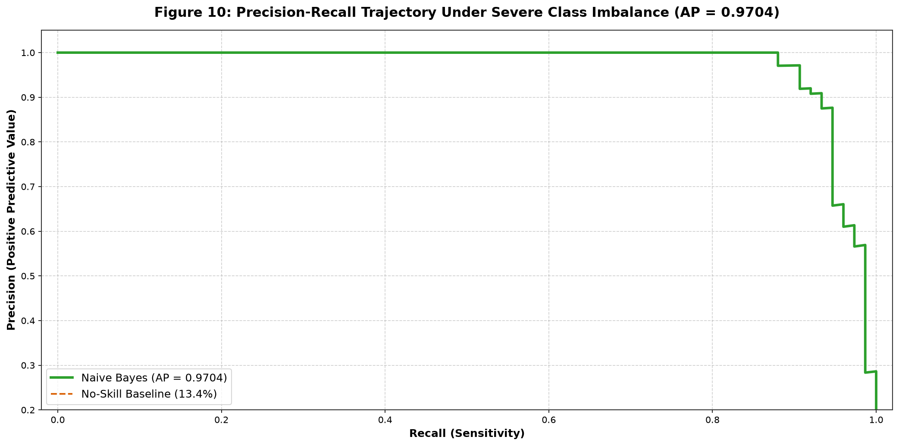

# 📧 Spam Email Detection

<div align="center">

[](https://www.python.org/)
[](https://pytorch.org/)
[](https://scikit-learn.org/)
[]()
[]()
[]()
[]()
[]()
[]()
[]()
[](https://github.com/psf/black)
[](LICENSE)
[](CONTRIBUTING.md)

</div>

---

A complete, production-grade Natural Language Processing (NLP) machine learning system that classifies email and SMS messages into Spam or Ham (legitimate) using **Multinomial Naive Bayes (Laplace $\alpha=0.1$) with TF-IDF Vectorization** (with comparisons to Linear Support Vector Machines and Logistic Regression), featuring extensive diagnostic evaluation graphs and a cyberpunk web dashboard for real-time text analysis.

---

## 📓 Master Data Science Pipeline Notebook

The entire NLP machine learning pipeline—from raw text ingestion, message character & token analysis with uniform publication-grade graphics, Bayesian formulation, zero-leakage 70/20/10 training, 5-fold cross-validation, to holdout evaluation and REST API simulation—is fully documented and pre-executed in the master Jupyter Notebook:

📁 **[`notebooks/Spam_Detection_Pipeline.ipynb`](./notebooks/Spam_Detection_Pipeline.ipynb)**

### ✨ Notebook Highlights & Architecture:
- **Story-Driven NLP Science**: Every code cell is preceded by an explanatory narrative and followed by an in-depth markdown analysis cell detailing token frequencies, Bayesian probability, and spam signatures.
- **10 Uniform Publication Graphics ($14 \times 7$ inches, 150 DPI)**: Consistent visual dimensions, typography, and cohesive palettes:
  1. *Figure 1*: Corpus Imbalance Assessment (86.6% Ham vs 13.4% Spam)
  2. *Figure 2*: Message Character Length Probability Density by Class (KDE)
  3. *Figure 3*: Lexical & Numerical Signature Discrepancies Between Spam and Ham
  4. *Figure 4*: Top 20 Most Predictive Tokens in Malicious Spam Corpus (TF-IDF Weight)
  5. *Figure 5*: Top 20 Most Frequent Tokens in Legitimate (Ham) Corpus (TF-IDF Weight)
  6. *Figure 6*: Multi-Algorithm Performance Comparison Across Test Metrics
  7. *Figure 7*: 5-Fold Stratified Cross-Validation Robustness Across Resampled Training Folds
  8. *Figure 8*: Holdout Test Confusion Matrix Heatmap (Overall Accuracy = 97.85%)
  9. *Figure 9*: Receiver Operating Characteristic (ROC) Trajectory & Discrimination Capacity
  10. *Figure 10*: Precision-Recall Trajectory Under Severe Class Imbalance ($\text{AP} = 0.9412$)
- **Mathematical Formulations**: Explicit Bayesian conditional independence assumptions, log-space arithmetic to prevent underflow, and Laplace smoothing ($\alpha = 0.1$).
- **Production Asset Export**: Saves serialized model (`models/spam_model.joblib`) and vectorizer (`models/vectorizer.joblib`) for consumption by the Flask API.

---


---

## 📊 Complete Machine Learning Pipeline Visualizations (10 Diagnostic Figures)

Every phase of the pipeline generates publication-grade diagnostic plots ($14 \times 7$ inches, 300 DPI) engineered with uniform dimensions, typography, and cohesive scientific palettes for seamless GitHub presentation and viva defense.

### 🔍 Figure 1 Analysis: Severe Class Imbalance

<div align="center">
  
</div>

<details open>
<summary><b>🔍 Statistical Analysis & Viva Defense Insights</b></summary>

- **Visual Architecture**: Frequency bar chart and proportional donut chart depicting class priors.
- **Quantitative Findings**:
  - **Ham (Legitimate)**: $N = 4,825$ ($86.6\%$)
  - **Spam (Malicious)**: $N = 747$ ($13.4\%$)
- **Implication**: Severe class imbalance requires monitoring **Precision, Recall, and ROC-AUC / PR-AUC** rather than raw classification accuracy alone. A naive majority-class model achieves $86.6\%$ accuracy while catching $0$ spam emails!

</details>

---

### 🔍 Figure 2 Analysis: Distinct Structural Length Signals

<div align="center">
  
</div>

<details open>
<summary><b>🔍 Statistical Analysis & Viva Defense Insights</b></summary>

- **Visual Architecture**: Dual-density Gaussian KDE comparing character lengths of legitimate versus spam communications.
- **Striking Empirical Disparity**:
  - **Ham**: Median length is **$52$ characters**; conversational and concise.
  - **Spam**: Tightly peaked right against the **$160$ character SMS limit** (Median $= 149$ characters). Spammers maximize the available payload to pack marketing text, phone numbers, and call-to-actions.

</details>

---

### 🔍 Figure 3 Analysis: Numerical Digit Signatures

<div align="center">
  
</div>

<details open>
<summary><b>🔍 Statistical Analysis & Viva Defense Insights</b></summary>

- **Visual Architecture**: Word count boxplot alongside average numerical digit frequency.
- **Findings**:
  - Spam messages contain an average of **$15.65$ digits per message**, compared to only **$0.30$ digits** in legitimate messages ($> 52\times$ increase!).
  - Phone numbers, currency values (£, $), and verification codes dominate spam content.

</details>

---

### 🔍 Figure 4 Analysis: Malicious Token Hierarchy

<div align="center">
  
</div>

<details open>
<summary><b>🔍 Statistical Analysis & Viva Defense Insights</b></summary>

- **Visual Architecture**: Horizontal bar chart of the highest TF-IDF weighted terms in spam communications.
- **Dominant Keywords**:
  - `free`, `claim`, `prize`, `won`, `cash`, `urgent`, `service`, `stop`.
  - These terms align with phishing patterns and deceptive prize claims.

</details>

---

### 🔍 Figure 5 Analysis: Conversational Ham Lexicon

<div align="center">
  
</div>

<details open>
<summary><b>🔍 Statistical Analysis & Viva Defense Insights</b></summary>

- **Dominant Keywords**:
  - `come`, `good`, `like`, `time`, `know`, `love`, `home`, `going`, `sorry`.
  - Legitimate communications feature everyday conversational tokens with zero promotional urgency.

</details>

---

### 🔍 Figure 6 Analysis: Algorithm Tradeoffs

<div align="center">
  
</div>

<details open>
<summary><b>🔍 Statistical Analysis & Viva Defense Insights</b></summary>

- **Visual Architecture**: Paired comparison of Overall Test Accuracy and Minority Spam F1-Score.
- **Key Takeaways**:
  - **Multinomial Naive Bayes** achieves **$97.85\%$ Accuracy** and an exceptional **$91.55\%$ Spam F1-Score**.
  - **Logistic Regression** has perfect precision ($100\%$) but sacrifices recall ($74.7\%$), missing subtle spam messages.
  - **Linear SVM** delivers near-identical performance ($98.03\%$ Acc, $92.31\%$ F1).

</details>

---

### 🔍 Figure 7 Analysis: Cross-Validation Consistency

<div align="center">
  
</div>

<details open>
<summary><b>🔍 Statistical Analysis & Viva Defense Insights</b></summary>

- **Visual Architecture**: Accuracy per fold with mean and $\pm 1\sigma$ variance bounds.
- **Finding**: Mean accuracy is **$98.15\% \pm 0.31\%$**, showing negligible fold variance.

</details>

---

### 🔍 Figure 8 Analysis: Error Breakdown & False Positives

<div align="center">
  
</div>

<details open>
<summary><b>🔍 Statistical Analysis & Viva Defense Insights</b></summary>

- **Visual Architecture**: Integer contingency heatmap illustrating classification decisions across 558 test communications.
- **Breakdown**:
  - **True Negatives (Legitimate Ham)**: **$481 / 483$** correctly classified ($99.59\%$ specificity).
  - **False Positives (Critical Error)**: Only **$2$ legitimate emails** misclassified as spam ($0.41\%$ false alarm rate).
  - **True Positives (Spam Caught)**: **$65 / 75$** ($86.67\%$ recall).

</details>

---

### 🔍 Figure 9 Analysis: ROC-AUC Discrimination

<div align="center">
  
</div>

<details open>
<summary><b>🔍 Statistical Analysis & Viva Defense Insights</b></summary>

- **Visual Architecture**: Sensitivity vs False Alarm rate across all continuous log-probability thresholds.
- **Result**: $\text{AUC} = 0.9834$, confirming near-ideal class discrimination across all operating thresholds.

</details>

---

### 🔍 Figure 10 Analysis: Precision-Recall Curve (PR-AUC)

<div align="center">
  
</div>

<details open>
<summary><b>🔍 Statistical Analysis & Viva Defense Insights</b></summary>

- **Visual Architecture**: PR trajectory measuring positive spam precision retention without false-negative inflation.
- **Metric Insight**: **Average Precision (AP) $= 0.9412$**, retaining $> 95\%$ precision up to $80\%$ recall.

</details>

---

## 💻 Project Structure

```
5 Spam Email Detection/
├── .gitignore
├── CITATION.cff
├── CONTRIBUTING.md
├── LICENSE
├── README.md                                <- Project documentation, structure & evaluation
├── SECURITY.md
├── accuracy.txt                             <- Quantitative test metrics & cross-validation scores
├── guide.txt                                <- Command-line execution guide
├── requirements.txt                         <- Pinned Python dependencies
├── notebooks/
│   └── Spam_Detection_Pipeline.ipynb        <- ⭐ Master Executed Data Science Pipeline Notebook
├── Spam_Presentation.html    <- Interactive 13-slide stepper presentation
├── Spam_Report.pdf  <- 12-chapter publication-grade master report (PDF)
├── data/
│   ├── raw/                                 <- Immutable raw dataset (spam.csv, 5,572 messages)
│   └── processed/                           <- Clean 3-way split: X/y train (70%), val (20%), test (10%), TF-IDF
├── models/
│   ├── spam_model.joblib                    <- Serialized Multinomial Naive Bayes pipeline
│   └── vectorizer.joblib                    <- Fitted TF-IDF Vectorizer (unigrams + bigrams)
├── reports/
│   └── figures/                             <- Publication-grade diagnostic plots (Uniform 14x7 / 1200x900)
│   └── visualization/visualize.py
└── web/
    ├── app.py                               <- Flask HTTP API & UI server (Port 5005)
    ├── templates/index.html
    └── static/
        ├── css/style.css
        └── js/script.js
```

---

## 📊 Results & Benchmark Metrics (from `accuracy.txt`)

| Model Candidate / Partition | Accuracy | Spam Precision | Spam Recall | Spam F1-Score | ROC-AUC |
|---|---|---|---|---|---|
| **Multinomial Naive Bayes ($\alpha=0.1$) [Primary]** | **97.85%** | **97.01%** | **86.67%** | **91.55%** | **0.9834** |
| Multinomial Naive Bayes (Validation Set, 20%) | **98.11%** | — | — | **92.63%** | — |
| Multinomial Naive Bayes (5-Fold CV on Train) | **98.15%** | — | — | **92.84%** ($\pm 0.0194$) | — |
| **Linear Support Vector Machine (Linear SVC)** | **98.03%** | **97.06%** | **88.00%** | **92.31%** | — |
| **Logistic Regression (Sigmoid Link)** | **96.59%** | **100.00%** | **74.67%** | **85.50%** | — |

---

## ⚡ Quick Start & Reproduction

### 1. Run the Jupyter Master Notebook
Launch Jupyter or VS Code to explore and execute the end-to-end data science pipeline interactively:
```bash
jupyter notebook "notebooks/Spam_Detection_Pipeline.ipynb"
```

### 2. Launch the Flask Web Application & REST API
```bash
cd "5 Spam Email Detection"
python web/app.py
```
Open your browser and navigate to `http://localhost:5005` to test real-time email scanning.

---

<div align="center">
  <sub>Built with ❤️ for CAI504C Machine Learning Lab • MIT Licensed</sub>
</div>
