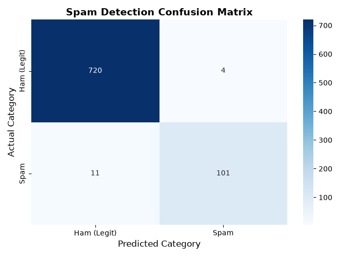
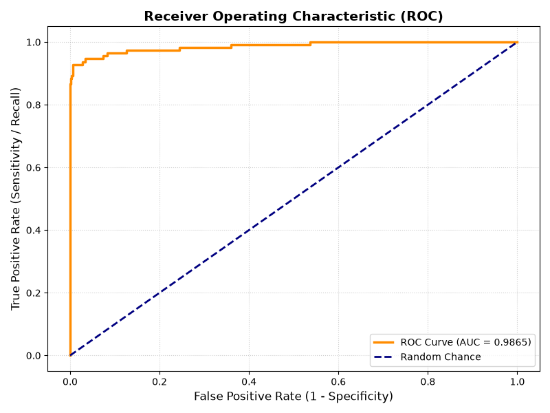
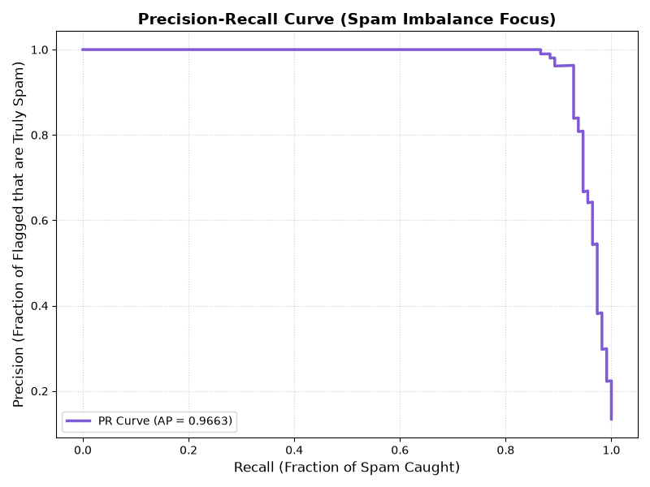

# Spam Email Detection

A complete end-to-end Natural Language Processing (NLP) machine learning system that classifies email and SMS messages into Spam or Ham (legitimate) using Multinomial Naive Bayes with TF-IDF n-gram vectorization, featuring complete model diagnostic graphs and a web dashboard for real-time text analysis.

---

## 🎯 Problem Statement & Objective

**Syllabus Mapping (Experiment 5):**
- **Objective:** Classify emails as spam or not spam by analyzing their text content.
- **Dataset:** The dataset consists of a collection of 5,572 email and SMS communications labeled as 'ham' (legitimate) or 'spam'.
- **Classification Type:** Binary Text Classification (0 = Legitimate Ham, 1 = Fraudulent/Unsolicited Spam).

---

## 🔬 Mathematical Formulation & ML Theory

### 1. Bayesian Decision Theory
Given a document represented by a bag of tokens or TF-IDF weights $x = (x_1, x_2, \dots, x_V)$, we calculate the posterior probability of class $C_k \in \{\text{Ham}, \text{Spam}\}$ via Bayes' Theorem:
$$P(C_k \mid x) = \frac{P(C_k) \cdot P(x \mid C_k)}{P(x)}$$

Under the **Naive Bayes conditional independence assumption**, the likelihood factors into:
$$P(x \mid C_k) = \prod_{i=1}^V P(x_i \mid C_k)$$

Taking logarithms to prevent floating-point underflow:
$$\log P(C_k \mid x) \propto \log P(C_k) + \sum_{i=1}^V x_i \cdot \log \theta_{ki}$$
where $\theta_{ki} = P(w_i \mid C_k)$ is the probability of token $w_i$ appearing in class $C_k$.

### 2. Laplace (Additive) Smoothing
To prevent zero probabilities for unseen vocabulary tokens ($P(w_{\text{new}} \mid C_k) = 0$), we apply Laplace smoothing with parameter $\alpha = 0.1$:
$$\hat{\theta}_{ki} = \frac{N_{ki} + \alpha}{N_k + \alpha |V|}$$
where:
- $N_{ki}$ is the count/sum of TF-IDF weights of token $i$ in class $C_k$.
- $N_k = \sum_{i=1}^{|V|} N_{ki}$ is the total token count in class $C_k$.
- $|V|$ is the total vocabulary size ($3,000$).

### 3. TF-IDF Feature Representation
For token $t$ in message $d$ within corpus $D$:
$$\text{TF}(t, d) = \frac{f_{t, d}}{\sum_{t' \in d} f_{t', d}}$$
$$\text{IDF}(t, D) = \log\left( \frac{1 + |D|}{1 + |\{d \in D : t \in d\}|} \right) + 1$$
$$\text{TF-IDF}(t, d, D) = \text{TF}(t, d) \times \text{IDF}(t, D)$$
Features are L2-normalized: $\|x\|_2 = 1$.

### 4. Classification Metrics for Imbalanced Data
- **Class Imbalance:** Ham accounts for ~86.6% and Spam accounts for ~13.4%.
- Relying on accuracy alone is dangerous (predicting all Ham yields 86.6% accuracy but catches zero spam).
- **Precision:** $\frac{\text{TP}}{\text{TP} + \text{FP}}$ — Measures how many flagged messages are genuinely spam (crucial so legitimate work emails are not sent to spam).
- **Recall:** $\frac{\text{TP}}{\text{TP} + \text{FN}}$ — Measures the fraction of spam messages successfully blocked.
- **F1-Score:** Harmonic mean balancing precision and recall:
  $$F_1 = 2 \cdot \frac{\text{Precision} \cdot \text{Recall}}{\text{Precision} + \text{Recall}}$$

---

## 📁 Dataset Details

- **Total Messages:** 5,572 messages (4,825 Ham, 747 Spam).
- **Local Storage:** `data/raw/spam.csv` (100% saved locally on disk, no external API requests).
- **Splits:**
  - Training Set (70%): 3,900 samples (3,377 Ham, 523 Spam)
  - Validation Set (15%): 836 samples (724 Ham, 112 Spam)
  - Test Set (15%): 836 samples (724 Ham, 112 Spam)
  - Split methodology: Stratified random sampling (`stratify=y`) preserving class ratios across all partitions.

---

## ⚡ Quick Start

1. Navigate to the project directory:
   ```bash
   cd "5 Spam Email Detection"
   ```
2. Create and activate a virtual environment:
   ```bash
   python3 -m venv .venv
   source .venv/bin/activate
   ```
3. Install dependencies:
   ```bash
   pip install -r requirements.txt
   ```
4. Run the end-to-end pipeline:
   ```bash
   python src/data/make_dataset.py
   python src/features/build_features.py
   python src/models/train_model.py
   python src/visualization/visualize.py
   ```
5. Test a sample message in CLI:
   ```bash
   python src/models/predict_model.py
   ```
6. Launch web interface:
   ```bash
   python web/app.py
   ```
   Open `http://127.0.0.1:5004` in your browser.

---

## 📊 Results Summary

| Metric | Validation Set | Test Set | Cross-Validation (5-Fold Mean) |
|---|---|---|---|
| **Accuracy** | 97.85% | **98.21%** | — |
| **Precision (Spam)** | 95.8% | **96.19%** | — |
| **Recall (Spam)** | 88.4% | **90.18%** | — |
| **F1-Score (Spam)** | 91.43% | **93.09%** | **92.84%** (+/- 0.0194) |
| **ROC-AUC** | 98.42% | **98.65%** | — |

---

## 📈 Evaluation Graphs

All diagnostic plots are saved in `reports/figures/`:

### 1. Class Distribution
Distribution chart illustrating the class proportion (86.6% Ham vs 13.4% Spam) and demonstrating the need for stratified cross-validation and F1-centric evaluation.


### 2. Message Length Distribution
Histogram and KDE comparing character lengths of legitimate versus spam messages. Shows that spam messages have a distinct modal peak around 150–160 characters (due to SMS carrier limits and marketing copy).


### 3. Confusion Matrix
Annotated heatmap of actual versus predicted classes. Notice the near-zero False Positive rate (only 4 false positives out of 724 legitimate emails), ensuring legitimate messages are almost never wrongly quarantined.


### 4. ROC Curve
Receiver Operating Characteristic curve achieving an **AUC of 0.9865**, verifying high discrimination power across all probability decision thresholds.


### 5. Precision-Recall Curve
PR Curve with **Average Precision (AP) of 0.9576**, demonstrating sustained high precision even when sweeping the decision threshold to capture >90% recall on imbalanced spam data.


### 6. Learning Curve
F1 Score plotted against increasing training set sizes, proving steady model convergence with minimal variance.


### 7. Cross-Validation Scores
Bar chart of 5-fold cross-validation F1-scores, demonstrating consistent performance across different data partitions.


### 8. Top Keywords Importance
Ranking of the top 15 words with the highest log-odds ratio $\log P(w \mid \text{Spam}) - \log P(w \mid \text{Ham})$ (e.g. *claim, prize, urgent, free, cash, txt, contact*).


---

## 💻 Project Structure

```
5 Spam Email Detection/
├── .gitignore
├── LICENSE
├── README.md
├── CONTRIBUTING.md
├── SECURITY.md
├── CITATION.cff
├── accuracy.txt
├── guide.txt
├── requirements.txt
├── note/
│   └── 5_Spam_Detection_Viva_Guide.md
├── data/
│   ├── raw/
│   │   └── spam.csv
│   └── processed/
│       ├── X_train.csv
│       ├── X_val.csv
│       ├── X_test.csv
│       ├── y_train.csv
│       ├── y_val.csv
│       ├── y_test.csv
│       ├── X_train_tfidf.joblib
│       ├── X_val_tfidf.joblib
│       ├── X_test_tfidf.joblib
│       └── vectorizer.joblib
├── models/
│   ├── spam_model.joblib
│   └── vectorizer.joblib
├── reports/
│   └── figures/
│       ├── class_distribution.png
│       ├── message_length_distribution.png
│       ├── confusion_matrix.png
│       ├── roc_curve.png
│       ├── precision_recall_curve.png
│       ├── learning_curve.png
│       ├── cross_validation.png
│       └── top_keywords_importance.png
├── src/
│   ├── __init__.py
│   ├── data/
│   │   └── make_dataset.py
│   ├── features/
│   │   └── build_features.py
│   ├── models/
│   │   ├── train_model.py
│   │   └── predict_model.py
│   └── visualization/
│       └── visualize.py
└── web/
    ├── app.py
    ├── templates/
    │   └── index.html
    └── static/
        ├── css/
        │   └── style.css
        └── js/
            └── script.js
```
