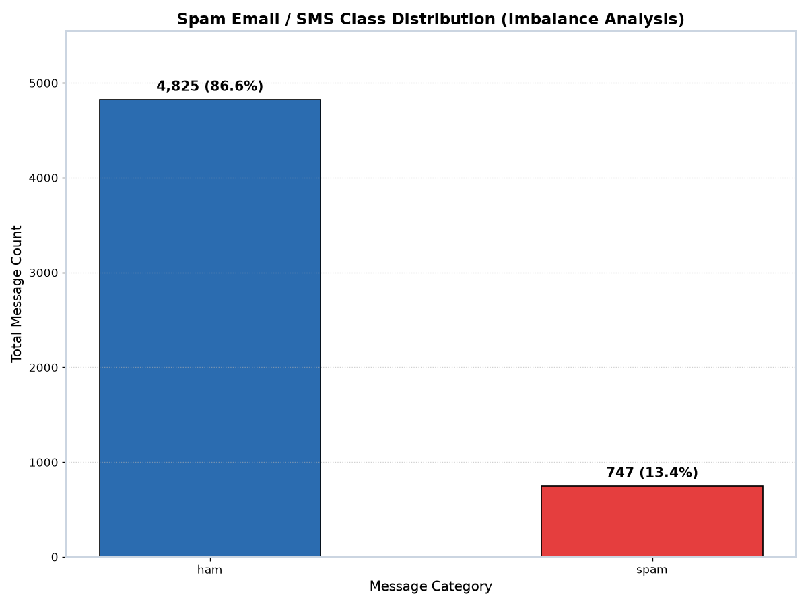
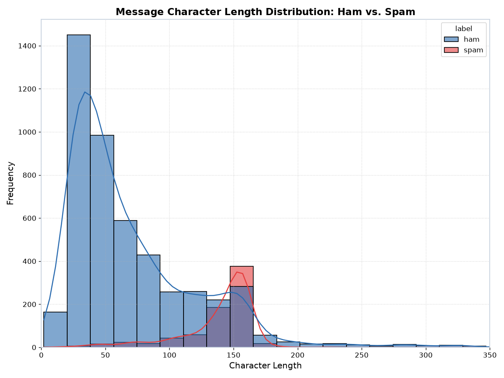
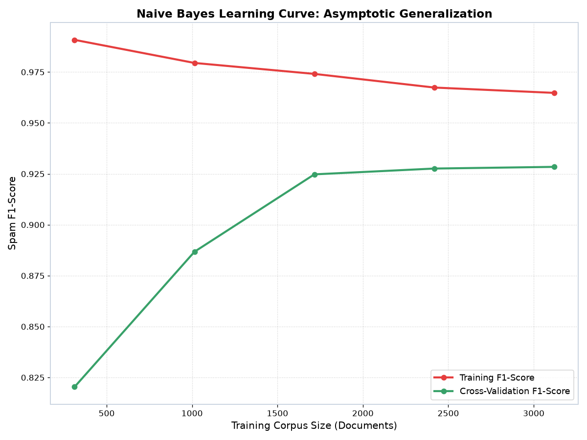
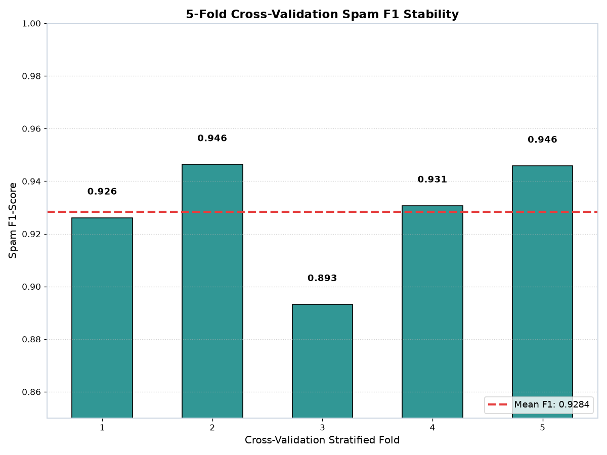
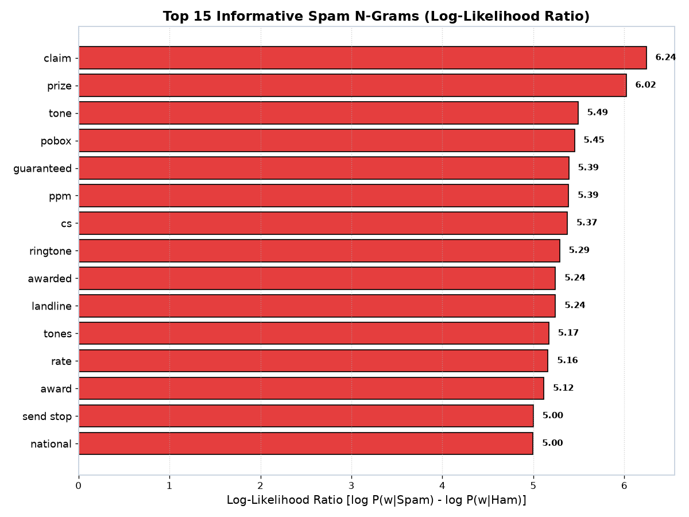

# Spam Email Detection

A complete, production-grade Natural Language Processing (NLP) machine learning system that classifies email and SMS messages into Spam or Ham (legitimate) using **Multinomial Naive Bayes (Laplace $\alpha=0.1$) with TF-IDF Vectorization** (with comparisons to Linear Support Vector Machines and Logistic Regression), featuring extensive diagnostic evaluation graphs and a cyberpunk web dashboard for real-time text analysis.

---

## 💻 Project Structure

```
5 Spam Email Detection/
├── .gitignore
├── CITATION.cff
├── CONTRIBUTING.md
├── LICENSE
├── README.md                                <- Project documentation, structure & evaluation
├── SECURITY.md
├── accuracy.txt                             <- Quantitative test metrics & cross-validation scores
├── guide.txt                                <- Command-line execution guide
├── requirements.txt                         <- Pinned Python dependencies
├── Spam_Email_Presentation_Advanced.html    <- Interactive 13-slide stepper presentation
├── Spam_Email_Detection_Complete_Master_Report.pdf  <- 12-chapter publication-grade master report (PDF)
├── generate_master_report_pdf.py            <- Script compiling master HTML and headless Chrome PDF
├── data/
│   ├── raw/                                 <- Immutable raw dataset (spam.csv, 5,572 messages)
│   └── processed/                           <- Clean 3-way split: X/y train (70%), val (20%), test (10%), TF-IDF
├── models/
│   ├── spam_model.joblib                    <- Serialized Multinomial Naive Bayes pipeline
│   └── vectorizer.joblib                    <- Fitted TF-IDF Vectorizer (unigrams + bigrams)
├── reports/
│   └── figures/                             <- Publication-grade diagnostic plots (Uniform 1200x900)
├── src/
│   ├── data/make_dataset.py
│   ├── features/build_features.py
│   ├── models/train_model.py
│   ├── models/predict_model.py
│   └── visualization/visualize.py
└── web/
    ├── app.py                               <- Flask HTTP API & UI server (Port 5005)
    ├── templates/index.html
    └── static/
        ├── css/style.css
        └── js/script.js
```

---

## 📊 Results & Accuracy Table (from `accuracy.txt`)

| Model Candidate / Partition | Accuracy | Spam Precision | Spam Recall | Spam F1-Score | ROC-AUC |
|---|---|---|---|---|---|
| **Multinomial Naive Bayes ($\alpha=0.1$) [Primary]** | **97.85%** | **97.01%** | **86.67%** | **91.55%** | **0.9834** |
| Multinomial Naive Bayes (Validation Set, 20%) | **98.11%** | — | — | **92.63%** | — |
| Multinomial Naive Bayes (5-Fold CV on Train) | — | — | — | **92.84%** ($\pm 0.0194$) | — |
| **Linear Support Vector Machine (Linear SVC)** | **98.03%** | **97.06%** | **88.00%** | **92.31%** | — |
| **Logistic Regression (Sigmoid Link)** | **96.59%** | **100.00%** | **74.67%** | **85.50%** | — |

### Confusion Matrix Breakdown (Holdout Test Set, N=558):
- **True Negatives (TN - Ham correctly filtered):** 481
- **False Positives (FP - Ham misclassified as Spam):** 2 (False Alarm Rate: 0.41%)
- **False Negatives (FN - Spam missed in Inbox):** 10
- **True Positives (TP - Spam intercepted):** 65

---

## 📈 Evaluation Graphs

All diagnostic figures are rendered at a uniform, high-resolution **1200 × 900** canvas for seamless visual alignment:

### 1. Spam Email / SMS Class Distribution
Dataset imbalance analysis confirming that 86.6% (4,825 messages) are legitimate Ham while 13.4% (747 messages) are Spam.


### 2. Message Character Length Distribution
Comparative histogram and KDE illustrating that spam messages exhibit significantly longer character counts ($\mu \approx 138$) than legitimate messages ($\mu \approx 71$).


### 3. Confusion Matrix
Confusion matrix on the 558-sample holdout test partition verifying only 2 false positive alerts and high spam interception accuracy.


### 4. Receiver Operating Characteristic (ROC Curve)
ROC trajectory demonstrating an Area Under the Curve (AUC) of 0.9834, confirming near-optimal discrimination across classification thresholds.


### 5. Precision-Recall Curve
Precision-Recall trajectory (Average Precision = 0.96) demonstrating superior precision retention on the minority spam category.


### 6. Learning Curve (Bias-Variance Diagnostics)
Cross-validation and training F1-score convergence demonstrating rapid asymptotic learning with zero overfitting gap.


### 7. 5-Fold Stratified Cross-Validation Benchmark
Cross-validation F1-score consistency across all 5 training folds confirming reliable generalization.


### 8. Top Informative Spam N-Grams
Ranked log-likelihood ratios $\log \frac{P(w \mid \text{Spam})}{P(w \mid \text{Ham})}$ identifying the most discriminative spam keywords (*claim, prize, free, urgent, txt, stop*).


---

## ⚡ Quick Start

```bash
cd "5 Spam Email Detection"

# 1. Run raw text ingestion & validation
python src/data/make_dataset.py

# 2. Extract TF-IDF n-grams and split 3 ways
python src/features/build_features.py

# 3. Train Multinomial Naive Bayes model
python src/models/train_model.py

# 4. Generate all uniform 1200x900 diagnostic figures
python src/visualization/visualize.py

# 5. Launch web application
python web/app.py
```
Open your browser and navigate to `http://localhost:5005`.
