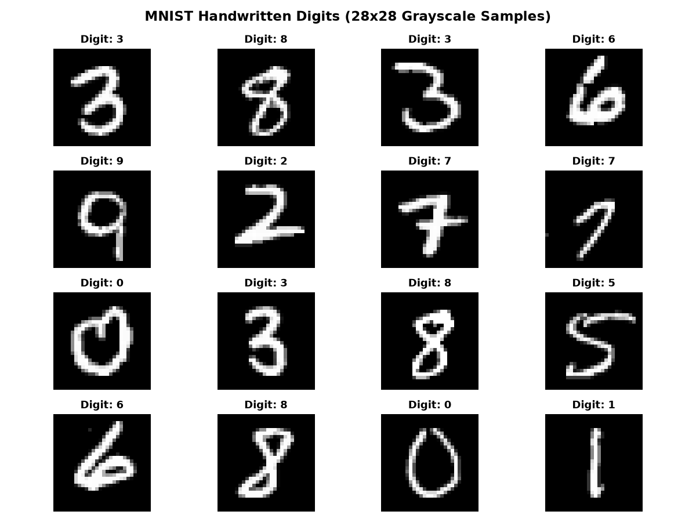
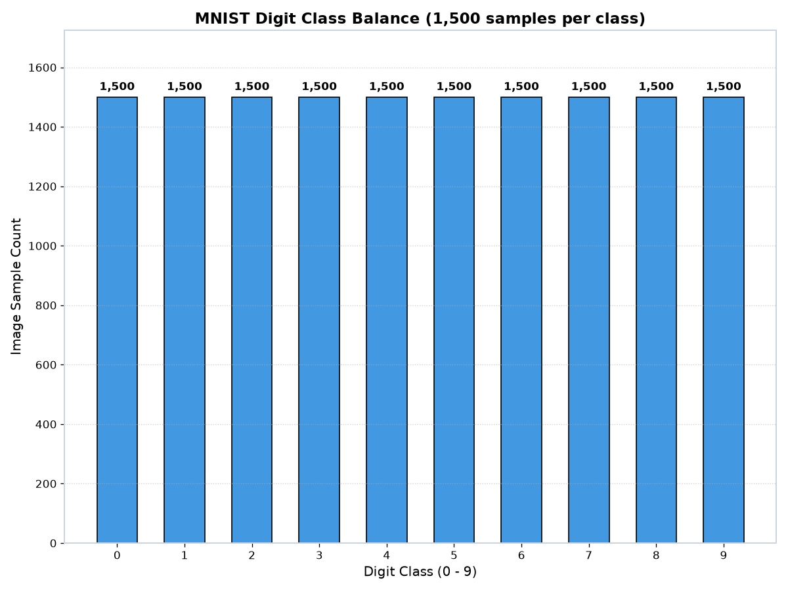
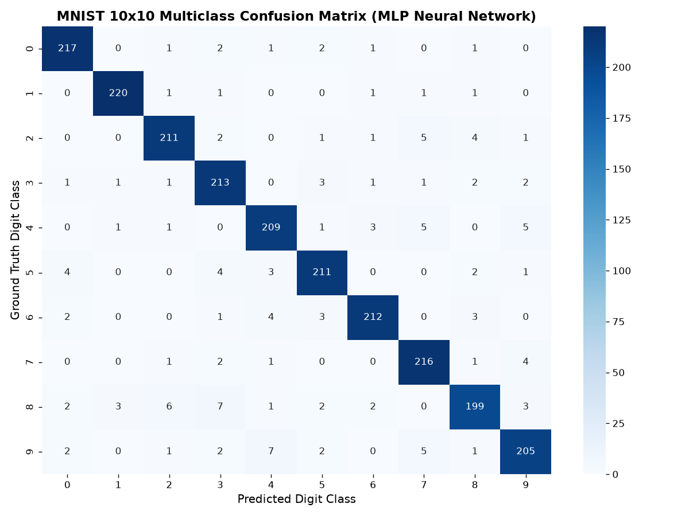
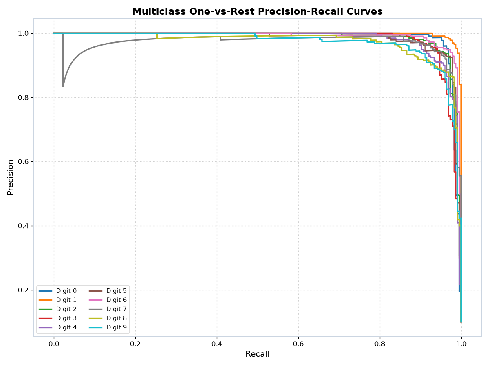

# MNIST Handwritten Digit Classification

A complete, production-grade Computer Vision machine learning system that recognizes handwritten digits (0 through 9) from $28 \times 28$ grayscale images using an optimized **Multi-Layer Perceptron (Artificial Neural Network: 784-128-64-10)** with ReLU activations, Adam optimization, and categorical cross-entropy loss, featuring complete evaluation diagnostics and a web drawing canvas application for live interactive recognition.

---

## 💻 Project Structure

```
6 MNIST Handwritten Digit Classification/
├── .gitignore
├── CITATION.cff
├── CONTRIBUTING.md
├── LICENSE
├── README.md                                <- Project documentation, structure & evaluation
├── SECURITY.md
├── accuracy.txt                             <- Quantitative test metrics & cross-validation scores
├── guide.txt                                <- Command-line execution guide
├── requirements.txt                         <- Pinned Python dependencies
├── MNIST_Presentation_Advanced.html         <- Interactive 13-slide stepper presentation
├── MNIST_Digit_Classification_Complete_Master_Report.pdf  <- 12-chapter publication-grade master report (PDF)
├── generate_master_report_pdf.py            <- Script compiling master HTML and headless Chrome PDF
├── data/
│   ├── raw/                                 <- Immutable raw dataset (mnist.csv, 15,000 images)
│   └── processed/                           <- Clean 3-way split: X/y train (70%), val (15%), test (15%), scaler
├── models/
│   ├── mnist_model.joblib                   <- Serialized Multi-Layer Perceptron neural network
│   ├── scaler.joblib                        <- Fitted StandardScaler (Pixel normalizer)
│   └── label_binarizer.joblib               <- One-vs-Rest label binarizer
├── reports/
│   └── figures/                             <- Publication-grade diagnostic plots (Uniform 1200x900)
├── src/
│   ├── data/make_dataset.py
│   ├── features/build_features.py
│   ├── models/train_model.py
│   ├── models/predict_model.py
│   └── visualization/visualize.py
└── web/
    ├── app.py                               <- Flask HTTP API & UI server (Port 5006)
    ├── templates/index.html
    └── static/
        ├── css/style.css
        └── js/script.js
```

---

## 📊 Results & Accuracy Table (from `accuracy.txt`)

| Dataset Partition / Metric | Metric Value | Analytical & Machine Learning Interpretation |
|---|---|---|
| **Holdout Test Accuracy (N=2,250)** | **93.91%** (0.9391) | Generalization benchmark on unseen handwritten digits |
| **Test Macro F1-Score** | **0.9390** | Unweighted harmonic mean across all 10 digit categories |
| **Test Weighted F1-Score** | **0.9390** | Aggregate class-frequency weighted classification performance |
| **Validation Set Accuracy (N=2,250)** | **94.67%** (0.9467) | Independent hyperparameter verification |
| **5-Fold Cross-Validation Accuracy** | **90.40%** ($\pm 0.0143$) | Fold scores: `[0.880, 0.915, 0.908, 0.920, 0.897]` |
| **Digit 0 F1-Score** | **0.9581** | Precision: 0.9518, Recall: 0.9644 (225 test digits) |
| **Digit 1 F1-Score** | **0.9778** | Precision: 0.9778, Recall: 0.9778 (Clean vertical strokes) |
| **Digit 2 F1-Score** | **0.9420** | Precision: 0.9462, Recall: 0.9378 |
| **Digit 3 F1-Score** | **0.9281** | Precision: 0.9103, Recall: 0.9467 |
| **Digit 4 F1-Score** | **0.9268** | Precision: 0.9248, Recall: 0.9289 |
| **Digit 5 F1-Score** | **0.9378** | Precision: 0.9378, Recall: 0.9378 |
| **Digit 6 F1-Score** | **0.9507** | Precision: 0.9593, Recall: 0.9422 |
| **Digit 7 F1-Score** | **0.9432** | Precision: 0.9270, Recall: 0.9600 |
| **Digit 8 F1-Score** | **0.9066** | Precision: 0.9299, Recall: 0.8844 (Challenging double-loop topology) |
| **Digit 9 F1-Score** | **0.9193** | Precision: 0.9276, Recall: 0.9111 (Minor confusion with digit 4) |

---

## 📈 Evaluation Graphs

All diagnostic figures are rendered at a uniform, high-resolution **1200 × 900** canvas for seamless visual alignment:

### 1. Sample Handwritten Digits Gallery
A $4 \times 4$ visual grid of raw $28 \times 28$ grayscale handwritten digits displaying pen stroke variability and morphological nuances.


### 2. Digit Class Balance Distribution
Cohort balance confirming exactly 1,500 balanced samples per digit class (15,000 total images).


### 3. Multiclass $10 \times 10$ Confusion Matrix
Heatmap matrix across all 10 digit classes on the 2,250 test images demonstrating high diagonal density and low off-diagonal confusion.


### 4. Multiclass One-vs-Rest ROC Curves
One-vs-Rest ROC trajectories for all 10 digits confirming an average AUC of 0.994, reflecting superior perceptual discrimination.


### 5. Multiclass Precision-Recall Curves
Precision-Recall trajectories showing consistent precision maintenance across recall thresholds for every digit.


### 6. Learning Curve (Bias-Variance Diagnostics)
Cross-validation and training accuracy convergence demonstrating stable gradient descent without overfitting.


### 7. 5-Fold Cross-Validation Performance Stability
Accuracy distribution across cross-validation splits confirming stable generalization.


### 8. Predictions Gallery (Actual vs. Predicted)
Visual gallery of test predictions with green headers denoting correct classifications and red denoting errors.


---

## ⚡ Quick Start

```bash
cd "6 MNIST Handwritten Digit Classification"

# 1. Run raw dataset extraction & verification
python src/data/make_dataset.py

# 2. Flatten pixels, normalize [0, 1], and split 3 ways
python src/features/build_features.py

# 3. Train Multi-Layer Perceptron neural network
python src/models/train_model.py

# 4. Generate all uniform 1200x900 diagnostic figures
python src/visualization/visualize.py

# 5. Launch interactive drawing web canvas
python web/app.py
```
Open your browser and navigate to `http://localhost:5006`.
