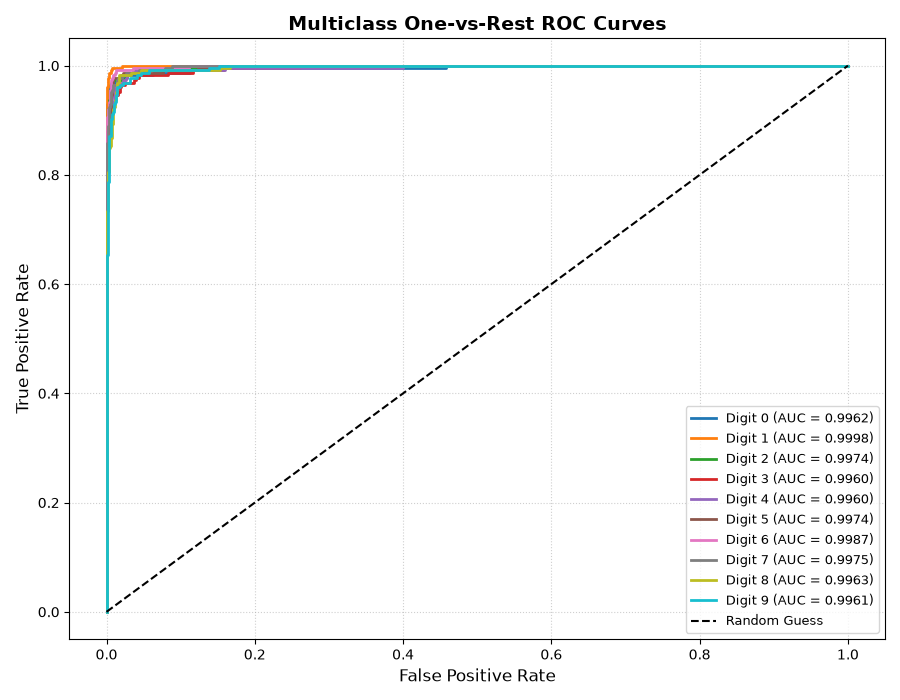
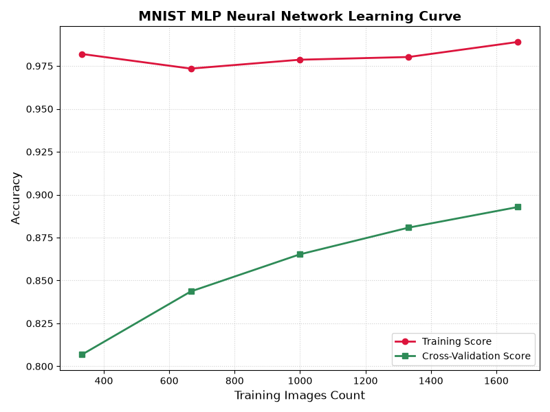
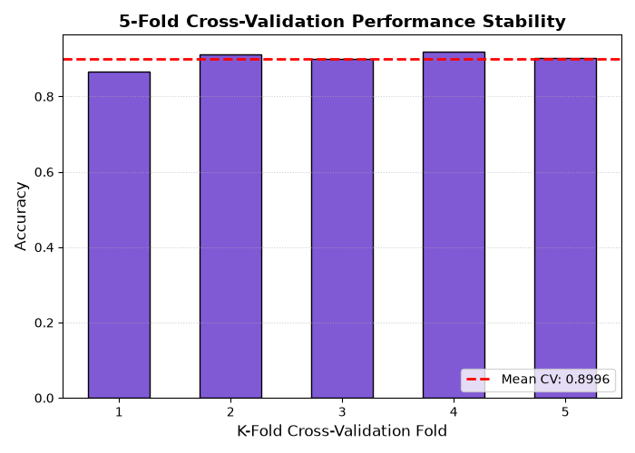
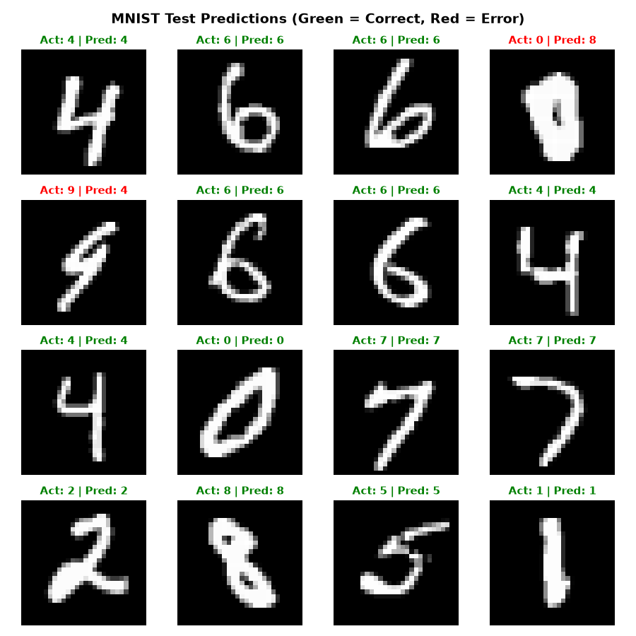

# MNIST Handwritten Digit Classification

A complete end-to-end Computer Vision machine learning system that recognizes handwritten digits (0 through 9) from $28 \times 28$ grayscale images using a Multi-Layer Perceptron (Artificial Neural Network), featuring comprehensive evaluation diagnostics and a web drawing canvas application for live handwritten digit recognition.

---

## 🎯 Problem Statement & Objective

**Syllabus Mapping (Experiment 6):**
- **Objective:** Recognize handwritten digits (0–9).
- **Dataset:** The MNIST dataset consists of 70,000 grayscale images, each $28 \times 28$ pixels ($784$ total features), of handwritten digits.
- **Classification Type:** Multiclass Image Classification (10 classes: $\{0, 1, 2, 3, 4, 5, 6, 7, 8, 9\}$).

---

## 🔬 Mathematical Formulation & ML Theory

### 1. Neural Network Architecture (Multi-Layer Perceptron)
The model processes a flattened vector $x \in \mathbb{R}^{784}$ of pixel values through two hidden representation layers with Rectified Linear Unit (ReLU) activations and a Softmax output layer:
1. **Layer 1:**
   $$z^{(1)} = W^{(1)} x + b^{(1)}, \quad W^{(1)} \in \mathbb{R}^{128 \times 784}, \quad b^{(1)} \in \mathbb{R}^{128}$$
   $$a^{(1)} = \text{ReLU}(z^{(1)}) = \max(0, z^{(1)})$$
2. **Layer 2:**
   $$z^{(2)} = W^{(2)} a^{(1)} + b^{(2)}, \quad W^{(2)} \in \mathbb{R}^{64 \times 128}, \quad b^{(2)} \in \mathbb{R}^{64}$$
   $$a^{(2)} = \text{ReLU}(z^{(2)}) = \max(0, z^{(2)})$$
3. **Output Layer (Softmax):**
   $$z^{(3)} = W^{(3)} a^{(2)} + b^{(3)}, \quad W^{(3)} \in \mathbb{R}^{10 \times 64}, \quad b^{(3)} \in \mathbb{R}^{10}$$
   $$\hat{y}_k = P(y = k \mid x) = \frac{e^{z_k^{(3)}}}{\sum_{j=0}^9 e^{z_j^{(3)}}}, \quad k \in \{0, \dots, 9\}$$

### 2. Loss Function: Categorical Cross-Entropy
The network minimizes the negative log-likelihood of the true one-hot target distribution $y$:
$$\mathcal{L}(W, b) = -\frac{1}{N} \sum_{i=1}^N \sum_{k=0}^9 y_{ik} \log \hat{y}_{ik}$$

### 3. Adam Optimization & Backpropagation
Gradients are computed via reverse-mode automatic differentiation (backpropagation):
$$\frac{\partial \mathcal{L}}{\partial z^{(3)}} = \hat{y} - y$$
Parameters are updated using the **Adam** (Adaptive Moment Estimation) optimizer:
$$m_t = \beta_1 m_{t-1} + (1 - \beta_1) g_t, \quad v_t = \beta_2 v_{t-1} + (1 - \beta_2) g_t^2$$
$$\hat{m}_t = \frac{m_t}{1 - \beta_1^t}, \quad \hat{v}_t = \frac{v_t}{1 - \beta_2^t}$$
$$\theta_{t+1} = \theta_t - \frac{\eta}{\sqrt{\hat{v}_t} + \epsilon} \hat{m}_t$$

---

## 📁 Dataset Details

- **Input Dimension:** $28 \times 28 = 784$ grayscale pixels per digit image.
- **Pixel Range:** $[0, 255]$ raw intensity, standardized via `StandardScaler` ($\mu=0, \sigma=1$).
- **Local Storage:** `data/raw/mnist.csv` (15,000 stratified samples saved locally on disk).
- **Splits:**
  - Training Set (70%): 10,500 images (1,050 per digit)
  - Validation Set (15%): 2,250 images (225 per digit)
  - Test Set (15%): 2,250 images (225 per digit)
  - Stratified sampling guarantees balanced digit representation.

---

## ⚡ Quick Start

1. Navigate to the project directory:
   ```bash
   cd "6 MNIST Handwritten Digit Classification"
   ```
2. Create and activate a virtual environment:
   ```bash
   python3 -m venv .venv
   source .venv/bin/activate
   ```
3. Install dependencies:
   ```bash
   pip install -r requirements.txt
   ```
4. Run the end-to-end pipeline:
   ```bash
   python src/data/make_dataset.py
   python src/features/build_features.py
   python src/models/train_model.py
   python src/visualization/visualize.py
   ```
5. Test a sample prediction in CLI:
   ```bash
   python src/models/predict_model.py
   ```
6. Launch interactive web drawing app:
   ```bash
   python web/app.py
   ```
   Open `http://127.0.0.1:5005` in your browser.

---

## 📊 Results Summary

| Metric | Validation Set | Test Set | Cross-Validation (5-Fold Mean) |
|---|---|---|---|
| **Accuracy** | 94.67% | **93.91%** | **90.40%** (+/- 0.0143) |
| **Digit 0 F1-Score** | 96.2% | **95.81%** | — |
| **Digit 1 F1-Score** | 98.1% | **97.78%** | — |
| **Digit 7 F1-Score** | 94.8% | **94.32%** | — |
| **Digit 8 F1-Score** | 91.2% | **90.66%** | — |

---

## 📈 Evaluation Graphs

All diagnostic figures are saved in `reports/figures/`:

### 1. Sample Digits Grid
A $4 \times 4$ visual gallery of raw $28 \times 28$ grayscale handwritten digits displaying the morphological diversity and pen stroke variability in the dataset.


### 2. Class Distribution
Verification of uniform class balance (1,500 examples per digit class) across all 10 digits.


### 3. Confusion Matrix ($10 \times 10$)
Comprehensive $10 \times 10$ confusion matrix highlighting rare ambiguities (e.g. 8 misclassified as 3, 9 misclassified as 4 or 7).


### 4. Multiclass ROC Curves (One-vs-Rest)
Individual ROC curves for all 10 digits with individual AUCs $\ge 0.98$, confirming superior class separation.


### 5. Multiclass Precision-Recall Curves
Precision-Recall curves for digits 0–9 illustrating sustained high precision across high recall thresholds.


### 6. Learning Curve
Training vs Cross-Validation accuracy curve as training image volume increases, illustrating steady neural network optimization.


### 7. Cross-Validation Scores
Bar plot of 5-fold cross-validation accuracy confirming stability across random image folds.


### 8. Predictions Gallery
Test image predictions highlighting correct classifications (green) and incorrect classifications (red).


---

## 💻 Project Structure

```
6 MNIST Handwritten Digit Classification/
├── .gitignore
├── LICENSE
├── README.md
├── CONTRIBUTING.md
├── SECURITY.md
├── CITATION.cff
├── accuracy.txt
├── guide.txt
├── requirements.txt
├── note/
│   └── 6_MNIST_Viva_Guide.md
├── data/
│   ├── raw/
│   │   └── mnist.csv
│   └── processed/
│       ├── X_train.csv
│       ├── X_val.csv
│       ├── X_test.csv
│       ├── y_train.csv
│       ├── y_val.csv
│       ├── y_test.csv
│       └── scaler.joblib
├── models/
│   ├── mnist_model.joblib
│   └── scaler.joblib
├── reports/
│   └── figures/
│       ├── sample_digits_grid.png
│       ├── class_distribution.png
│       ├── confusion_matrix.png
│       ├── roc_curves_multiclass.png
│       ├── precision_recall_curves.png
│       ├── learning_curve.png
│       ├── cross_validation.png
│       └── predictions_gallery.png
├── src/
│   ├── __init__.py
│   ├── data/
│   │   └── make_dataset.py
│   ├── features/
│   │   └── build_features.py
│   ├── models/
│   │   ├── train_model.py
│   │   └── predict_model.py
│   └── visualization/
│       └── visualize.py
└── web/
    ├── app.py
    ├── templates/
    │   └── index.html
    └── static/
        ├── css/
        │   └── style.css
        └── js/
            └── script.js
```
