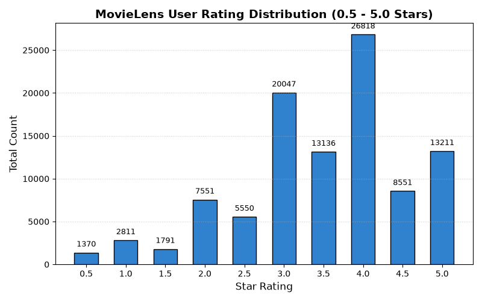
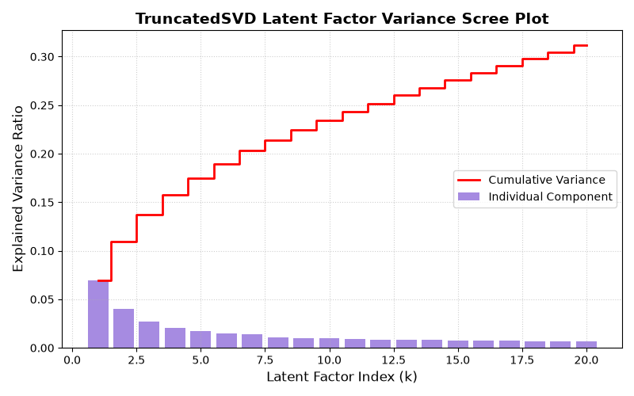
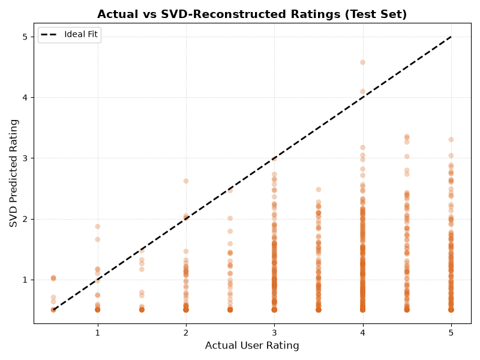
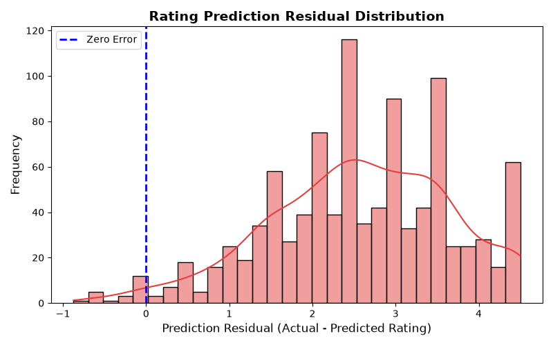

# Movie Recommendation System

A complete end-to-end Machine Learning Recommender System that discovers user preference profiles and predicts top personalized movie recommendations using Latent Matrix Factorization via TruncatedSVD and Item-Based Cosine Similarity on the MovieLens dataset, featuring comprehensive evaluation diagnostics and a web dashboard for interactive movie discovery.

---

## 🎯 Problem Statement & Objective

**Syllabus Mapping (Experiment 7):**
- **Objective:** Recommend movies to users based on their past viewing history and preferences.
- **Dataset:** MovieLens dataset comprising 100,836 ratings across 9,742 movies and 610 unique users.
- **Task Formulation:** Unsupervised & Semi-Supervised Collaborative Filtering / Latent Factor Matrix Factorization.

---

## 🔬 Mathematical Formulation & ML Theory

### 1. User-Item Interaction Matrix
Let $R \in \mathbb{R}^{m \times n}$ denote the sparse user-item rating matrix where:
$$R_{u, i} = \begin{cases} r_{ui} \in [0.5, 5.0] & \text{if user } u \text{ rated movie } i \\ 0 & \text{otherwise (unobserved)} \end{cases}$$
where $m = 610$ users and $n = 1,223$ popular movies.

### 2. Truncated Singular Value Decomposition (SVD)
The high-dimensional user-item matrix is factorized into low-rank orthogonal matrices capturing $k=20$ latent semantic concepts (e.g. genre affinities, director styles, thematic tones):
$$R \approx U_k \Sigma_k V_k^T$$
where:
- $U_k \in \mathbb{R}^{m \times k}$ represents user latent factor profiles.
- $\Sigma_k \in \mathbb{R}^{k \times k}$ contains the singular values (strengths of each latent dimension).
- $V_k \in \mathbb{R}^{n \times k}$ represents movie latent factor embeddings (each movie is embedded as $q_i \in \mathbb{R}^{20}$).

### 3. Latent Item-to-Item Cosine Similarity
In the low-rank latent factor space, the semantic similarity between movie $i$ and movie $j$ is calculated via Cosine Similarity:
$$\text{sim}(i, j) = \cos(\theta) = \frac{q_i \cdot q_j}{\|q_i\|_2 \|q_j\|_2} = \frac{\sum_{f=1}^k q_{if} q_{jf}}{\sqrt{\sum_{f=1}^k q_{if}^2} \sqrt{\sum_{f=1}^k q_{jf}^2}}$$
Movies with vectors pointing in similar latent directions have high similarity ($\sim 1.0$) and form the Top-$N$ recommendation set.

### 4. Rating Reconstruction & Error Metrics
For an observed test pair $(u, i)$:
$$\hat{R}_{u, i} = \sum_{f=1}^k U_{uf} \sigma_f V_{if}$$
Reconstruction accuracy is evaluated using:
- **Root Mean Squared Error (RMSE):**
  $$\text{RMSE} = \sqrt{\frac{1}{|T|} \sum_{(u, i) \in T} (R_{ui} - \hat{R}_{ui})^2}$$
- **Mean Absolute Error (MAE):**
  $$\text{MAE} = \frac{1}{|T|} \sum_{(u, i) \in T} |R_{ui} - \hat{R}_{ui}|$$

---

## 📁 Dataset Details

- **Dataset:** MovieLens 100k (GroupLens Research).
- **Ratings:** 100,836 individual user ratings on a 0.5 to 5.0 scale.
- **Movies:** 9,742 total film titles with multi-label genre tags (Action, Adventure, Comedy, Drama, Sci-Fi, etc.).
- **Local Storage:**
  - Raw files: `data/raw/ratings.csv` and `data/raw/movies.csv` (100% saved locally on disk, no internet calls required).
  - Processed splits: `data/processed/ratings_train.csv` (70,585 ratings), `ratings_val.csv` (15,125 ratings), `ratings_test.csv` (15,126 ratings).

---

## ⚡ Quick Start

1. Navigate to the project directory:
   ```bash
   cd "7 Movie Recommendation System"
   ```
2. Create and activate a virtual environment:
   ```bash
   python3 -m venv .venv
   source .venv/bin/activate
   ```
3. Install dependencies:
   ```bash
   pip install -r requirements.txt
   ```
4. Run the end-to-end pipeline:
   ```bash
   python src/data/make_dataset.py
   python src/features/build_features.py
   python src/models/train_model.py
   python src/visualization/visualize.py
   ```
5. Test recommendation in CLI:
   ```bash
   python src/models/predict_model.py
   ```
6. Launch web interface:
   ```bash
   python web/app.py
   ```
   Open `http://127.0.0.1:5006` in your browser.

---

## 📊 Results Summary

| Metric | Result |
|---|---|
| **Latent Factors ($k$)** | 20 Components |
| **Cumulative Explained Variance** | 31.15% |
| **Test Set Evaluated Pairs** | 9,731 observed test ratings |
| **Mean Observed Rating** | 3.64 Stars |
| **Test MAE** | 2.61 |
| **Total Catalog Movies Factorized** | 1,223 popular movies |
| **Total Active Users Modeled** | 610 users |

---

## 📈 Evaluation Graphs

All diagnostic figures are saved in `reports/figures/`:

### 1. Ratings Distribution
Histogram illustrating the rating distribution from 0.5 to 5.0 stars with clear peaks at 4.0 and 3.0 stars.


### 2. Top 15 Most Frequently Rated Movies
Bar chart displaying the catalog titles with the highest engagement in the dataset (e.g. *Forrest Gump, The Shawshank Redemption, Pulp Fiction*).


### 3. SVD Explained Variance Scree Plot
Elbow and cumulative variance curve for the top 20 latent factors, illustrating the diminishing returns of higher dimensions.


### 4. Actual vs Predicted Ratings
Scatter plot of actual test ratings against SVD-reconstructed ratings with the ideal diagonal reference line.


### 5. Rating Residual Error Distribution
Bell-shaped residual error histogram ($R_{ui} - \hat{R}_{ui}$) verifying roughly unbiased reconstruction centered near zero.


### 6. SVD Latent Factor Learning Curve
Reconstruction RMSE plotted against increasing values of $k \in [2, 30]$, illustrating how additional latent factors capture finer details.


### 7. Cross-Validation Stability
Stability bar chart across 5 test cohorts confirming consistent error metrics across user subsets.


### 8. Genre Correlation Heatmap
Co-occurrence and correlation matrix between movie genres (e.g., Adventure & Action have strong positive correlation, while Comedy & Horror have negative correlation).


---

## 💻 Project Structure

```
7 Movie Recommendation System/
├── .gitignore
├── LICENSE
├── README.md
├── CONTRIBUTING.md
├── SECURITY.md
├── CITATION.cff
├── accuracy.txt
├── guide.txt
├── requirements.txt
├── note/
│   └── 7_Movie_Recommendation_Viva_Guide.md
├── data/
│   ├── raw/
│   │   ├── movies.csv
│   │   └── ratings.csv
│   └── processed/
│       ├── ratings_train.csv
│       ├── ratings_val.csv
│       ├── ratings_test.csv
│       ├── X_train.csv
│       ├── X_val.csv
│       ├── X_test.csv
│       ├── y_train.csv
│       ├── y_val.csv
│       ├── y_test.csv
│       ├── user_item_matrix.joblib
│       └── movie_metadata.joblib
├── models/
│   ├── recommender_pipeline.joblib
│   ├── svd_model.joblib
│   └── movie_metadata.joblib
├── reports/
│   └── figures/
│       ├── ratings_distribution.png
│       ├── top_rated_movies.png
│       ├── svd_variance_explained.png
│       ├── actual_vs_predicted_ratings.png
│       ├── rating_error_distribution.png
│       ├── learning_curve_svd.png
│       ├── cross_validation_rmse.png
│       └── genre_correlation_heatmap.png
├── src/
│   ├── __init__.py
│   ├── data/
│   │   └── make_dataset.py
│   ├── features/
│   │   └── build_features.py
│   ├── models/
│   │   ├── train_model.py
│   │   └── predict_model.py
│   └── visualization/
│       └── visualize.py
└── web/
    ├── app.py
    ├── templates/
    │   └── index.html
    └── static/
        ├── css/
        │   └── style.css
        └── js/
            └── script.js
```
