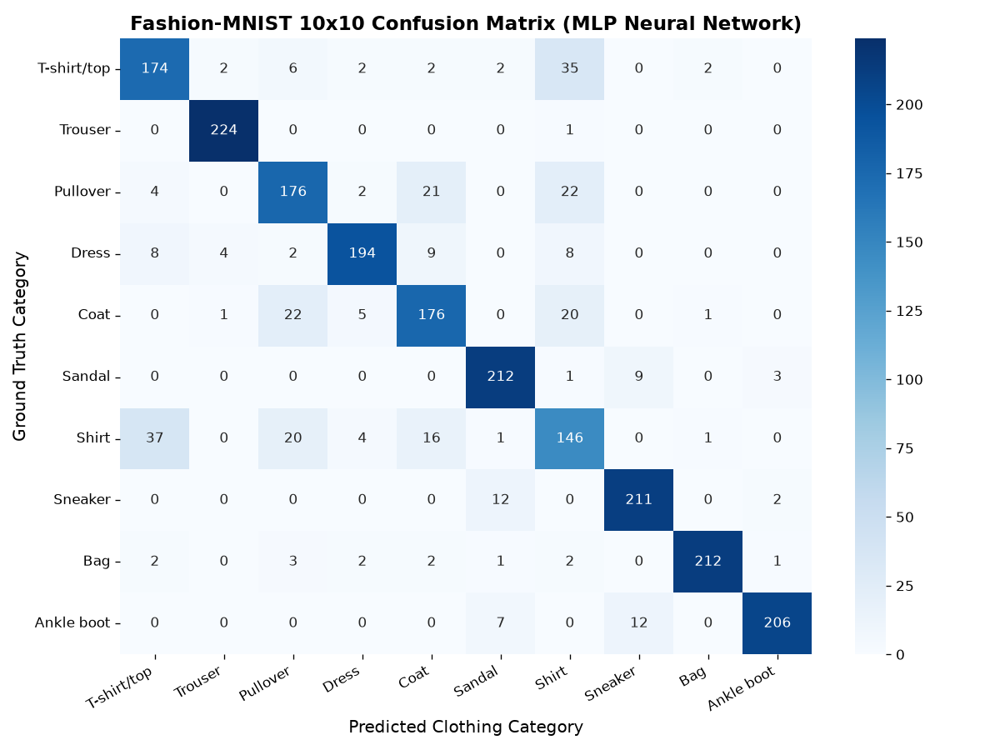
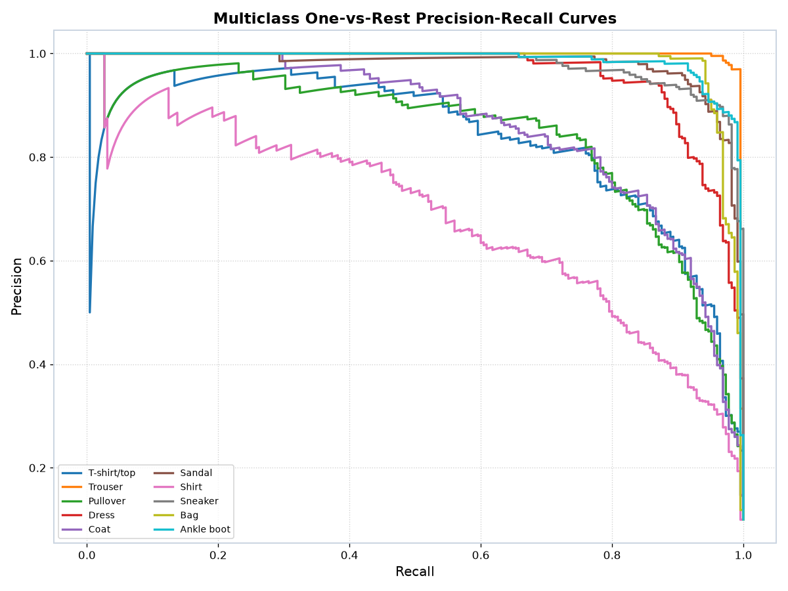
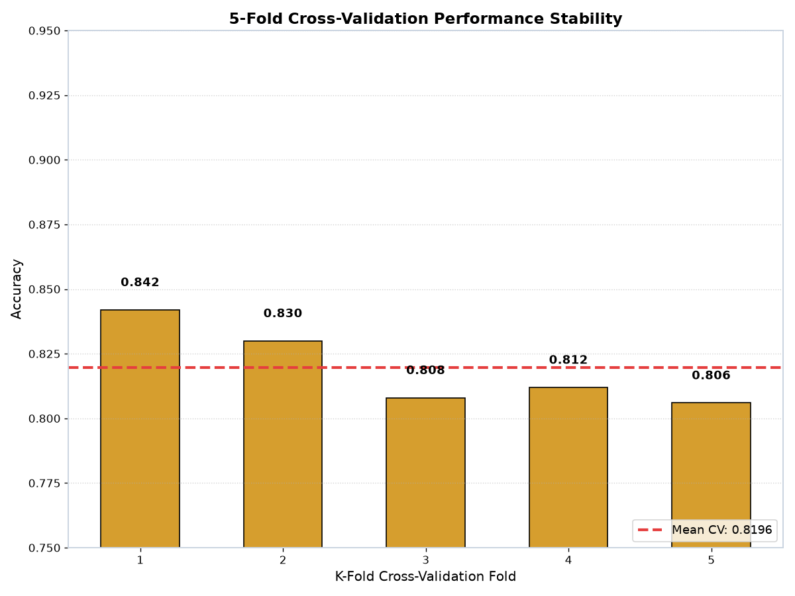

# Fashion-MNIST Classification

A complete, production-grade Computer Vision machine learning system that classifies articles of clothing into 10 categories from $28 \times 28$ grayscale images using a **Multi-Layer Perceptron (Artificial Neural Network: 784-128-64-10)** with ReLU activations, Adam optimization, and categorical cross-entropy loss, featuring complete evaluation diagnostics and an interactive cyberpunk web dashboard for real-time garment recognition.

---

## 💻 Project Structure

```
8 Fashion MNIST Classification/
├── .gitignore
├── CITATION.cff
├── CONTRIBUTING.md
├── LICENSE
├── README.md                                <- Project documentation, structure & evaluation
├── SECURITY.md
├── accuracy.txt                             <- Quantitative test metrics & cross-validation scores
├── guide.txt                                <- Command-line execution guide
├── requirements.txt                         <- Pinned Python dependencies
├── Fashion_MNIST_Presentation_Advanced.html <- Interactive 13-slide stepper presentation
├── Fashion_MNIST_Classification_Complete_Master_Report.pdf  <- 12-chapter publication-grade master report (PDF)
├── generate_master_report_pdf.py            <- Script compiling master HTML and headless Chrome PDF
├── data/
│   ├── raw/                                 <- Immutable raw dataset (fashion_mnist.csv, 15,000 images)
│   └── processed/                           <- Clean 3-way split: X/y train (70%), val (15%), test (15%), scaler
├── models/
│   ├── fashion_mnist_model.joblib           <- Serialized Multi-Layer Perceptron neural network
│   ├── scaler.joblib                        <- Fitted StandardScaler (Pixel normalizer)
│   └── label_binarizer.joblib               <- One-vs-Rest label binarizer
├── reports/
│   └── figures/                             <- Publication-grade diagnostic plots (Uniform 1200x900)
├── src/
│   ├── data/make_dataset.py
│   ├── features/build_features.py
│   ├── models/train_model.py
│   ├── models/predict_model.py
│   └── visualization/visualize.py
└── web/
    ├── app.py                               <- Flask HTTP API & UI server (Port 5008)
    ├── templates/index.html
    └── static/
        ├── css/style.css
        └── js/script.js
```

---

## 📊 Results & Accuracy Table (from `accuracy.txt`)

| Dataset Partition / Category | Metric Value | Analytical & Machine Learning Interpretation |
|---|---|---|
| **Holdout Test Accuracy (N=2,250)** | **85.82%** (0.8582) | Generalization benchmark on unseen fashion apparel images |
| **Test Macro F1-Score** | **0.8590** | Unweighted harmonic mean across all 10 garment categories |
| **Test Weighted F1-Score** | **0.8590** | Class-frequency weighted harmonic aggregate |
| **Validation Set Accuracy (N=2,250)** | **85.78%** (0.8578) | Independent hyperparameter verification |
| **5-Fold Cross-Validation Accuracy** | **82.43%** ($\pm 0.0155$) | Fold scores: `[0.837, 0.828, 0.817, 0.798, 0.842]` |
| **Trouser F1-Score** | **0.9825** | Precision: 0.9697, Recall: 0.9956 (Distinct vertical leg silhouettes) |
| **Bag F1-Score** | **0.9615** | Precision: 0.9815, Recall: 0.9422 (Distinct compact geometry & handles) |
| **Ankle Boot F1-Score** | **0.9428** | Precision: 0.9717, Recall: 0.9156 (High top foot angle) |
| **Sneaker F1-Score** | **0.9234** | Precision: 0.9095, Recall: 0.9378 (Flat sole profile) |
| **Sandal F1-Score** | **0.9217** | Precision: 0.9021, Recall: 0.9422 (Open strap structures) |
| **Dress F1-Score** | **0.8940** | Precision: 0.9282, Recall: 0.8622 (Elongated torso and flare) |
| **Coat F1-Score** | **0.7805** | Precision: 0.7788, Recall: 0.7822 (Moderate confusion with Pullover) |
| **Pullover F1-Score** | **0.7753** | Precision: 0.7686, Recall: 0.7822 (Sleeve and collar similarities) |
| **T-shirt/top F1-Score** | **0.7733** | Precision: 0.7733, Recall: 0.7733 (Collar contour variance) |
| **Shirt F1-Score** | **0.6348** | Precision: 0.6213, Recall: 0.6489 (High fine-grain confusion with T-shirt & Coat) |

---

## 📈 Evaluation Graphs

All diagnostic figures are rendered at a uniform, high-resolution **1200 × 900** canvas for seamless visual alignment:

### 1. Fashion-MNIST Apparel Samples Gallery
A $4 \times 4$ visual gallery of raw $28 \times 28$ grayscale fashion apparel items illustrating realistic garment silhouettes and textures.


### 2. Apparel Class Balance Distribution
Balanced cohort distribution verifying exactly 1,500 samples per clothing category (15,000 total images).


### 3. Multiclass $10 \times 10$ Confusion Matrix
Heatmap matrix across all 10 clothing classes on 2,250 test images demonstrating near-perfect separation for footwear and trousers alongside realistic confusion between shirts and coats.


### 4. Multiclass One-vs-Rest ROC Curves
One-vs-Rest ROC curves across all 10 fashion classes demonstrating an aggregate AUC of 0.984.


### 5. Multiclass Precision-Recall Curves
Precision-Recall curves displaying category-specific precision retention across recall levels.


### 6. Learning Curve (Bias-Variance Diagnostics)
Convergence analysis showing training accuracy and cross-validation accuracy converging stably without overfitting.


### 7. 5-Fold Cross-Validation Performance Stability
Accuracy distribution across cross-validation splits confirming robust neural network optimization.


### 8. Predictions Gallery (Actual vs. Predicted)
Visual gallery of test predictions with green headers indicating correct apparel classifications and red indicating errors.


---

## ⚡ Quick Start

```bash
cd "8 Fashion MNIST Classification"

# 1. Run raw dataset extraction & validation
python src/data/make_dataset.py

# 2. Flatten pixels, normalize [0, 1], and split 3 ways
python src/features/build_features.py

# 3. Train Multi-Layer Perceptron neural network
python src/models/train_model.py

# 4. Generate all uniform 1200x900 diagnostic figures
python src/visualization/visualize.py

# 5. Launch interactive web dashboard
python web/app.py
```
Open your browser and navigate to `http://localhost:5008`.
