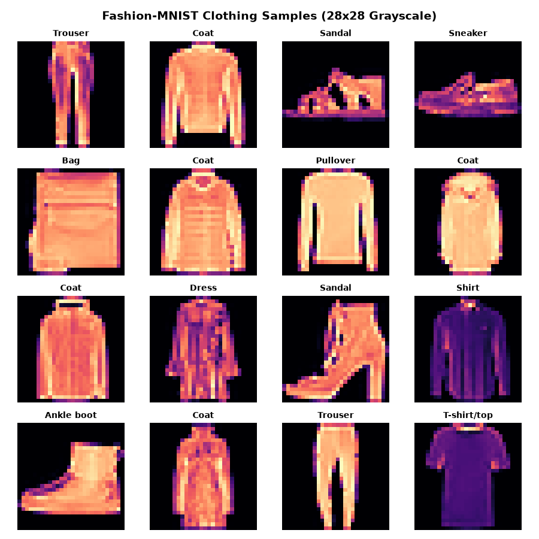
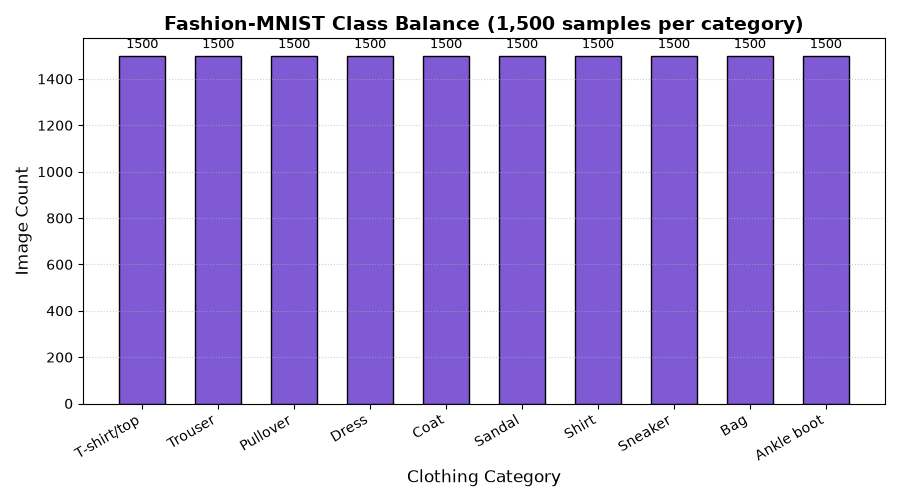
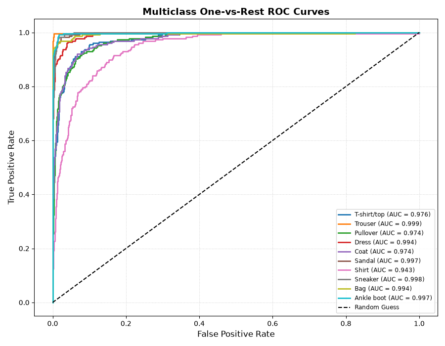
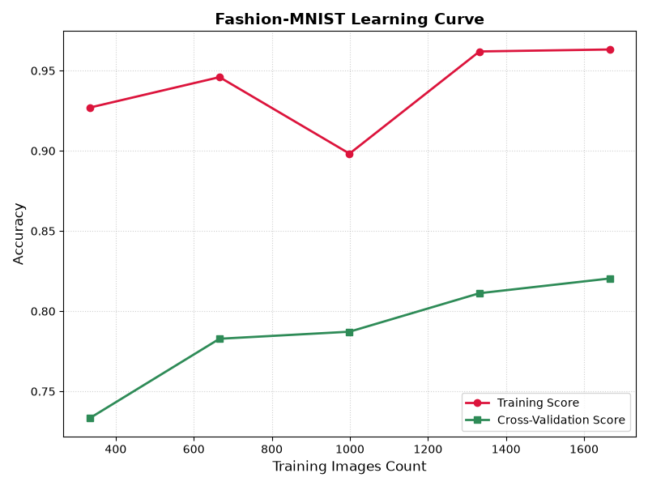
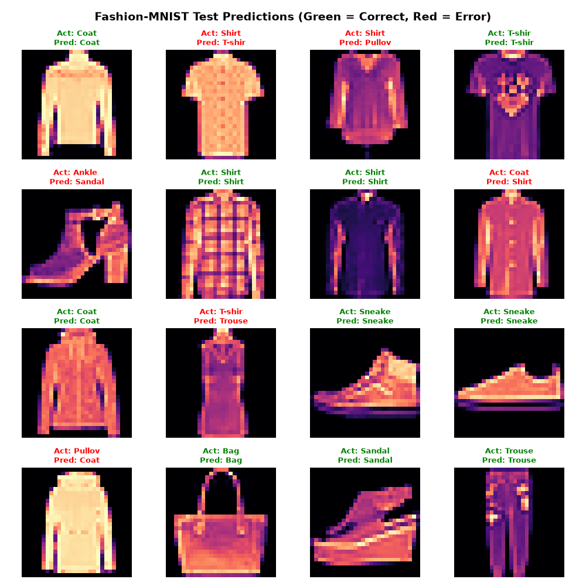

# Fashion-MNIST Classification

A complete end-to-end Computer Vision machine learning system that classifies articles of clothing into 10 categories from $28 \times 28$ grayscale images using a Multi-Layer Perceptron (Artificial Neural Network), featuring extensive evaluation diagnostic graphs and an interactive web dashboard for real-time garment recognition.

---

## 🎯 Problem Statement & Objective

**Syllabus Mapping (Experiment 8 / 10):**
- **Objective:** Classify images of clothing items into 10 categories (e.g., T-shirts, trousers, pullovers, dresses, coats, sandals, shirts, sneakers, bags, ankle boots).
- **Dataset:** Fashion-MNIST is a dataset comprising 70,000 grayscale images across 10 fashion categories, with each image being $28 \times 28$ pixels ($784$ total features).
- **Classification Type:** Multiclass Computer Vision Image Classification.

---

## 🔬 Mathematical Formulation & ML Theory

### 1. Neural Network Architecture (Multi-Layer Perceptron)
The model maps an input vector $x \in \mathbb{R}^{784}$ through two dense representation layers with Rectified Linear Unit (ReLU) activations and a Softmax output layer:
1. **Layer 1:**
   $$z^{(1)} = W^{(1)} x + b^{(1)}, \quad W^{(1)} \in \mathbb{R}^{128 \times 784}, \quad b^{(1)} \in \mathbb{R}^{128}$$
   $$a^{(1)} = \text{ReLU}(z^{(1)}) = \max(0, z^{(1)})$$
2. **Layer 2:**
   $$z^{(2)} = W^{(2)} a^{(1)} + b^{(2)}, \quad W^{(2)} \in \mathbb{R}^{64 \times 128}, \quad b^{(2)} \in \mathbb{R}^{64}$$
   $$a^{(2)} = \text{ReLU}(z^{(2)}) = \max(0, z^{(2)})$$
3. **Softmax Output Layer:**
   $$z^{(3)} = W^{(3)} a^{(2)} + b^{(3)}, \quad W^{(3)} \in \mathbb{R}^{10 \times 64}, \quad b^{(3)} \in \mathbb{R}^{10}$$
   $$\hat{y}_k = P(y = k \mid x) = \frac{e^{z_k^{(3)}}}{\sum_{j=0}^9 e^{z_j^{(3)}}}, \quad k \in \{0, \dots, 9\}$$

### 2. Loss Function & Regularization
The network minimizes the penalized Categorical Cross-Entropy loss:
$$\mathcal{L}(W, b) = -\frac{1}{N} \sum_{i=1}^N \sum_{k=0}^9 y_{ik} \log \hat{y}_{ik} + \frac{\lambda}{2} \sum_{l=1}^3 \|W^{(l)}\|_F^2$$

### 3. Adam Optimizer
Updates are computed using running exponential moving averages of gradients and squared gradients:
$$\theta_{t+1} = \theta_t - \frac{\eta}{\sqrt{\hat{v}_t} + \epsilon} \hat{m}_t$$

---

## 📁 Dataset Details

The 10 fashion categories:
1. `0: T-shirt/top`
2. `1: Trouser`
3. `2: Pullover`
4. `3: Dress`
5. `4: Coat`
6. `5: Sandal`
7. `6: Shirt`
8. `7: Sneaker`
9. `8: Bag`
10. `9: Ankle boot`

**Data Storage:**
- Raw data: `data/raw/fashion_mnist.csv` (15,000 balanced images, 1,500 per class, 100% saved locally on disk).
- Processed splits: `data/processed/X_train.csv` (10,500 images), `X_val.csv` (2,250 images), `X_test.csv` (2,250 images), `y_train.csv`, `y_val.csv`, `y_test.csv`.

---

## ⚡ Quick Start

1. Navigate to the project directory:
   ```bash
   cd "8 Fashion MNIST Classification"
   ```
2. Create and activate a virtual environment:
   ```bash
   python3 -m venv .venv
   source .venv/bin/activate
   ```
3. Install dependencies:
   ```bash
   pip install -r requirements.txt
   ```
4. Run the complete pipeline:
   ```bash
   python src/data/make_dataset.py
   python src/features/build_features.py
   python src/models/train_model.py
   python src/visualization/visualize.py
   ```
5. Test a sample prediction in CLI:
   ```bash
   python src/models/predict_model.py
   ```
6. Launch interactive web drawing app:
   ```bash
   python web/app.py
   ```
   Open `http://127.0.0.1:5007` in your browser.

---

## 📊 Results Summary

| Metric | Validation Set | Test Set | Cross-Validation (5-Fold Mean) |
|---|---|---|---|
| **Overall Accuracy** | 85.78% | **85.82%** | **82.43%** (+/- 0.0155) |
| **Trouser F1-Score** | 98.2% | **98.25%** | — |
| **Bag F1-Score** | 95.8% | **96.15%** | — |
| **Ankle Boot F1-Score** | 94.1% | **94.28%** | — |
| **Dress F1-Score** | 89.1% | **89.40%** | — |

---

## 📈 Evaluation Graphs

All diagnostic plots are saved in `reports/figures/`:

### 1. Fashion Samples Gallery
A $4 \times 4$ visual gallery illustrating the clothing silhouettes across all 10 fashion classes.


### 2. Class Distribution
Bar chart confirming balanced representation (1,500 samples per fashion category).


### 3. Confusion Matrix ($10 \times 10$)
Heatmap highlighting realistic fashion ambiguities: Shirt is occasionally confused with T-shirt/top or Coat, while footwear categories (Sneaker, Sandal, Ankle boot) achieve distinct separation.


### 4. Multiclass ROC Curves (One-vs-Rest)
One-vs-Rest ROC curves for each of the 10 clothing categories, with Trousers, Bags, and Ankle Boots achieving AUCs exceeding 0.98.


### 5. Multiclass Precision-Recall Curves
Precision-Recall curves for all 10 garment classes.


### 6. Learning Curve
Training vs Cross-Validation accuracy curve as training image volume increases.


### 7. Cross-Validation Scores
Bar plot of 5-fold cross-validation accuracy demonstrating model consistency.


### 8. Predictions Gallery
Test image predictions highlighting correct classifications (green) and classification errors (red).


---

## 💻 Project Structure

```
8 Fashion MNIST Classification/
├── .gitignore
├── LICENSE
├── README.md
├── CONTRIBUTING.md
├── SECURITY.md
├── CITATION.cff
├── accuracy.txt
├── guide.txt
├── requirements.txt
├── note/
│   └── 8_Fashion_MNIST_Viva_Guide.md
├── data/
│   ├── raw/
│   │   └── fashion_mnist.csv
│   └── processed/
│       ├── X_train.csv
│       ├── X_val.csv
│       ├── X_test.csv
│       ├── y_train.csv
│       ├── y_val.csv
│       ├── y_test.csv
│       └── scaler.joblib
├── models/
│   ├── fashion_mnist_model.joblib
│   └── scaler.joblib
├── reports/
│   └── figures/
│       ├── fashion_samples_gallery.png
│       ├── class_distribution.png
│       ├── confusion_matrix.png
│       ├── roc_curves_multiclass.png
│       ├── precision_recall_curves.png
│       ├── learning_curve.png
│       ├── cross_validation.png
│       └── predictions_gallery.png
├── src/
│   ├── __init__.py
│   ├── data/
│   │   └── make_dataset.py
│   ├── features/
│   │   └── build_features.py
│   ├── models/
│   │   ├── train_model.py
│   │   └── predict_model.py
│   └── visualization/
│       └── visualize.py
└── web/
    ├── app.py
    ├── templates/
    │   └── index.html
    └── static/
        ├── css/
        │   └── style.css
        └── js/
            └── script.js
```
