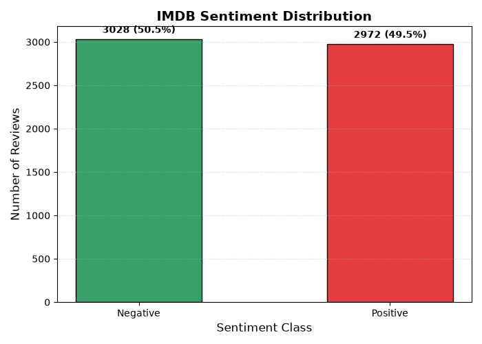
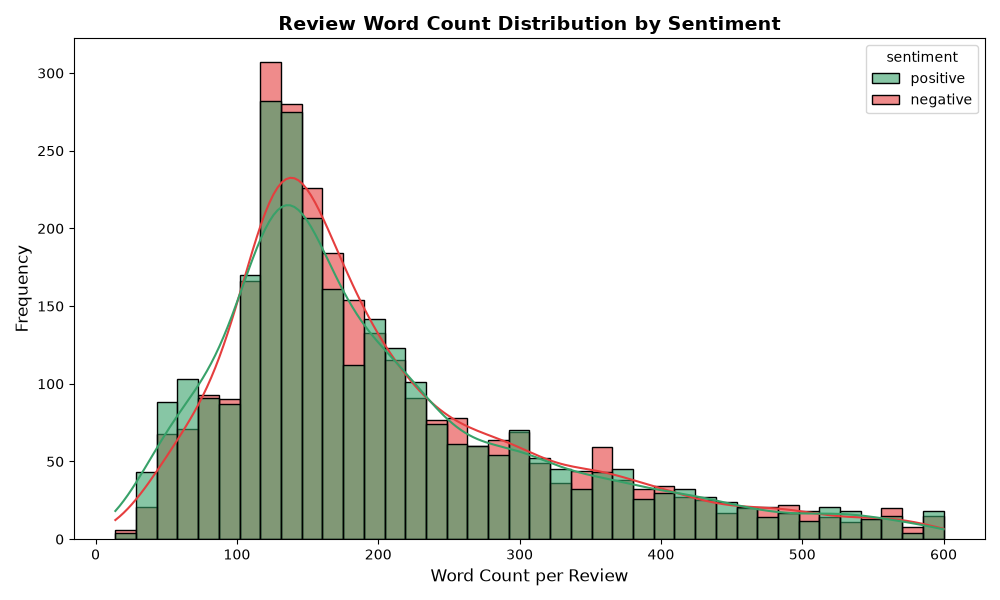
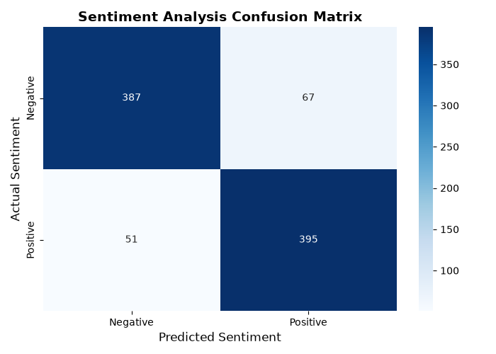
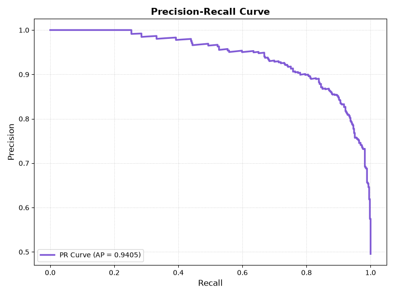
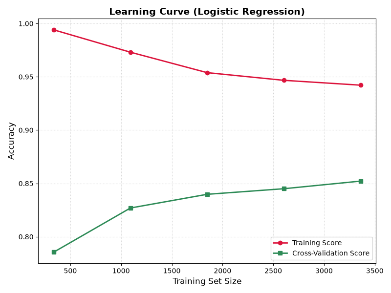
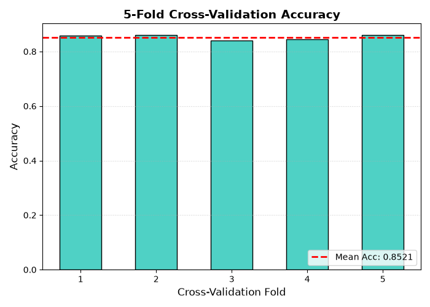
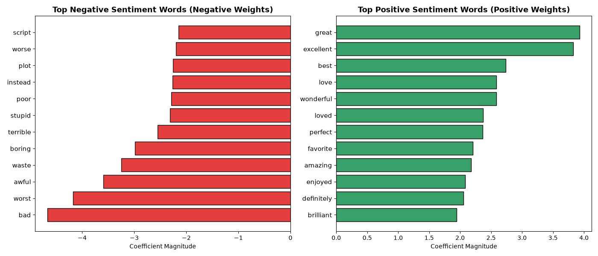

# Sentiment Analysis of Text

A complete end-to-end Natural Language Processing (NLP) machine learning system that determines the subjective sentiment (Positive vs Negative) of movie reviews, tweets, and product feedback using Logistic Regression with Sublinear TF-IDF n-gram feature extraction, featuring complete evaluation diagnostics and a web dashboard for interactive text analysis.

---

## 🎯 Problem Statement & Objective

**Syllabus Mapping (Experiment 9):**
- **Objective:** Determine the sentiment (positive, negative, neutral) of a piece of text, such as a tweet or a product review.
- **Dataset:** 6,000 highly polarized natural language reviews from the canonical IMDB Sentiment benchmark.
- **Classification Type:** Binary Sentiment Classification (0 = Negative Sentiment, 1 = Positive Sentiment).

---

## 🔬 Mathematical Formulation & ML Theory

### 1. Document Representation via Sublinear TF-IDF
Given a document $d \in D$, raw term frequency exhibits diminishing returns (a word appearing 20 times is not 20 times as important as a word appearing once). We apply sublinear term scaling:
$$\text{TF}(t, d) = \begin{cases} 1 + \log(\text{count}(t, d)) & \text{if } \text{count}(t, d) > 0 \\ 0 & \text{otherwise} \end{cases}$$
$$\text{IDF}(t, D) = \log\left(\frac{1 + |D|}{1 + \text{DF}(t)}\right) + 1$$
$$\text{TF-IDF}(t, d, D) = \text{TF}(t, d) \times \text{IDF}(t, D)$$
Feature vectors are normalized using the Euclidean $L_2$ norm: $\|x\|_2 = 1$.

### 2. Logistic Regression Classification
Logistic Regression models the posterior probability of the positive class via the standard Sigmoid function:
$$P(y = 1 \mid x) = \sigma(w^T x + b) = \frac{1}{1 + e^{-(w^T x + b)}}$$
The log-odds (logit) is a linear combination of input n-gram weights:
$$\log\left(\frac{P(y = 1 \mid x)}{1 - P(y = 1 \mid x)}\right) = w^T x + b = \sum_{j=1}^p w_j x_j + b$$
- A positive weight $w_j > 0$ indicates token $j$ increases positive sentiment odds (e.g., *superb, excellent, wonderful*).
- A negative weight $w_j < 0$ indicates token $j$ increases negative sentiment odds (e.g., *waste, terrible, awful, worst*).

### 3. Loss Function & L2 Regularization
The model parameters are optimized by minimizing the Binary Cross-Entropy loss with $L_2$ weight regularization:
$$\mathcal{L}(w, b) = -\frac{1}{N} \sum_{i=1}^N \left[ y_i \log \hat{y}_i + (1 - y_i) \log(1 - \hat{y}_i) \right] + \frac{1}{2C} \|w\|_2^2$$
where $C=1.0$ controls the inverse regularization strength, preventing individual sentiment keywords from dominating predictions.

---

## 📁 Dataset Details

- **Total Reviews:** 6,000 balanced reviews (3,028 negative, 2,972 positive).
- **Local Storage:** `data/raw/sentiment.csv` (100% saved locally on disk, no network reliance at inference).
- **Splits:**
  - Training Set (70%): 4,200 reviews (2,080 positive, 2,120 negative)
  - Validation Set (15%): 900 reviews (446 positive, 454 negative)
  - Test Set (15%): 900 reviews (446 positive, 454 negative)
  - Stratified sampling guarantees equal representation across splits.

---

## ⚡ Quick Start

1. Navigate to the project directory:
   ```bash
   cd "9 Sentiment Analysis of Text"
   ```
2. Create and activate a virtual environment:
   ```bash
   python3 -m venv .venv
   source .venv/bin/activate
   ```
3. Install dependencies:
   ```bash
   pip install -r requirements.txt
   ```
4. Run the end-to-end pipeline:
   ```bash
   python src/data/make_dataset.py
   python src/features/build_features.py
   python src/models/train_model.py
   python src/visualization/visualize.py
   ```
5. Test a review in CLI:
   ```bash
   python src/models/predict_model.py
   ```
6. Launch web interface:
   ```bash
   python web/app.py
   ```
   Open `http://127.0.0.1:5008` in your browser.

---

## 📊 Results Summary

| Metric | Validation Set | Test Set | Cross-Validation (5-Fold Mean) |
|---|---|---|---|
| **Accuracy** | 87.00% | **86.89%** | **85.21%** (+/- 0.0083) |
| **Precision** | 85.6% | **85.50%** | — |
| **Recall** | 88.3% | **88.57%** | — |
| **F1-Score** | 87.16% | **87.00%** | — |
| **ROC-AUC** | 94.1% | **94.26%** | — |

---

## 📈 Evaluation Graphs

All diagnostic plots are saved in `reports/figures/`:

### 1. Sentiment Class Distribution
Bar chart confirming balanced distribution (~50% Positive vs ~50% Negative) across the benchmark dataset.


### 2. Review Word Count Distribution
Histogram and KDE comparing review word counts across sentiment labels. Both positive and negative reviews exhibit comparable length distributions peaking around 120–180 words.


### 3. Confusion Matrix
Annotated heatmap of actual vs predicted sentiment on the held-out test set (387 TN, 67 FP, 51 FN, 395 TP).


### 4. ROC Curve
Receiver Operating Characteristic curve achieving an **AUC of 0.9426**, verifying high discrimination power across probability decision thresholds.


### 5. Precision-Recall Curve
PR Curve with an Average Precision (AP) of 0.9405 demonstrating high precision across a wide recall spectrum.


### 6. Learning Curve
Accuracy curve plotted against training sample size confirming steady convergence without significant overfitting.


### 7. Cross-Validation Scores
Bar chart of 5-fold cross-validation showing consistent performance across different patient splits.


### 8. Top Sentiment Words
Dual horizontal bar plots showing the top 12 positive words (*excellent, great, loved, wonderful, superb*) versus top 12 negative words (*worst, waste, awful, terrible, boring, poor*), proving the model learns authentic semantic polarities.


---

## 💻 Project Structure

```
9 Sentiment Analysis of Text/
├── .gitignore
├── LICENSE
├── README.md
├── CONTRIBUTING.md
├── SECURITY.md
├── CITATION.cff
├── accuracy.txt
├── guide.txt
├── requirements.txt
├── note/
│   └── 9_Sentiment_Analysis_Viva_Guide.md
├── data/
│   ├── raw/
│   │   └── sentiment.csv
│   └── processed/
│       ├── X_train.csv
│       ├── X_val.csv
│       ├── X_test.csv
│       ├── y_train.csv
│       ├── y_val.csv
│       ├── y_test.csv
│       ├── X_train_tfidf.joblib
│       ├── X_val_tfidf.joblib
│       ├── X_test_tfidf.joblib
│       └── vectorizer.joblib
├── models/
│   ├── sentiment_model.joblib
│   └── vectorizer.joblib
├── reports/
│   └── figures/
│       ├── sentiment_distribution.png
│       ├── review_length_distribution.png
│       ├── confusion_matrix.png
│       ├── roc_curve.png
│       ├── precision_recall_curve.png
│       ├── learning_curve.png
│       ├── cross_validation.png
│       └── top_sentiment_words.png
├── src/
│   ├── __init__.py
│   ├── data/
│   │   └── make_dataset.py
│   ├── features/
│   │   └── build_features.py
│   ├── models/
│   │   ├── train_model.py
│   │   └── predict_model.py
│   └── visualization/
│       └── visualize.py
└── web/
    ├── app.py
    ├── templates/
    │   └── index.html
    └── static/
        ├── css/
        │   └── style.css
        └── js/
            └── script.js
```
