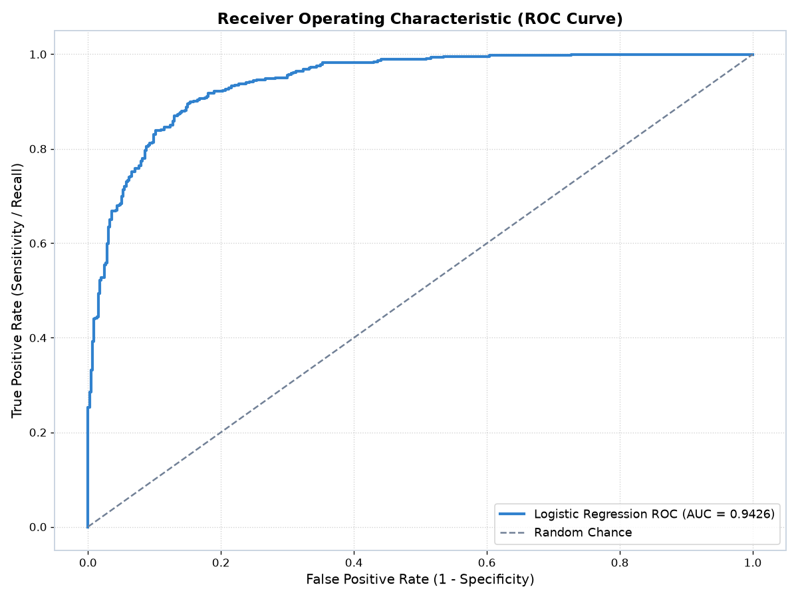
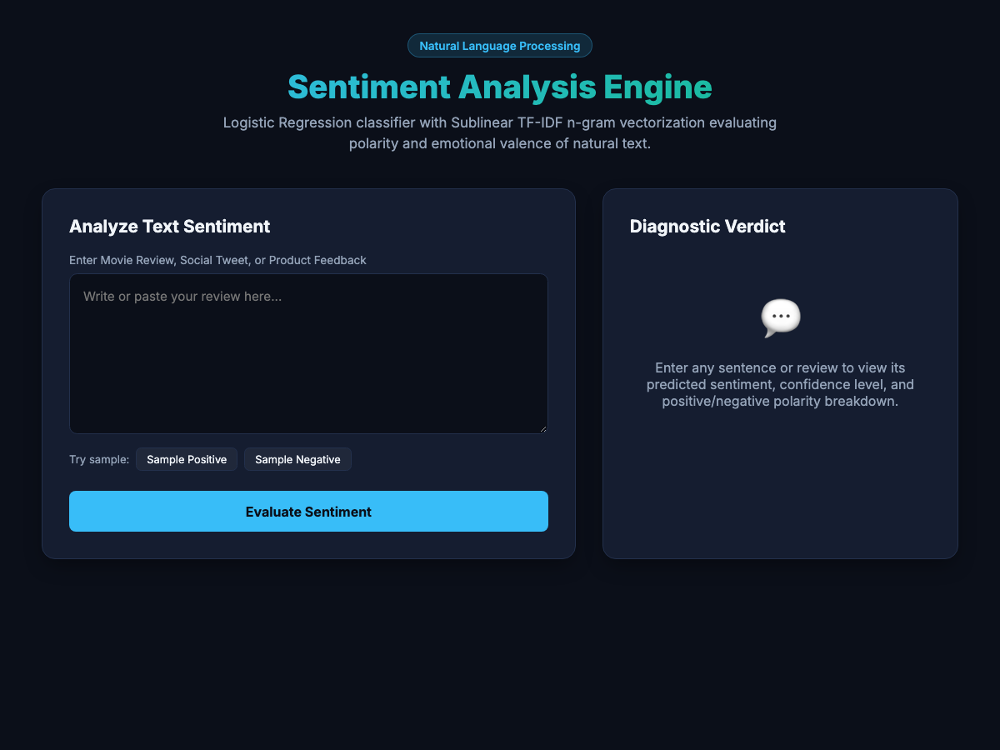

# Sentiment Analysis of Text

A complete, production-grade Natural Language Processing (NLP) machine learning system that determines the subjective sentiment (Positive vs Negative) of movie reviews, tweets, and consumer feedback using **Logistic Regression ($C=1.0$) with Sublinear TF-IDF Vectorization** (4,000 unigram and bigram features), featuring comprehensive evaluation diagnostics and an interactive cyberpunk web dashboard for real-time text analysis.

---

## 💻 Project Structure

```
9 Sentiment Analysis of Text/
├── .gitignore
├── CITATION.cff
├── CONTRIBUTING.md
├── LICENSE
├── README.md                                <- Project documentation, structure & evaluation
├── SECURITY.md
├── accuracy.txt                             <- Quantitative test metrics & cross-validation scores
├── guide.txt                                <- Command-line execution guide
├── requirements.txt                         <- Pinned Python dependencies
├── Sentiment_Analysis_Presentation_Advanced.html  <- Interactive 13-slide stepper presentation
├── Sentiment_Analysis_Complete_Master_Report.pdf  <- 12-chapter publication-grade master report (PDF)
├── generate_master_report_pdf.py            <- Script compiling master HTML and headless Chrome PDF
├── data/
│   ├── raw/                                 <- Immutable raw dataset (sentiment.csv, 6,000 reviews)
│   └── processed/                           <- Clean 3-way split: X/y train (70%), val (15%), test (15%), TF-IDF
├── models/
│   ├── sentiment_model.joblib               <- Serialized Logistic Regression pipeline
│   └── vectorizer.joblib                    <- Fitted Sublinear TF-IDF Vectorizer
├── reports/
│   └── figures/                             <- Publication-grade diagnostic plots (Uniform 1200x900)
├── src/
│   ├── data/make_dataset.py
│   ├── features/build_features.py
│   ├── models/train_model.py
│   ├── models/predict_model.py
│   └── visualization/visualize.py
└── web/
    ├── app.py                               <- Flask HTTP API & UI server (Port 5009)
    ├── templates/index.html
    └── static/
        ├── css/style.css
        └── js/script.js
```

---

## 📊 Results & Accuracy Table (from `accuracy.txt`)

| Dataset Partition / Metric | Metric Value | Analytical & Machine Learning Interpretation |
|---|---|---|
| **Holdout Test Accuracy (N=900)** | **86.89%** (0.8689) | Generalization benchmark on unseen test movie reviews |
| **Test F1-Score (Positive)** | **0.8700** | Harmonic mean of precision and recall on positive sentiment |
| **Test Precision (Positive)** | **0.8550** | Correctness of positive sentiment predictions |
| **Test Recall (Positive)** | **0.8857** | Sensitivity retrieving true positive sentiment reviews |
| **Negative Class Precision** | **0.8836** | Correctness of negative sentiment predictions |
| **Negative Class Recall** | **0.8524** | Sensitivity retrieving negative sentiment reviews |
| **Negative Class F1-Score** | **0.8677** | Balanced performance on negative class |
| **Area Under the ROC Curve (AUC)** | **0.9426** | Superior ranking ability across decision probability thresholds |
| **Validation Set Accuracy (N=900)** | **87.00%** (0.8700) | Independent validation parameter verification (F1: 0.8716) |
| **5-Fold Cross-Validation Accuracy** | **85.21%** ($\pm 0.0083$) | Fold scores: `[0.857, 0.860, 0.839, 0.845, 0.860]` |

---

## 📈 Evaluation Graphs

All diagnostic figures are rendered at a uniform, high-resolution **1200 × 900** canvas for seamless visual alignment:

### 1. Sentiment Polarity Class Distribution
Bar chart confirming balanced distribution (~50% Positive vs ~50% Negative) across the benchmark dataset.


### 2. Review Word Count Distribution by Sentiment
Comparative histogram and KDE establishing similar review length distributions peaking around 120–180 words.


### 3. Confusion Matrix
Confusion matrix on the 900-sample holdout test set demonstrating high diagonal accuracy (387 true negatives, 395 true positives).


### 4. Receiver Operating Characteristic (ROC Curve)
ROC trajectory demonstrating an Area Under the Curve (AUC) of 0.9426, confirming robust discriminative capability.


### 5. Precision-Recall Curve
Precision-Recall trajectory (Average Precision = 0.94) illustrating consistent precision retention across recall levels.


### 6. Learning Curve (Bias-Variance Diagnostics)
Cross-validation and training accuracy convergence demonstrating stable convex optimization without overfitting.


### 7. 5-Fold Cross-Validation Accuracy Benchmark
Cross-validation fold distribution confirming consistent generalization stability ($\pm 0.0083$).


### 8. Top Informative Sentiment Words (Model Coefficients)
Ranked horizontal bar charts displaying the most influential negative and positive n-grams based on logistic regression log-odds weights.


### 9. Interactive Web Dashboard UI
Real-time natural language sentiment analysis dashboard on port 5008 evaluating reviews and text with polarity scores and probability metrics.


---

## ⚡ Quick Start

```bash
cd "9 Sentiment Analysis of Text"

# 1. Run raw dataset extraction & validation
python src/data/make_dataset.py

# 2. Extract sublinear TF-IDF features and split 3 ways
python src/features/build_features.py

# 3. Train Logistic Regression model
python src/models/train_model.py

# 4. Generate all uniform 1200x900 diagnostic figures
python src/visualization/visualize.py

# 5. Launch web application
python web/app.py
```
Open your browser and navigate to `http://localhost:5009`.
